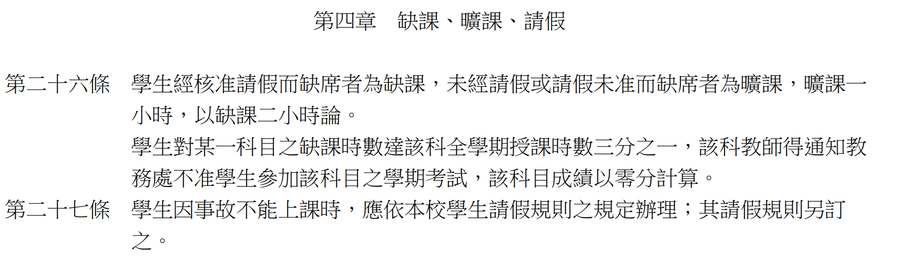

# 資訊與人工智慧概論 課程介紹

| 項目 | 內容 |
|---|---|
| 學期（課號） | 115-1（IE123） |
| 學分數 | 3 學分 |
| 授課老師 | 呂卓勲、孫天龍（以授課順序排序） |
| Email | chohsunlu@saturn.yzu.edu.tw、tsun@saturn.yzu.edu.tw |
| Office Hour | 呂老師：每週四 13:30–16:30、孫老師：請自行諮詢孫老師 |
| 上課時間 | 每週五，第 2–4 節（B 班）、第 6–8 節（A 班），各三小時。上課日若遇國定假日則停課一次。 |
| 上課地點 | 2425（B 班）、2115（A 班） |
| 課程內容 | 理解當代計算機基礎架構、資訊科技演進、人工智慧（Artificial Intelligence, AI）現況，能讓你對於電腦與資訊科技與 AI 有基本概念 |

> **本文件很長，但每一條都會影響你的成績。請不要只在第一週聽老師講過一次就算了——找時間自己從頭到尾讀完一遍。學期中真的出狀況時，老師是依這份文件處理，不是依你記得的版本。**

本文件與 [00-Exam-Rules.md](00-Exam-Rules.md)（期中考試規定）都讀完之後，請自己做一遍 [00-Course-Rules-Quiz.md](00-Course-Rules-Quiz.md)（課程規範理解測驗）。**這份測驗不計分、不用繳交，也不用給老師看**，答案就附在文件後面，目的只是讓你確認自己記得的版本是不是對的——每年都有同學把規則記成另一個樣子，到出狀況時才發現。**建議在第 2 週（09/18）上課前做完**，答錯的題目回頭把出處那一節重讀一次，還是不懂就在課堂上或 LINE 群組問。

若覺得有些規定你不太能接受，歡迎直接跟老師聊聊，也許只是還沒說清楚。這些規範對全班一體適用，老師沒辦法為個別同學調整；如果談過還是覺得不合適，**趁加退選期間想清楚要不要繼續修這門課就好**，在還有選擇的時候做決定，總比整學期都不自在來得好。文件若有異動，會於 LINE 群組公告，以 **最新版本** 為準。

## 本文件的適用範圍

本課程由兩位老師合授，各佔學期成績的 50%，但兩邊的評分方式、上課方式、教材與進度 **都是分開的**。

這份文件與 [00-Exam-Rules.md](00-Exam-Rules.md)（期中考試規定）只涵蓋呂卓勲老師負責的資訊科技概論部分：兩份文件中所有關於期中考、補考、簽到簽退、扣考、複查期限的規定，講的都是呂老師這半學期的事。

孫天龍老師負責的人工智慧概論部分，評分方式與上課方式一律 **由孫老師自行公告**，本文件不代為說明，也不保證與孫老師的規定一致。文件中出現「請自行諮詢孫老師」的地方，就是指這件事。

> 請同學務必記得：等孫老師開始上課時，再跟孫老師確認一次他那部分的評分方式與課堂要求。不要拿這份文件的規定去推論孫老師那半學期怎麼算。

## 重點速覽

下表是提醒，**不能取代全文**。每一列的完整條件與例外都在「詳見」欄指出的章節裡，真的發生爭議時以該處的條文為準。

| 項目 | 重點 | 詳見 |
|---|---|---|
| 適用範圍 | **本文件只涵蓋呂卓勲老師的部分**；孫天龍老師的評分與上課方式由孫老師公告，請當面再確認一次 | 本文件的適用範圍 |
| 配分 | 呂卓勲老師 50%（期中考）、孫天龍老師 50%（計算方式請自行諮詢孫老師） | 學期配分比重 |
| 關鍵日期 | 期中考 **第 9 週（11/06）**；期中複習課程 **10/28 晚間**（暫定，自由參加） | 課程預計進度表 |
| 考試範圍 | 呂卓勲老師所教授的所有教材內容；題型為單選題與簡答題 | 期中考試規定 |
| 遲到與離場 | **遲到逾 20 分鐘不得入場，視同缺考**；已入場者 30 分鐘內不得交卷離場 | 期中考試規定／考試規定 |
| 缺考與補考 | 須依學校規定請假並另行申請補考；一般個人因素以實得分數 **80%** 計算，不可抗力並提出證明才是 **100%**，**沒請假就是 0 分** | 期中考試規定／什麼算不可抗力？ |
| 扣考 | **本課程只看曠課**，曠課超過 18 小時逕行扣考，扣考等於不能參加期中考 | 課堂規範／扣考規則 |
| 成績複查 | 考後第一個週一公布，公布後 **當週週三前** 提出，逾期不受理 | 期中考試規定／考試規定 |
| 公告管道 | 所有公告都在 **LINE 群組**，請務必加入 | LINE 群組 |

## 學期配分比重

|授課老師|比重|如何評分|說明|
|---|---|---|---|
|呂卓勲|50%|期中考|假如你期中考考 80 分，總成績就拿到 80 × 50% = 40 分|
|孫天龍|50%|請自行諮詢孫老師|計算方式請記得與孫老師做最後確認|

呂老師這 50% 全部來自期中考一次定生死，細節見 [00-Exam-Rules.md](00-Exam-Rules.md)（期中考試規定）。**孫老師那 50% 怎麼算，這裡不說明也無從說明，等孫老師上課時請務必當面確認一次**，不要自己猜，也不要假設跟呂老師這邊一樣。

> 呂老師的期中考成績於考完期中考後的第一個週一公布

## 課程教材

|授課老師|哪裡找得到？|說明|
|---|---|---|
|呂卓勲|[連結](https://github.com/billy1125/Introduction-of-Information-Technology)|這是呂老師自編的教材，你可以自行再利用，例如用 AI 幫你做筆記、不懂的都可以拿去問 AI|
|孫天龍|Portal|教材與使用方式由孫老師公告，請以孫老師課堂上的說明為準|

## 課程預計進度表

下表涵蓋呂卓勲老師負責的第 1 至 9 週。實際進度可能依上課狀況微調，異動會在課堂與 LINE 群組公告。

| 週次 | 日期 | 主題 | 對應檔案 | 投影片版本 | 練習筆記本 | 說明 |
|---|---|---|---|---|---|---|
| 1 | 09/11 | 課程介紹、計算機歷史 | [00-Course-Introduction.md](00-Course-Introduction.md) [01-History-of-Computer.md](01-History-of-Computer.md) | [00-Course-Introduction.slides.md](00-Course-Introduction.slides.md) [01-History-of-Computer.slides.md](01-History-of-Computer.slides.md) | — | 講解本文件 |
| 2 | 09/18 | 電腦硬體、作業系統與應用軟體 | [02-Computer-Structure.md](02-Computer-Structure.md) | [02-Computer-Structure.slides.md](02-Computer-Structure.slides.md) | [Computer-Structure-Examples.ipynb](notebooks/Computer-Structure-Examples.ipynb) | — |
| 3 | 09/25 | **中秋節放假** | — | — | — | 停課 |
| 4 | 10/02 | 程式設計概念 | [03-Computer-Program.md](03-Computer-Program.md) | [03-Computer-Program.slides.md](03-Computer-Program.slides.md) | [Computer-Program-Examples.ipynb](notebooks/Computer-Program-Examples.ipynb) | — |
| 5 | 10/09 | **國慶日補假** | — | — | — | 停課；10/10 國慶日適逢週六，補假挪至本日 |
| 6 | 10/16 | 網路與網際網路 | [04-Networks-and-Internet.md](04-Networks-and-Internet.md) | [04-Networks-and-Internet.slides.md](04-Networks-and-Internet.slides.md) | — | — |
| 7 | 10/23 | 資訊系統與資料庫 | [05-Information-Systems-and-Database.md](05-Information-Systems-and-Database.md) | [05-Information-Systems-and-Database.slides.md](05-Information-Systems-and-Database.slides.md) | — | — |
| 8 | 10/30 | 資料科學、人工智慧與智慧製造（含工業4.0） | [06-Data-Science-AI-and-Smart-Manufacturing.md](06-Data-Science-AI-and-Smart-Manufacturing.md) | [06-Data-Science-AI-and-Smart-Manufacturing.slides.md](06-Data-Science-AI-and-Smart-Manufacturing.slides.md) | — | 全課程終點 |
| 9 | 11/04 | **期中複習** | — | — | — | **自由參加**；時間：18:00-21:00、地點：2623教室 |
| 9 | 11/06 | **期中考** | [00-Exam-Rules.md](00-Exam-Rules.md) | — | — | **考試時間為課程時間；地點 A 班 2115、B 班 2623（非原上課教室）** |

## 期中考試

期中考的考試規定、缺考與補考、不可抗力認定、評分等第與考前複習課程，另見 [00-Exam-Rules.md](00-Exam-Rules.md)（期中考試規定）。

## 課堂規範

### 簽到與簽退

我們每一週上課都要簽退與簽到，助教將會在上課前 10–20 分鐘給同學簽到，下課時間後則可以簽退。

||時間|說明|
|---|---|---|
|簽到|上課前 10–20 分鐘到上課鐘響後 20 分鐘內|超過時間後助教就會離開|
|簽退|第三堂課下課後|助教會在現場等候，沒有同學要簽退就會離開|

如何計算曠課時數，請見下表：

|狀況|備註|
|---|---|
|未簽到有簽退|曠課 1 小時|
|有簽到未簽退|曠課 1 小時|
|未簽到也未簽退|曠課 3 小時|

> **請注意**：簽到與簽退時間一到，助教會等所有同學簽到退完成後，立刻離開現場，請同學不可因為個人因素干擾助教進行前述的工作！或者事後再找助教補簽，違者將依照學校規定處理

### 扣考規則

> **所謂扣考就是：不能參加期中考。**

學校已經將相關規定寫在學則裡面：

*圖片來源：元智大學（無日期）*

簡單來說，如果一堂課 3 學分，全學期共有 54 小時。學校規定是缺課 18 小時就會被扣考，所謂「缺課」包括了「曠課（曠課 1 小時，以缺課 2 小時論）、病假、事假」都算在內。

換句話說，假如你的曠課、病假、事假時數通通加起來超過 18 小時，就等於被當。但是你放心，卓勲老師這裡的規定很寬鬆，如下：

> **我只看曠課，曠課 1 小時，以缺課 2 小時論，曠課超過 18 小時（等於有六次沒來上課），將逕行扣考。**

換句話說，你只要想辦法不要超過曠課 18 小時，就不會被扣考。

你自己算算看，要曠課超過 18 小時，其實很難！所以拜託，不要太誇張。

因此，如果沒有來上課，請務必請假。關於請假規定，請繼續往下讀。

### 請假規定

- 請假請自行按照學校規定申請，但是請勿濫用各種假別……務必仔細思考有必要才請假
- 你的請假理由，麻煩不要太扯，什麼叫做很扯的理由，像是：
  - 要去打工、打工班表已排好 🈲 🙅
  - 你考駕照考了四五次甚至更多 🚗 🛵
  - 老師我已經機票買好了，可以之後補考期中考嗎？
  - 要去排演唱會周邊、心儀的偶像閃電結婚／退伍 👩‍🎤 🧑‍🎤
  - 我的鬧鐘壞了 ⏰️
  - 昨晚熬夜打電動，現在太睏了 🎮
  - 男生請生理假？
  - 我頭髮骨折
  - 任何太蝦 🦐 的理由……
- 真的因為某些因素會有長期缺課，請務必聯絡任課老師，不要預設任何情況，敬請先跟任課老師討論，以免造成不可挽回的悲劇狀況

上面這串是平時上課的請假。如果你要請假的那一天是 **期中考**，判斷標準更嚴格，也直接影響補考分數怎麼算，請見 [00-Exam-Rules.md](00-Exam-Rules.md)〈什麼算不可抗力？〉一節。

### 其他規範

- 上課禁止使用智慧型手機，使用電腦請務必與本課程有關，要追劇、打電動、看直播、聽音樂請回家
- 如果我發現你玩得太過頭，老師不會罵人但是請你離開教室，想好好上課再回來

## 成績有問題怎麼辦？

先分清楚兩件事：**分數算錯了** 和 **分數不理想**，處理方式完全不同。

**分數算錯了**：請先跟任課老師聯絡，不要預設任何立場。成績有問題不一定是「針對你／黑箱／完全不能改」，可能只是誤植、算錯。請在 [00-Exam-Rules.md](00-Exam-Rules.md)〈十、成績公布與複查〉的期限內提出問題，確認成績是否正確，不用客氣。

**分數不理想**：這種情況請先提複查，確認分數本身沒有算錯。如果複查過後分數仍然不理想，**也請同學接受這個結果**。老師原則上不會另外用補考、補交作業、加交報告之類的方式讓你補分數，那對其他同學不公平。呂老師這 50% 就是這樣了，請把力氣放在孫老師負責的另外 50%，在那邊繼續努力。

要區分清楚：這一段講的是分數不理想想要加分，那沒有管道。因為缺考而依規定請假、申請補考是另一回事，見 [00-Exam-Rules.md](00-Exam-Rules.md)〈九、缺考、請假與補考〉。

真正有用的做法是 **提早說**。修課過程中遇到困難（身體狀況、家裡的事、或真的跟不上進度），請在還來得及的時候讓老師知道，那時候能一起想辦法的空間最大。

> 被當掉不是天崩地裂，人生還很長，真的有困難早點讓老師知道，總比成績都送出去了才來求情好得多。

## LINE 群組

本課程所有公告事務於 LINE 上公告，請加入 LINE 群組。

> 請同學務必加入，免得漏掉重要訊息，每學年都有人最後才加入，然後發現自己什麼都不知道，請不要當這種人

為避免干擾同學，若有需要公告的事務，老師將僅於上班時間週一至五 09:00–16:00 公布，除非有緊急事務，則儘可能於晚間 9 時前公布。

同學有疑問，或只是想聊天，不在此限（也請注意同學之間應有的禮節）。

### A 班

[https://line.me/ti/g/5-ASxmUASa](https://line.me/ti/g/5-ASxmUASa)

### B 班

[https://line.me/ti/g/p7uqhZyHjS](https://line.me/ti/g/p7uqhZyHjS)

## 參考文獻

- 元智大學（無日期）。《元智大學學則》。https://web.yzu.edu.tw/
