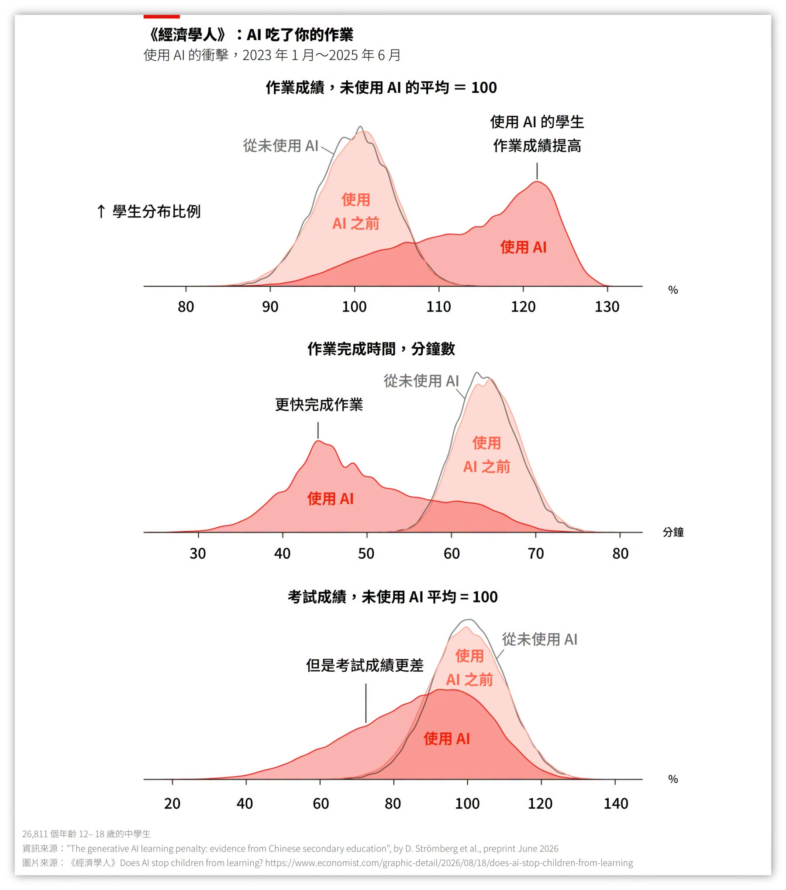

# 資訊與人工智慧概論 期中考試規定

**資訊與人工智慧概論（IE123）115-1** ｜ 課程規範見 [00-Course-Introduction.md](00-Course-Introduction.md)

> 本文件只涵蓋呂卓勲老師負責的期中考。孫天龍老師那半學期的評量方式由孫老師自行公告，見 [00-Course-Introduction.md](00-Course-Introduction.md)〈本文件的適用範圍〉。

期中考是呂老師這半學期唯一的正式評量，佔學期總成績的 50%，考壞了很難補回來。其中 **遲到與離場、請假與補考、成績複查** 這幾條每年都有人沒看仔細而吃虧，請把整份文件讀完，考前再讀一遍。

> **請你拿出與參加學測、分科測驗一樣的心態來考試**

## 為什麼只有考試

呂老師這半學期不出作業、不做報告，成績只看期中考，**原因是 AI 已經讓作業與報告很難測出你到底學了多少**。呂老師另一門「系統分析與設計」改用報告評分，但要配上台報告、當場提問與面對面訪談，才能確認分數是你自己的；這門課的時數做不到。

《經濟學人》整理的一份研究追蹤中國 26,811 名學生（The Economist, 2026）：用 AI 寫作業的學生，作業成績進步 18%，寫作業時間從 64 分鐘縮到 45 分鐘，**但到了大考，比從沒用過 AI 的學生退步 20%**。成績沒退步的是 **「用了 AI 但時間沒省下來」的那群人——他們拿 AI 解釋觀念，而不是直接生成答案**。

所以你可以用 AI 準備考試：整理教材重點、把不懂的地方講到你聽懂、出練習題考自己。差別在於用它弄懂觀念，而不是替你交差。

*圖片來源：Ko（2026），整理自 The Economist（2026）*

## 考試規定

以下規定老師與助教會 **嚴格執行**，請大家配合，共同維持考場秩序與考試公平。

### 一、考試時間、地點與範圍

- 日期：**2026.11.06（第 9 週）**。
- 地點：2623（B 班）、2115（A 班），**B 班考試地點不是原來上課教室，改為 2623 教室**。
- 題目類型：單選題、簡答題。
- 範圍：呂卓勲老師所教授的所有教材內容。
- **A、B 兩班的考卷一定不同**，但難度相當。各班考卷另分不同卷別，卷別之間只有題目順序不同。

| 項目 | A 班 | B 班 |
|---|---|---|
| 開始考試 | **13:10** | **09:10** |
| 最晚入場時間 | **13:30** | **09:30** |
| 最早交卷時間 | **13:40** | **09:40** |
| 考試結束 | **16:10** | **12:10** |

- 考試於上表的開始時間準時開始。
- **最晚入場時間（含）前可入場；遲到逾 20 分鐘者不得入場，並視同缺考。**
- 已入場者自開考起 30 分鐘內不得交卷離場，所以最早交卷時間是開考後 30 分鐘。
- 考試結束時間一到請立即停筆，不得再書寫、修改或擦拭答案。

### 二、座位安排

- 本次考試採 **隨機安排座位**，座位表於考試當天 **現場公告**。請依公告座位入座，不得自行更換。
- **建議提早到場**，現場查看座位表、找到座位才有充裕的時間。

### 三、進入教室後【請特別注意】

- **進入教室後即保持安靜**，不交談、不討論、不任意離座，不要等老師或助教提醒。
- 老師確認考場已安靜就座後，才開始發放題目卷。
- 持續交談、走動或影響考場秩序的同學，老師或助教會個別處理，**不會因此縮短其他同學的作答時間。**

### 四、答案卷填寫與身分查驗

- 桌面會預先放置 **答案卷**，入座後可先用 **鉛筆或一般原子筆** 填寫 **學號及姓名**，請書寫清楚。
- 開考後老師及助教會依序 **點名及查驗身分**，比對證件與答案卷上的學號、姓名。查驗期間可以繼續作答，聽到點名再配合即可。

### 五、應考物品：必帶、可帶與不得攜帶

| 類別 | 物品 | 說明 |
|---|---|---|
| **必須攜帶** | 學生證或身分證、考試所需文具 | 開考後會查驗身分；文具老師不會幫你準備 |
| **可以放在桌面** | 文具、水壺或飲料罐 | 其餘物品不得放在桌面 |
| **不得隨身攜帶** | 手機、計算機、智慧型手錶、智慧型眼鏡、各種形式的耳機（有線、無線、藍牙、骨傳導等），以及其他具通訊、拍攝、錄音、顯示或運算功能的裝置 | **可以放在隨身包包內**，包包於開考前統一放在講台前指定位置；手機須關閉聲音或設為靜音 |

- 眼鏡外觀難以確認是否具有電子功能時，老師或助教可能簡單查驗，確認後即可繼續配戴。
- 因 **醫療或健康需求** 必須攜帶或使用電子裝置者，請於考試前主動告知老師。臨時或緊急醫療需求由現場老師或監考人員依實際情況處理。

### 六、考卷與答案卷填寫方式【請務必注意】

- 每位同學會拿到 **題目卷** 與 **答案卷**。題目卷分為不同 **卷別**，標示於 **題目卷第一頁右上角**，拿到後請先確認。
- 計算過程可以寫在題目卷上，但 **評分只看答案卷的內容**。
- 答案卷的其他空白位置也可以拿來計算，但請注意不要影響答案的清晰度。**若答案卷過於凌亂而造成評分有誤，由同學自行負責。**

答案卷請依以下方式填寫：

- **第 1 行：卷別。** 依題目卷第一頁右上角所標示的卷別填寫。
- **第 2～41 行：選擇題。** 依題號順序，每題一行，共 40 題。
- **第 42 行起：簡答題。** 可依作答需要自行安排空間。

選擇題答案請勿填在其他位置，以免影響辨識與批改。**卷別未填寫或填寫錯誤，相關辨識問題由同學自行負責。**

### 七、身體不適、如廁與暫時離場

- 考試期間不得任意離開考場，建議入場前先上廁所。
- 因身體不適、如廁或其他特殊狀況需要暫時離場，請先舉手告知，**不得自行離開考場**。經監考人員同意後，由 **助教或試務人員陪同離場**；如廁時陪同人員在廁所外等候，**不會進入廁所**。
- 離場期間不得使用電子裝置、與他人交談、接觸考試相關資料或自行前往其他場所。
- 考試尚未結束時，經同意可 **返回原座位繼續作答**。**暫時離場期間仍計入考試時間，不會因此延長作答時間。**
- 不另外限制如廁次數或每次離場分鐘數；多次或較長時間離場，由老師或監考人員依實際狀況處理。
- 身體狀況已無法繼續考試時，請立即告知老師或助教，依學校相關規定處理。

### 八、交卷與正式離場

- 最早交卷時間起可以交卷，須同時繳回 **題目卷** 與 **答案卷**，依老師及助教指示完成交卷後再離開。
- 交卷後即視為本次考試結束，**不得返回考場繼續作答**。

### 九、缺考、請假與補考

- 無法應考須依學校規定請假，並另行申請補考。請假要有合理的理由，見 [00-Course-Introduction.md](00-Course-Introduction.md)〈請假規定〉。
- **只有請假通過者才能參加補考**，補考時間另訂。
- **補考題目一定與正式考試不同**，難度維持相當，先跟同學打聽題目沒有用。
- 補考成績依請假原因計算：
  - **一般個人因素**：以實得分數的 **80%** 計算，例如補考 90 分，登記為 90 × 80% = 72 分。
  - **不可抗力**：以實得分數的 **100%** 計算，但 **務必提出相關證明**。判斷標準見〈什麼算不可抗力？〉。

### 十、成績公布與複查

- 成績預計於考試後的第一個週一公布；公布後至 **當週週三前** 可提出複查，逾期恕不受理。

## 什麼算不可抗力？

補考成績以 80% 還是 100% 計算，差別在是不是不可抗力。本節只適用於 **期中考缺考與補考計分**，平時請假依學校規定辦理。

| 情況 | 結果 |
|---|---|
| 不可抗力，且提出證明 | 可補考，成績以實得分數的 **100%** 計算 |
| 一般個人因素，但依規定請假並通過 | 可補考，成績以實得分數的 **80%** 計算 |
| 沒有請假，或請假未通過 | **視同缺考，該次考試 0 分** |

### 一、什麼事情算是不可抗力

**住院或急診、法定傳染病隔離、重大意外、直系親屬喪事、兵役徵集、法院傳票。**

> 不限於以上事由。其他經學校請假系統核准，或有客觀證明且確實無法事先避免的重大事由，由老師依一致標準個案認定。

**三個條件必須同時成立**：

1. **事由本身不是你能決定的**。
2. **你也沒有機會事先避開**：期中考的週次第一週就公告了，凡是你有時間事先安排、事先排開的，都不算。
3. **提得出客觀憑證**。

第 2 條是關鍵。打工班表確實不是你排的，但你有整個學期可以拿考試日期去跟雇主調班，這就是 **有機會事先避開**；旅遊、社團活動、考照、演唱會同理。住院、急診、意外、法院傳票則沒有給你事先安排的餘地。

憑證只能證明事情真的發生，**不能讓不符合前兩個條件的事情變成不可抗力**。機票、班表、報名表交得出來，一樣不算。

### 二、什麼事情不算不可抗力

以下都 **不算不可抗力**。請假通過仍可補考，但以 80% 計算；沒有請假或請假未通過，就是缺考 0 分：

| 類型 | 常見例子 |
|---|---|
| 自己安排的行程 | 打工班表、旅遊、返鄉、社團活動、系上活動、球隊練習或比賽、演唱會、婚宴、家庭聚餐 |
| 可以改期或再考一次的事 | 考駕照、語言檢定、各類證照考試、企業參訪、徵才活動、公司面試 |
| 其他課的事 | 別的課考試、作業或報告撞期；別的課的實驗、實習或校外教學 |
| 沒有就醫紀錄的身體不適 | 感冒、疲勞、身體不舒服，但沒有就醫，也提不出診斷證明 |
| 自己該管的準備工作 | 睡過頭、記錯日期、熬夜念書、鬧鐘壞掉、忘記帶文具或學生證 |
| 交通問題 | 塞車、大眾運輸誤點、機車故障、找不到停車位 |

這張表不是窮舉，沒列到的情況一樣用三個條件判斷。**塞車誤點、睡過頭、忘記帶東西，請自己留緩衝**。例外是台鐵人身事故、電車線斷落這類重大事故，如果在你已經上車後才發生，三個條件同時成立，就算不可抗力。

### 三、為什麼卡這麼死？

**最主要的理由是公平。** 同一時間、同一份考卷、同一套規則，分數才有意義。只要有人能因個人因素往後挪，多出來的準備時間、可能外流的題目，對準時到場的同學都不公平。學測與分科測驗規定入場時限、遲到不能進場，也是同一個道理：**只要對某個人放寬一次，所有人的分數就都不能比了**。

另一個原因是希望你養成習慣。研究所考試、國家考試、證照檢定、公司甄選，規則都寫在那裡，沒有人會為你破例。很多人不是能力不夠，而是敗在晚到十分鐘、證件沒帶、報名表漏填這類小事。出了社會也一樣：

| 場合 | 你會講的理由 | 實際會發生的事 |
|---|---|---|
| 求職面試 | 「路上塞車，晚了二十分鐘」 | 時段是排定的，遲到就是取消 |
| 對客戶提案 | 「我另一個會議撞期」 | 會議照開，你的部分換人講或直接跳過，案子不會重來 |
| 線上投標、報名、申請補助 | 「系統上傳到一半當掉」 | 截止時間一到系統就關閉，沒有補件程序 |
| 報稅、繳費、各種法定期限 | 「我忘記了，也沒收到通知」 | 滯納金照算，逾期失權就是失權——老師自己忘記驗車，罰了 900 元 |
| 排定的上班班表 | 「我睡過頭」 | 曠職紀錄照登，累積到一定次數就是資遣事由 |

共同點是 **時間是所有人一起排的，不是你一個人的事**。這門課至少還有請假補考的管道、不可抗力的補救措施，以及一個願意聽你解釋的老師。

### 四、通報與證明

| 項目 | 規定 |
|---|---|
| 通報對象 | 任課老師 |
| 通報時限 | 知道的當下立即通知，最遲不得晚於考試當天開考前 |
| 證明文件 | 仍須依學校請假系統辦理請假，並提出診斷證明、就醫紀錄、隔離通知、訃聞或相關單位開立的公文 |

**提不出證明者不適用本節**，依一般個人因素或缺考辦理。

## 期中考評分

期中考原始分數為 0 到 100 分，並換算成等第：

|期中考分數（原始）|期中評量等第|備註|
|---|---|---|
|80 分（含）以上|A|優異|
|70 分以上、未滿 80 分|B|良好|
|60 分以上、未滿 70 分|C|待加強|
|未滿 60 分|D|不及格；導師會關切，家長可能會收到通知|

拿到 D 時，學校會通知你、導師會關切，家長也可能會知道。期中考以原始分數乘以 50% 計入學期總成績，例如 70 分 × 50% = 35 分。

## 期中考複習課程（畫重點？！）

本學期前段放假較多，**11/04（三）18:00-21:00 在 2623 教室** 開設考前複習課程，不點名、自由參加。也歡迎另外找時間跟老師討論。

## 參考文獻

- Ko, J. (2026). 《經濟學人》: AI 工具讓學生停止學習？［貼文圖卡］. Facebook. https://www.facebook.com/share/p/17doyPZUWu/
- The Economist. (2026, August 18). *Does AI stop children from learning?* https://www.economist.com/graphic-detail/2026/08/18/does-ai-stop-children-from-learning
