# 程式設計概念——工業工程管理導向

## 前言：從排班表談起

想像一個場景：你是工廠的生產排程員，需要為下週的生產線安排工作：

- 共有 3 條生產線，每條每天 3 班
- 共有 45 名操作員，每人每週最多上 5 班
- 部分操作員只能操作特定機台
- 需要在每條線的每班維持至少 3 名有資格的操作員
- 部分員工請假或有輪班限制

如果沒有電腦，你會遇到以下困境：

- 用手工排班，可能需要數個小時，而且很容易出錯
- 用紙筆紀錄，不容易管理與使用，而且不易保存
- 手工排班的邏輯與限制，不僅難以計算，你也很難傳給下一個新手使用

如果有電腦，你可以有效的做以下事情：

- 將手工排班邏輯用「**程式語言**」轉換成一個程式：你只需要輸入人員名單、機台資格與請假紀錄，程式幾秒鐘就能給你一份符合所有條件的排班表
- 排班所需要的各項資料，以合適的「**資料結構**」存進電腦記憶體或硬碟：電腦可以快速存取，並且不需要儲存大量的紙本記錄，更不需要擔心如果辦公室空間不夠、不容易保存與備份等問題
- 以有效率的「**演算法**」計算排班的邏輯：不用花幾個小時甚至好幾天就能處理完畢，甚至能以 AI 模型自動最佳化，同時考慮更多參數，讓加班成本最小化

> **這就是程式語言、資料結構與演算法的核心價值**：把人類解決問題的邏輯，以電腦能理解的方式寫下來，讓電腦幫你重複執行、有效率地儲存，並快速處理大量資料。

| 工業場景中的問題 | 對應的程式設計概念 |
|---------------|----------------|
| 記錄每台機器每日產量 | 變數與資料型態 |
| 依序執行品管檢查步驟 | 流程控制（循序、選擇、重複） |
| 管理數百筆訂單資料 | 資料結構（串列、字典） |
| 計算最短搬運路徑 | 演算法（搜尋、最佳化） |
| 自動產生生產報表 | 函式與模組化設計 |

> 本章的目的不是把你訓練成程式設計師，而是讓你理解「程式是怎麼思考問題的」：讀懂基本程式邏輯、知道資料結構與演算法各自有什麼用。有了這些，你在數位化的工作環境裡才能跟 IT 與 AI 工程師溝通，也才有能力運用基本的自動化工具。

> **課程主線定位**：資訊與數位科技的本質，是把 **資料** 有效處理成 **資訊**，再轉化為能支援決策的 **知識**。本章講的是人如何把處理資料的邏輯交給電腦執行：程式語言負責描述步驟，資料結構決定資料怎麼擺放，演算法決定怎麼算得快。讀的時候不必死背名詞，隨時想想：這項技術為什麼出現、它解決了什麼問題、解決之後又帶出什麼新問題。

> **給同學的提醒：本章節不考程式碼**。本章出現的 Python 程式碼與偽代碼都 **僅供參考**，考試 **不會考** 程式碼怎麼寫。請把力氣放在概念：程式在做什麼、為什麼要這樣設計。想動手試試看，可以打開 [Computer-Program-Examples.ipynb](notebooks/Computer-Program-Examples.ipynb) 實際執行。看懂概念，比記住語法重要。

---

## 第一篇：程式設計基礎

---

## 一、什麼是電腦程式

要理解電腦程式，得先回到電腦的理論原型 [圖靈機（Turing Machine）](https://zh.wikipedia.org/zh-tw/圖靈機)。圖靈機有一條劃分成格子的紙帶，以最簡單的情況來說，每格寫著 0 或 1；讀寫頭一次看一格，再依照一張事先定好的 **規則表**，決定這格要改寫成什麼、往左還是往右移。同一台機器換一張規則表，就會用不同的方式處理這些 0 與 1，做出完全不同的計算。圖靈機的完整介紹見 [02-Computer-Structure.md](02-Computer-Structure.md)〈一、計算機科學的思想基礎〉。

問題是，規則表要放在哪裡？早期的電子計算機把規則直接做在電路裡。以 [ENIAC（Electronic Numerical Integrator and Computer）](https://zh.wikipedia.org/zh-tw/電子數值積分計算機) 為例，要讓它換一種計算，工作人員得重新插拔連接線、一個個撥動開關，等於把機器的電路重新接一遍，換一次工作常常要花上好幾天。


*ENIAC 的操作人員正在插線板前重新接線。要讓 ENIAC 換一種計算，就得像這樣重新插拔連接線。圖片來源：[Wikimedia Commons「World's First Computer, the Electronic Numerical Integrator and Calculator (ENIAC).gif」](https://commons.wikimedia.org/wiki/File:World%27s_First_Computer,_the_Electronic_Numerical_Integrator_and_Calculator_(ENIAC).gif)，美國國家檔案館典藏（National Archives ID: 594262），公有領域（Public Domain）*

後來的做法，是把規則表本身也寫成一串 0 與 1 的 **指令（Instruction）**，跟要處理的資料一起存進記憶體，機器再一條一條讀出來照做。圖靈在 1936 年的論文就提過這個想法（Turing, 1936）：一台 [通用圖靈機（Universal Turing Machine）](https://zh.wikipedia.org/zh-tw/通用圖靈機) 可以從紙帶上讀入另一台機器的規則，照著模仿它的運作；1945 年提出的馮諾依曼架構（von Neumann, 1993），則把它變成實際的電腦設計。從此要電腦換一件工作，只要換一串指令，不必再動電路。

早期的程式設計師，是直接用機器看得懂的數字代號寫程式，這種程式稱為 [機器碼（Machine Code）](https://zh.wikipedia.org/zh-tw/機器語言)。每台電腦都有一張指令表，規定哪個代號代表哪個動作，例如 `10` 代表「加法」。寫程式時，程式設計師先在紙上畫流程圖，想清楚步驟，再一步一步查表，把每個步驟翻成一列數字。下圖的 IBM 650 程式稿就是這樣寫出來的，其中一列 `0530  AUP 10  1001  0540`，意思是「把第 1001 格的數字加進來，做完再到第 0540 格找下一個步驟」。`AUP` 是寫給人看的提示，機器只認得 `10`。寫好之後，再把這些數字打在紙帶或打孔卡上，讓機器讀進去。整份程式都是數字，人很難看懂，只要寫錯一個數字，結果就可能全錯。

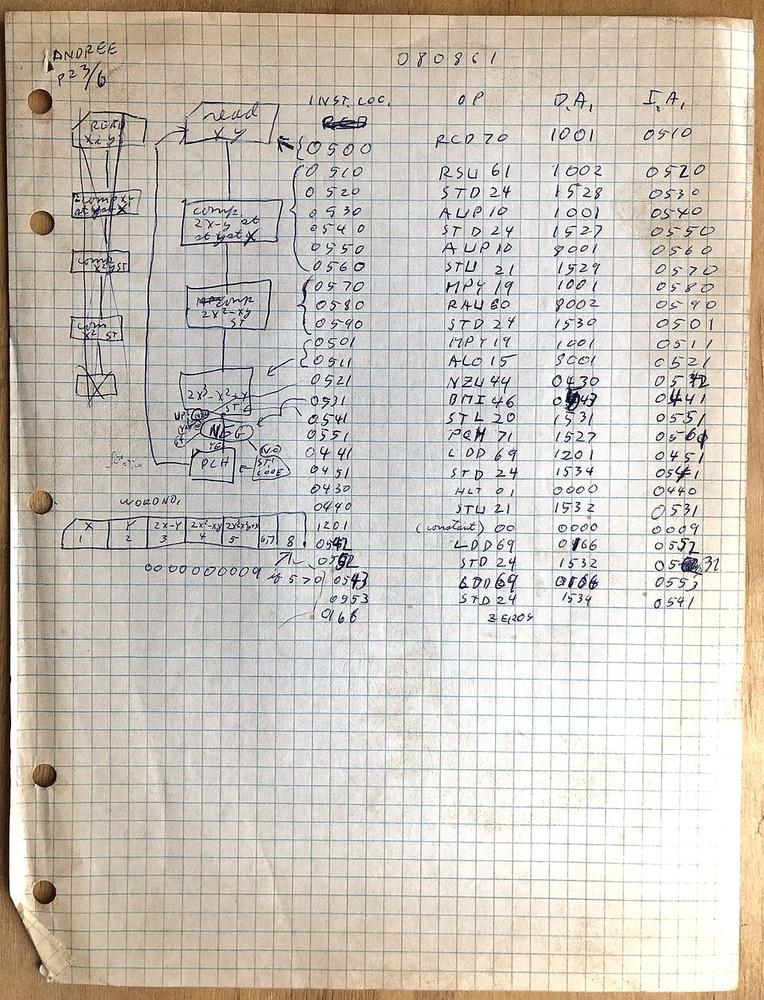

*1961 年一名學生為 IBM 650 手寫的機器語言程式。左邊是先畫好的流程圖，右邊每一列是一條指令，依序寫出指令的存放位置、操作碼與位址。IBM 650 以十進位數字表示指令，原理與 0 和 1 的機器碼相同。圖片來源：[Wikimedia Commons「IBM 650 student program 1961.agr.jpg」](https://commons.wikimedia.org/wiki/File:IBM_650_student_program_1961.agr.jpg)，作者 Arnold Reinhold，授權 CC BY-SA 4.0*

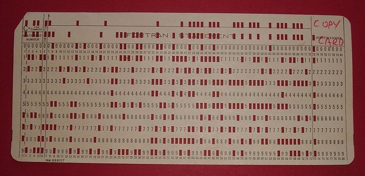

*IBM 1130 電腦的打孔卡，卡上的孔洞就是二進位的機器碼，有孔代表 1、沒孔代表 0。這張卡本身就是一個小程式，功能是複製放在它後面的整疊卡片。卡片上印的「FORTRAN STATEMENT」只是空白卡預先印好的格式。圖片來源：[Wikimedia Commons「IBM1130CopyCard.agr.jpg」](https://commons.wikimedia.org/wiki/File:IBM1130CopyCard.agr.jpg)，作者 Arnold Reinhold，授權 CC BY-SA 2.5*

電腦本身不會主動做任何事，它只會照著指令一步一步執行。[程式（Program）](https://zh.wikipedia.org/zh-tw/電腦程式) 就是寫給電腦看的一連串指令，用來寫這些指令的語言，稱為 [程式語言（Programming Language）](https://zh.wikipedia.org/zh-tw/程式語言)。你每天用的 Excel、瀏覽器、手機 App，全都是別人事先寫好的程式。

### 電腦程式簡史

前面提到，最早的程式是直接用 0 與 1 寫成的機器碼。之後七十多年，程式的寫法一直往同一個方向走：讓人用更接近人類語言的方式描述步驟，再交給工具翻譯成機器碼。

| 年代 | 寫法 | 改變了什麼 |
| --- | --- | --- |
| 1940 年代 | 機器碼 | 直接寫 0 與 1，再撥開關或打紙帶、打孔卡輸入 |
| 1950 年代 | [組合語言（Assembly Language）](https://zh.wikipedia.org/zh-tw/組合語言) | 用 `ADD`、`LOAD` 這類英文縮寫代替數字代號，再由 [組譯器（Assembler）](https://zh.wikipedia.org/zh-tw/組譯器) 自動翻成機器碼。前面程式稿裡手寫的 `AUP` 就是這種縮寫，只是當時還得自己查表換成 `10` |
| 1950 年代後期 | 高階語言：[FORTRAN](https://zh.wikipedia.org/zh-tw/Fortran)（1957）、[COBOL](https://zh.wikipedia.org/zh-tw/COBOL)（1959） | 可以寫成接近數學式或英文句子的形式，由 [編譯器（Compiler）](https://zh.wikipedia.org/zh-tw/編譯器) 翻成機器碼。FORTRAN 用於科學與工程計算，COBOL 用於薪資、帳務等商業資料處理 |
| 1960–1970 年代 | [BASIC](https://zh.wikipedia.org/zh-tw/BASIC)（1964）、[C 語言](https://zh.wikipedia.org/zh-tw/C語言)（1972） | BASIC 專為初學者設計；C 語言由貝爾實驗室開發，用來撰寫 Unix 作業系統，至今仍是嵌入式系統與控制器常用的語言 |
| 1980–1990 年代 | C++（1985）、Python（1991）、Java（1995） | 物件導向成為主流（見〈五、函式與模組化〉）；Python 以好讀、好寫為設計目標 |
| 2020 年代 | 生成式 AI 輔助寫程式 | 用文字描述需求，由 AI 產生程式碼，人負責檢查與修正 |

表中的組譯器與編譯器都是「翻譯程式」：把人寫的程式翻成機器碼，差別在翻譯的對象。

- **組譯器**：把組合語言翻成機器碼。組合語言的一行，大致就對應一條機器指令，例如把 `AUP` 換回 `10`，所以翻譯起來很直接，像照著對照表一個詞換一個詞。
- **編譯器**：把高階語言翻成機器碼。高階語言的一行，例如 `平均 ← (A + B + C) ÷ 3`，要拆成「讀出 A、加上 B、加上 C、除以 3、存起來」好幾條機器指令，所以編譯器要先看懂整行在做什麼，再決定怎麼拆。

有了這兩種工具，查表換數字的工作就交給電腦，程式設計師可以專心想步驟本身。

工廠裡也有一條自己的演進線。1968 年，通用汽車（GM）為了取代生產線上靠繼電器接線的控制盤，提出了 [可程式邏輯控制器（Programmable Logic Controller, PLC）](https://zh.wikipedia.org/zh-tw/可程式邏輯控制器) 的需求。原本每次換車型，控制盤就得重新配線，跟 ENIAC 遇到的問題一樣；改用 PLC 之後，換的是程式，不是電線。PLC 常用的 [階梯圖（Ladder Diagram）](https://zh.wikipedia.org/zh-tw/梯形圖) 刻意畫成繼電器電路圖的樣子，讓看慣電路圖的電機技師也能直接寫程式。

回頭看這段歷史，程式設計的每一次演進，目的都一樣：讓人更容易寫程式。從撥開關、查表換數字，到寫縮寫、寫接近數學式的句子，人要遷就機器的地方越來越少。到了 2020 年代，[大型語言模型（Large Language Model, LLM）](https://zh.wikipedia.org/zh-tw/大型語言模型) 出現，人類逐漸可以直接用 [自然語言（Natural Language）](https://zh.wikipedia.org/zh-tw/自然語言)，也就是平常說話用的中文或英文描述需求，讓電腦自己寫出程式。不過不管用哪一種方式，程式最後都要翻成機器碼才能執行。

---

## 二、為什麼要寫程式

既然已經有這麼多現成的軟體，為什麼還要自己寫程式？因為現成軟體只能做設計者事先想到的事。Excel 能幫你算平均，但它不知道你們工廠有一條規則是「同一台機台連續 3 批良率低於 95% 就要通知班長」。每間工廠的機台、製程與管理規則都不一樣，這些專屬的判斷邏輯沒有現成軟體會替你做好，只能把規則寫成程式，交給電腦執行。

寫程式最划算的時機，是同一件事要重複做很多次的時候。假設你每天要把 20 台機台的產量與不良品數抄進表格、逐台算出良率，再挑出低於標準的機台，手算一次要半小時；一年 250 個工作天下來，就是 125 小時。把這些步驟寫成程式之後，每天只要執行一次，幾秒鐘就有結果，而且每次的算法都一樣，不會抄錯也不會算錯。哪些工作適合交給程式，〈十三、自動化思維〉會再細談。

你將來不一定要親手寫程式——工廠通常有 IT 人員，現在的生成式 AI 工具也能依照文字描述產生程式碼。但不管由誰來寫，你都得先講清楚「要電腦做什麼」，拿到結果後也要看得懂程式做了什麼，才能判斷它對不對。這兩件事，就是本章要建立的能力。下面先看程式設計師實際上是怎麼工作的。

### 程式設計師怎麼寫程式

程式設計師寫程式，並不是直接坐下來一直打字，而是先理解「要解決什麼問題」。他們會先確認需求，例如：這個程式要給誰用？使用者會輸入什麼？程式要輸出什麼結果？有哪些限制？這一步很像解題前先讀懂題目，避免寫到一半才發現方向錯了。

理解需求之後，程式設計師接著會設計做法，也就是把大問題拆成小步驟。例如要做一個成績計算程式，就可以拆成「輸入分數」、「計算平均」、「判斷及格或不及格」、「顯示結果」。這個階段不一定馬上寫程式，有時會先畫流程圖、寫簡單的步驟說明，或先想好資料要怎麼儲存。

設計好流程後，第三步才是實際寫程式。程式設計師會把前面設計好的流程，用某一種程式語言寫出來，例如 Python、JavaScript 或 C++。寫程式時，他們通常不會一次完成全部功能，而是先寫出一小部分，確認可以運作後，再逐步增加新功能。

程式寫完，工作也還沒結束，一定要測試和除錯。測試是檢查程式在不同情況下能不能正常運作；除錯則是找出錯誤原因並修正。錯誤可能是語法打錯、邏輯想錯，或是某些特殊情況沒有考慮到。程式設計師會看錯誤訊息、印出中間結果、逐步檢查程式執行過程，直到找到問題所在。

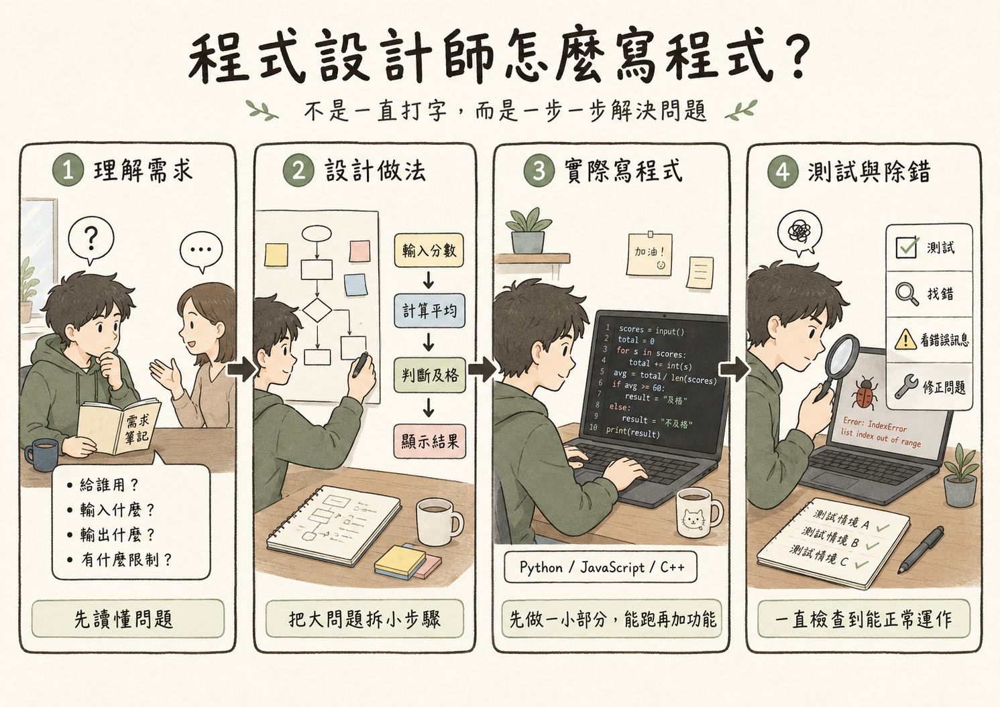

*本圖由 ChatGPT 生成，已由作者審核內容正確性*

> **趣味小知識**：「臭蟲（Bug）」與「除錯（Debug）」這兩個程式設計術語，據說源自 1947 年——[葛麗絲·霍普（Grace Hopper）](https://zh.wikipedia.org/zh-tw/葛丽丝·霍普)的團隊在排查哈佛 Mark II 電腦的故障時，真的在繼電器裡發現了一隻被夾死的飛蛾，導致電路短路。他們把這隻蛾貼在維修日誌上，並寫下「第一個發現真正臭蟲的案例」，這個詞從此沿用至今。霍普本人也是電腦科學史上的傳奇人物：她是哈佛 Mark I 電腦最早的程式設計師之一，後來更開發出世界第一個編譯器（Compiler），並主導設計了影響深遠的商用程式語言 COBOL。

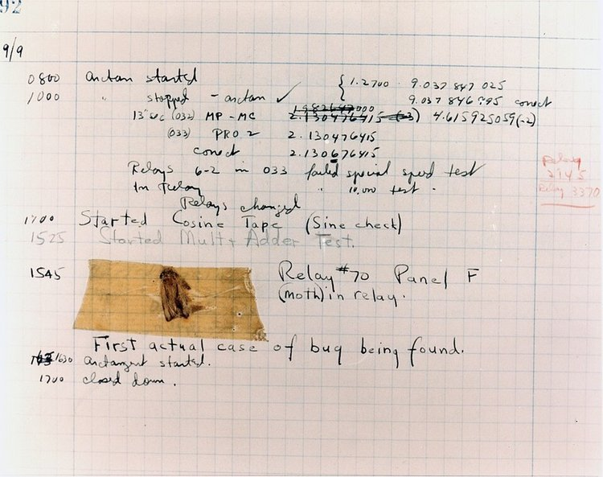

*圖片來源：[Wikimedia Commons「First Computer Bug, 1947.jpg」](https://commons.wikimedia.org/wiki/File:First_Computer_Bug,_1947.jpg)，美國海軍水面作戰中心典藏，公有領域（Public Domain）*

> **真實世界**：實務上的程式設計工作，通常沒有這麼順利。程式設計師真正花在寫程式、想程式、除錯上的時間，往往只佔一部分；以老師的經驗來說，大概只有 20% 到 30%。更多時間其實是在溝通，例如確認需求、討論規格、說明為什麼某個功能做不到、和同事協調不同看法，甚至有時候是在「和人吵架」。所以基本流程雖然可以整理成：理解需求 → 設計流程 → 寫程式 → 測試與除蟲 → 整理與改進，但在真實工作中，這些步驟常常會因為溝通、修改需求和反覆確認而來回循環。

> 也因此，系統與軟體開發有一門重要的學問，叫做「**軟體工程（Software Engineering）**」。它不是只教人怎麼寫程式，而是在研究怎麼把「寫程式」與「開發資訊系統」這件事做得更好，例如如何理解需求、分工合作、管理進度、測試品質，以及讓軟體在長期維護時不會變得一團混亂。

從上面的流程可以看出，無論問題大小，程式設計師都是先理解問題、拆解步驟，再動手處理，最後檢查結果。

---

## 三、程式設計基本概念

程式設計師想好的步驟，終究要寫成電腦能讀懂的語言、真正執行出來，才能發揮作用——這正是「程式設計」要做的事。接下來，我們從程式設計最基本的概念開始。

> 系上的「程式設計」課程會把這一節的概念講得更清楚，這裡你可以建立最基本的概念。

### 1. 程式的本質

一個程式，無論多複雜，其本質都可以用三個字描述：**輸入 → 處理 → 輸出**。

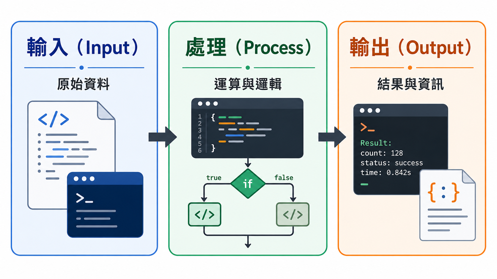

*本圖由 ChatGPT 生成，已由作者審核內容正確性*

- **輸入**：程式接收的資料，來源可以是鍵盤輸入、檔案讀取、感測器訊號、資料庫查詢……
- **處理**：程式對資料進行的計算、判斷、轉換等操作
- **輸出**：處理完成後產生的結果，可以是螢幕顯示、檔案寫入、發送指令給機台……

**工業應用範例：良率計算程式**

下面用 Python 寫出這個程式。`#` 後面的文字是 **註解**，寫給人看的說明，電腦執行時會直接略過：

```python
# 程式：計算今日良率

# 【輸入】
生產總數 = 500
不良品數 = 12

# 【處理】
良品數 = 生產總數 - 不良品數          # 500 - 12 = 488
良率 = 良品數 / 生產總數 * 100        # 488 ÷ 500 × 100 = 97.6

# 【輸出】
print("今日良率：", round(良率, 1), "%")
```

三段各自對應程式的三個環節：輸入只負責把資料拿進來，處理只做計算，輸出只負責把結果交出去。這個例子雖然簡單，但結構與任何複雜程式完全相同——換成一萬行的程式，外層骨架還是這三段。

### 2. 變數與資料型態

程式與資料都要先放進記憶體，電腦才能運算。電腦用編號標示每筆資料在記憶體中的位置，但這些編號對寫程式的人來說很難記。因此程式語言讓我們替這些位置取名字，之後用名字存、用名字取，資料實際放在哪個位置則交給程式語言處理。這種有名字的資料存放處，就是下面要介紹的變數。

**變數（Variable）** 是程式中用來儲存資料的「容器」，有名稱（讓你找得到它）和值（實際儲存的內容）。就像倉庫中貼了標籤的儲位：「A-01」儲位裡放著「齒輪，數量：50」。

回頭看前面的良率程式，裡面出現的四個名字都是變數：

| 變數名稱 | 值 | 怎麼來的 |
| --- | --- | --- |
| 生產總數 | 500 | 輸入階段讀進來 |
| 不良品數 | 12 | 輸入階段讀進來 |
| 良品數 | 488 | 處理階段算出來 |
| 良率 | 97.6 | 處理階段算出來 |

Python 的等號 `=` 不是數學上的「相等」，而是「把右邊的結果，存進左邊這個變數」。所以 `良品數 = 生產總數 - 不良品數` 的意思是：先算出 488，再把它放進名為「良品數」的容器裡；後面 `良率 = 良品數 / 生產總數 * 100` 要用到 488 時，直接寫變數名稱就能取出來，不必再算一次。

變數的值也可以被換掉。明天的資料進來時，`生產總數` 會從 500 變成新的數字，而下面兩行的算式一個字都不用改，算出來的就是明天的良率——這就是變數存在的理由：程式寫的是步驟，不是寫死的數字。

不同性質的資料需要不同的[資料型態（Data Type）](https://zh.wikipedia.org/zh-tw/資料型態) 來儲存，這影響了資料在記憶體中的表示方式與可進行的操作：

| 資料型態 | 說明 | 工業範例 |
| --- | --- | --- |
| **整數（Integer）** | 沒有小數的數字 | 今日產量 500（件）、不良品數 12（件）、批次序號 1023 |
| **浮點數（Float）** | 帶有小數的數字 | 溫度 23.5°C、良率 0.976、重量 1.25 kg |
| **字串（String）** | 文字資料，以引號括住 | 產品名稱「精密齒輪」、操作員姓名「王小明」、機台型號「CNC-500」 |
| **布林（Boolean）** | 只有兩種值：真（True）或假（False） | 機台是否運作中 → True、零件是否合格 → False |

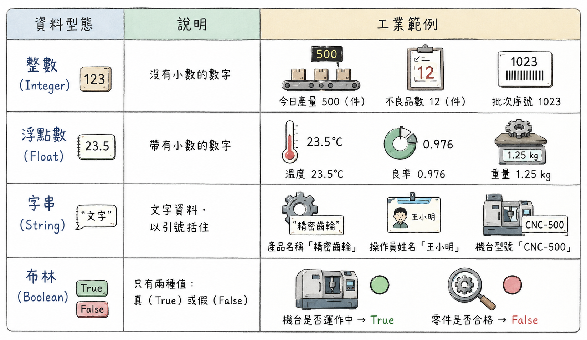

*本圖由 ChatGPT 生成，已由作者審核內容正確性*

**為什麼資料型態重要？**

資料型態不是程式語言額外加上去的規定，而是資料數位化的直接結果。[02-Computer-Structure.md](02-Computer-Structure.md)〈三、資料表示與數位化〉到〈五、浮點數與 IEEE 754〉說明過，電腦內部只有 0 與 1，而不同性質的資料要用不同的方式轉成二進位：整數直接換算成二進位，負數用二補數；帶小數的數值用 IEEE 754 拆成符號、指數、尾數三個欄位；文字則是逐字查 ASCII 或 Unicode 編碼表。以「50」為例，存成不同型態時，得到的位元完全不同：

| 資料 | 資料型態 | 轉成二進位的方式 | 二進位表示（示意） |
| --- | --- | --- | --- |
| 50 | 整數 | 直接換算成二進位（以 8 位元為例） | `00110010` |
| 50.0 | 浮點數 | IEEE 754 單精度（符號、指數、尾數） | `0 10000100 10010000000000000000000` |
| 「50」 | 字串 | 逐字查 ASCII 編碼表（字元 5 是 53、字元 0 是 48） | `00110101 00110000` |
| True | 布林 | 兩種狀態對應 1 與 0 | `1` |

> **前情提要**：如果看不懂上表的位元是怎麼算出來的，建議先回到上一章複習二進位轉換與資料數位化的概念，再繼續往下讀。整數的換算見 [02-Computer-Structure.md](02-Computer-Structure.md)〈四、數字系統與進位轉換（必考）〉，浮點數見〈五、浮點數與 IEEE 754〉，文字編碼見〈三、資料表示與數位化〉。

反過來說，同一串位元用不同的方式解讀，會得到不同的資料。因此程式必須記住每一筆資料當初是用哪一種方式轉換的，這個紀錄就是資料型態。它決定了兩件事：這串位元該怎麼解讀，以及這筆資料可以做哪些運算。

各種程式語言也都會針對不同的資料型態分別最佳化，替每一種型態準備專屬的儲存方式與運算方法。整數的加減直接交給 CPU 的加法電路，速度快而且結果精確；浮點數依照 IEEE 754 的規則運算，能表示的範圍大，但結果是近似值；字串則提供串接、搜尋、切割等文字專用的操作。同一個「+」符號，用在整數上是數學加法，用在字串上卻是把兩段文字接起來。

正因為如此，資料型態錯誤是程式常見的錯誤來源，而且特別容易被忽略——在螢幕上，數字 50 與文字「50」看起來一模一樣，光用眼睛完全分辨不出來，只有程式本身知道它實際儲存的是哪一種型態。例如，若產品數量被儲存為字串「50」而非整數 50，表面上顯示完全正常，但程式在計算「50 + 30」時，可能不是做數學加法得到 80，而是把兩段文字直接接在一起變成「5030」。這種問題在工業系統中格外常見：從 CSV 檔案、感測器訊號或使用者輸入讀進來的資料，預設往往都是文字，若沒有明確轉換成正確的型態，就可能導致產量統計錯誤，造成錯誤的生產決策。

### 3. 基本運算

第一章提過，計算機最早的用途多半是計算與處理資料。寫程式就是告訴電腦兩件事：數字要怎麼算，算出來的結果要怎麼判斷。例如先算出今日良率，再判斷它有沒有達到標準。前者靠算術運算，後者靠邏輯運算，所以程式語言一定會提供這兩類基本工具。

程式可以對資料進行兩大類運算：

**算術運算（Arithmetic Operations）**：

| 運算 | 符號 | 範例 | 結果 |
| --- | --- | --- | --- |
| 加法 | `+` | `良品數 = 總數 - 不良數` | 488 |
| 減法 | `-` | `500 - 12` | 488 |
| 乘法 | `*` | `單價 * 數量` | 總金額 |
| 除法 | `/` | `488 / 500` | 0.976 |
| 取餘數 | `%` | `17 % 5` | 2（17 除以 5 餘 2） |

**邏輯運算（Logical Operations）**：

邏輯運算用於判斷條件，結果為真（True）或假（False）：

| 運算 | 說明 | 工業範例 |
| --- | --- | --- |
| `AND`（且） | 兩個條件都為真，結果才為真 | 溫度正常 AND 壓力正常 → 製程正常 |
| `OR`（或） | 任一條件為真，結果即為真 | 溫度異常 OR 壓力異常 → 觸發警報 |
| `NOT`（非） | 將真假反轉 | NOT 合格 → 不合格 |

**工業應用：生產資料計算**

把前面的良率程式再往下寫一步，加上「有沒有達到標準」的判斷，算術運算與邏輯運算就同時出現在一個程式裡：

```python
# 程式：判斷今日良率是否達標

# 【輸入】
生產總數 = 500
不良品數 = 12
良率標準 = 0.95

# 【處理】
良品數 = 生產總數 - 不良品數       # 算術運算：500 - 12 = 488
良率 = 良品數 / 生產總數           # 算術運算：488 ÷ 500 = 0.976
是否達標 = 良率 >= 良率標準        # 邏輯運算：0.976 ≥ 0.95，結果為 True

# 【輸出】
print("今日良率：", round(良率 * 100, 1), "%")
print("是否達標：", 是否達標)
```

注意 `是否達標` 這個變數：前面兩行算出來的是數字，這一行算出來的是真或假。同一個程式裡，不同變數可以存不同型態的資料。

---

## 四、控制結構

### 為什麼需要控制結構？

若程式只能從頭到尾執行一遍，它能做的事情非常有限。**控制結構（Control Structure）** 讓程式能夠根據條件做出不同的選擇，或重複執行某些步驟，使程式具備真正的「邏輯判斷」與「自動化」能力。

> 其實要真正的了解控制結構，**光看教材文字說明是絕對不夠的**，一定要把程式寫起來看看，你才能真正理解。請同學一定要開啟 [Computer-Program-Examples.ipynb](notebooks/Computer-Program-Examples.ipynb) 的筆記本，實際操作裡面的程式。雖然我們的課程不是程式設計，但我們仍提供最簡單的範例，系上大一的必修「**程式設計**」課程會深入說明（由主任授課），希望也能對同學在學習這堂課程有所幫助。

控制結構主要有四種：**循序結構（Sequence）**、**選擇結構（Selection）**、**重複結構（Repetition，又稱迴圈 Loop）**，以及一些特殊的流程控制（break 與 continue，不會考），以下依序介紹，並附上 Python 的寫法。（也有人只稱三種基本控制結構——循序、選擇、重複，而將 break、continue 視為迴圈內部的補充寫法，而非獨立的第四種類型。）

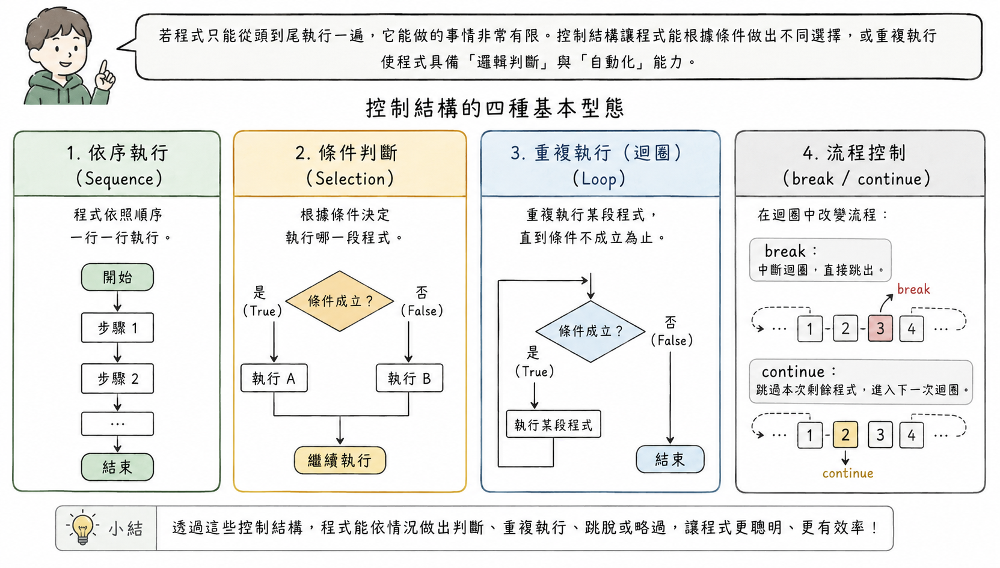

*本圖由 ChatGPT 生成，已由作者審核內容正確性*

### 1. 循序結構（Sequence）

**循序結構** 是最基本的控制結構：程式碼由上而下、一行接著一行執行，沒有分支也沒有重複。

**生活範例：煮一碗泡麵**

```python
print("撕開泡麵蓋子到一半")
print("倒入調味包")
print("加熱水到碗內的標線")
print("蓋上蓋子，等 3 分鐘")
print("開動")
```

五個步驟由上而下各做一次。順序一換就出事：還沒加熱水就開動，吃到的是一塊乾麵餅。

前面的良率計算程式也是循序結構的例子，把它縮到只剩骨架是這樣：

```python
生產總數 = 500
不良品數 = 12
良率 = (生產總數 - 不良品數) / 生產總數 * 100
print("今日良率：", round(良率, 1), "%")   # 今日良率： 97.6 %
```

四行，每一行都只執行一次，順序固定，換順序就會出錯——第三行需要前兩行的資料，第四行需要第三行的結果。Python 的除法寫成 `/`、乘法寫成 `*`；`round(良率, 1)` 是四捨五入到小數點後 1 位。

循序結構本身雖然單純，卻是選擇結構與重複結構的基礎：接下來的兩種控制結構，其實都是在「循序結構」的骨架上，加入分支或重複的能力。

### 2. 選擇結構（Selection）

**選擇結構** 讓程式根據某個條件是否成立，選擇執行不同的程式碼區塊，也常稱為條件判斷。Python 用 `if`、`elif`、`else` 來寫，其基本邏輯是：

```python
if 條件:
    執行 A
else:
    執行 B
```

**生活範例：出門要不要帶傘**

```python
降雨機率 = 40

if 降雨機率 >= 70:
    print("帶長傘")
elif 降雨機率 >= 30:
    print("帶折疊傘")
else:
    print("什麼都不帶")
```

`elif` 是 else if 的縮寫，意思是「否則，如果……」。降雨機率 40 % 沒有達到 70 %，但達到 30 %，所以這次印出「帶折疊傘」。下面的良率判定是同一種寫法，只是把降雨機率換成良率，把帶哪一種傘換成廠內的處置方式。

**工業應用：良率分級判定**

同樣一支良率程式，加上條件判斷之後，它不只算出數字，還會依照廠內標準給出處置：

```python
生產總數 = 500
不良品數 = 12
良率 = (生產總數 - 不良品數) / 生產總數     # 0.976

if 良率 >= 0.98:
    判定 = "優良"
elif 良率 >= 0.95:
    判定 = "合格"
else:
    判定 = "未達標"
    print("通知生產線主管")

print("今日良率：", round(良率 * 100, 1), "%，判定：", 判定)
```

三個分支只會走其中一條：良率 0.976 沒有 ≥ 0.98，但 ≥ 0.95，所以判定是「合格」，「未達標」那一段這次完全不會執行。這樣的判定邏輯寫進 MES 系統之後，每天的良率分級與警報都能自動產生，不必人工逐線核算。

### 3. 重複結構（Repetition）

**重複結構** 又稱 **迴圈（Loop）**，讓程式能夠重複執行一段程式碼。Python 最常用的寫法是 `for`。這正是電腦「不知疲倦」的關鍵——它可以用同樣的速度重複執行一個操作一萬次，而不會因疲勞而出錯。

**for 迴圈**：對清單裡的每一個項目，各做一次同樣的事。上課點名就是一個 for 迴圈，名單上有幾位同學，就點幾次名：

```python
修課名單 = ["王小明", "陳小華", "林小美"]

for 同學 in 修課名單:
    print(同學)
```

`for 同學 in 修課名單` 的意思是：從名單裡一次拿出一位同學，放進 `同學` 這個變數，執行底下縮排的那一行，再換下一位。名單有 3 人就跑 3 次，有 60 人就跑 60 次。如果沒有迴圈，只能用循序結構把每個人都寫出來：

```python
print("王小明")
print("陳小華")
print("林小美")
print("張小強")
# ……同樣的寫法，再照抄 55 次
print("黃小婷")
```

60 位同學就是 60 行，而且每一行都長得一樣，只差名字。點名方式一改（例如改成刷學生證），60 行要一行一行改；多一位加簽的同學，又得再補一行。有了迴圈，只要把步驟寫一次，再交代「名單上每個人都做一遍」，名單多長都一樣。

工廠裡也一樣。廠裡有三條生產線，良率就要算三次——算式一模一樣，只有資料不同，這正是迴圈的用途：

```python
生產線 = ["A 線", "B 線", "C 線"]
生產總數 = [500, 320, 410]
不良品數 = [12, 8, 31]

for i in range(len(生產線)):
    良率 = (生產總數[i] - 不良品數[i]) / 生產總數[i] * 100
    print(生產線[i], round(良率, 1), "%")
```

`len(生產線)` 是清單的長度 3，`range(3)` 會依序產生 0、1、2，拿來當索引，一次處理一條生產線。迴圈裡的兩行被執行了三次，印出 A 線 97.6 %、B 線 97.5 %、C 線 92.4 %。如果明天多開一條 D 線，只要把它加進清單，程式一個字都不用改。

**生活範例：計算本學期修課總學分**

```python
學分 = [3, 3, 3, 2, 1]     # 微積分、普通物理、程式設計、英文、體育

總學分 = 0
for 該課學分 in 學分:
    總學分 = 總學分 + 該課學分

print(總學分)   # 12
```

`總學分` 一開始是 0，每跑一圈就加上一門課的學分，所有課都跑完，才得到最後的總數。下面的批次作業用的是同一招，只是把課換成批次，把學分換成生產數。

**工業應用：批次作業**

工廠常見的批次作業（Batch Processing）天然適合用迴圈表達。把良率從單一批次擴大到全日 50 個批次，只要在迴圈裡一邊算、一邊累加：

```python
批次 = ["001", "002", "003", "004", "005"]    # 實際有 50 批，這裡只列 5 批
生產數 = [200, 180, 210, 190, 205]
不良數 = [4, 12, 3, 5, 15]

總生產數 = 0
總不良數 = 0
待檢討清單 = []

for i in range(len(批次)):
    總生產數 = 總生產數 + 生產數[i]
    總不良數 = 總不良數 + 不良數[i]
    批次良率 = (生產數[i] - 不良數[i]) / 生產數[i]
    if 批次良率 < 0.95:
        待檢討清單.append(批次[i])

全日良率 = (總生產數 - 總不良數) / 總生產數
print(round(全日良率, 3), 待檢討清單)   # 0.96 ['002', '005']
```

`append` 是把一個項目加到清單尾端，這裡用來記下良率不到 0.95 的批次。注意 `總生產數` 與 `總不良數`：它們在迴圈外歸零，在迴圈裡不斷被加上新值，所有批次都跑完之後才拿來算全日良率。這種「在迴圈中持續累積」的變數，是迴圈最常見的用法之一。

### 4. 一些特殊的流程控制（break 與 continue）

> **給同學的提醒**：這一小節不會考，目的是讓你知道迴圈還能中途跳出或略過。

在迴圈執行過程中，還有一些常用的特殊流程控制寫法，讓迴圈的行為更有彈性，其中最常見的是 break 與 continue：

- **break（中斷）**：立即結束整個迴圈，跳出迴圈繼續往下執行。常用於找到目標後不需繼續搜尋，或偵測到嚴重異常需立即停止的情境。
- **continue（繼續）**：跳過本次迴圈剩餘的步驟，直接進入下一次迴圈。常用於略過不需處理的特殊情況。

**生活範例：吃迴轉壽司**

```python
輸送帶 = ["鮭魚", "芥末章魚", "鮪魚", "玉子", "甜蝦"]
吃了幾盤 = 0

for 壽司 in 輸送帶:
    if 壽司 == "芥末章魚":
        continue        # 不敢吃，讓它過去，等下一盤
    if 吃了幾盤 == 3:
        break           # 吃飽了，直接去結帳
    print("吃掉", 壽司)
    吃了幾盤 = 吃了幾盤 + 1
```

執行結果是依序吃掉鮭魚、鮪魚、玉子。不敢吃的芥末章魚只是放它過去，你還會繼續看下一盤，這是 `continue`；吃了三盤就飽了，最後那盤甜蝦再好吃都跟你無關，這是 `break`。

**工業情境範例：** 還是同一份批次良率的工作，加上兩種例外處理：

```python
批次良率 = [0.97, None, 0.96, 0.78, 0.98]    # None 代表這一批還沒完成量測
良率報表 = []

for 良率 in 批次良率:
    if 良率 is None:
        continue        # 跳過這一批，直接處理下一批
    if 良率 < 0.80:
        print("通知停線檢修")
        break           # 良率崩掉了，不必再往下算，整個迴圈就此結束
    良率報表.append(良率)

print(良率報表)   # [0.97, 0.96]
```

兩者的差別在於跳多遠：`continue` 只放掉這一圈，迴圈還會繼續；`break` 直接離開迴圈，後面的批次再也不會被處理。

> **補充小知識**：早期程式語言其實還有一種更自由、但也更危險的跳轉方式——`goto`（跳到某一行繼續執行），可以跳到程式的任何角落。1968 年，荷蘭電腦科學家[艾茲赫爾·戴克斯特拉（Edsger Dijkstra）](https://zh.wikipedia.org/zh-tw/艾兹格·迪杰斯特拉)發表了一篇影響深遠的短文〈Go To Statement Considered Harmful〉（Dijkstra, 1968），指出濫用 `goto` 會讓程式邏輯像一團纏繞的麵條般難以追蹤，後人稱之為「[義大利麵條式程式碼（Spaghetti Code）](https://zh.wikipedia.org/zh-tw/意大利面条式代码)」。這篇文章推動了[結構化程式設計（Structured Programming）](https://zh.wikipedia.org/zh-tw/結構化程式設計)的興起——也就是只用循序、選擇、重複這三種「規矩」的控制結構取代自由的 `goto`，這正是本節你所學到的選擇結構與重複結構的歷史由來。

### 如果程式只能一行一行往下執行……

程式設計如果只能一行一行照順序執行，代表每一個動作都必須被明確寫出來。遇到不同情況時，程式無法自己選擇該走哪一條路，只能把各種可能都用直線式的方式展開，這會讓程式很快變得冗長、重複，也不容易閱讀。

選擇結構、重複結構和流程控制的存在，是為了讓程式能更有效率地處理問題。選擇結構可以讓程式根據條件做出不同反應；重複結構可以重複執行相同或類似的工作；break 和 continue 則可以讓程式在適當時機中止迴圈或略過某些步驟，使整體流程更有彈性。

如果缺少這些控制流程的工具，程式不只會變得又臭又長，後續維護也會非常困難。當程式出錯時，開發者需要在大量重複的程式碼中尋找問題；想要修正或最佳化時，也可能必須修改許多相似的地方。因此，流程控制能讓程式更簡潔、清楚，也更容易除錯與改進。

> **小結**：選擇結構讓程式「有邏輯」，重複結構讓程式「有效率」。這兩種控制結構的組合，是幾乎所有自動化程式的核心骨架。在工業場域中，大量重複性的判斷與計算工作——從感測器資料篩選到批次報表生成——都可以透過這兩種結構自動化完成。

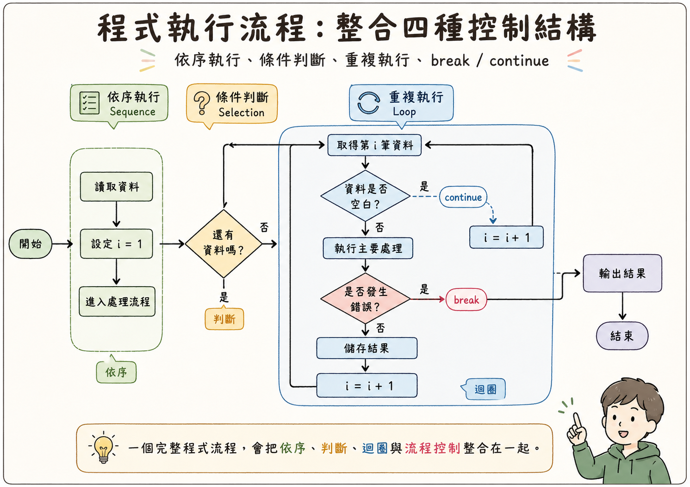

*本圖由 ChatGPT 生成，已由作者審核內容正確性*

---

## 五、函式與模組化

有了循序、選擇、重複這些控制結構，程式已經能處理相當複雜的邏輯；但程式規模一旦變大，同樣的邏輯難免會在不同地方重複出現。函式與模組化，就是用來管理這種複雜度、避免重複的工具。

### 1. 函式的概念

[函式（Function）](https://zh.wikipedia.org/zh-tw/子程式) 是一段被命名、可重複呼叫的程式碼區塊，用來完成一個特定的任務。函式接受 **輸入（參數，Parameter）**，執行處理，並回傳 **輸出（回傳值，Return Value）**。

從這裡開始，程式會比較複雜。為了先把流程看清楚，接下來的範例會先用 **偽代碼（Pseudocode）** 說明，再附上真實的 Python 程式碼。偽代碼是用接近白話的方式描述程式步驟，時常用來描述程式碼的大致流程與概念，不管特定程式語言的語法規定，重點是把流程講清楚。

**生活範例：把煮泡麵包成一個函式**

〈四、控制結構〉的循序結構用煮泡麵當例子，總共五個步驟。現在把這五個步驟包起來，取一個名字叫「煮泡麵」，它就成了一個函式。先看偽代碼：

```text
函式定義：
    煮泡麵(口味):
        拿出一碗 口味 的泡麵
        撕開泡麵蓋子到一半
        倒入調味包
        加熱水到碗內的標線
        蓋上蓋子，等 3 分鐘
        回傳 一碗煮好的麵

函式呼叫：
    晚餐 = 煮泡麵(牛肉)
```

寫成 Python 是這樣：

```python
def 煮泡麵(口味):
    print("拿出一碗", 口味, "泡麵")
    print("撕開泡麵蓋子到一半")
    print("倒入調味包")
    print("加熱水到碗內的標線")
    print("蓋上蓋子，等 3 分鐘")
    return 口味 + "泡麵"

晚餐 = 煮泡麵("牛肉")
print("晚餐是", 晚餐)    # 晚餐是 牛肉泡麵
```

`def` 是 define（定義）的縮寫，用來定義函式；括號裡的 `口味` 是參數，呼叫時給的 `"牛肉"` 會放進這個參數；`return` 把結果回傳給呼叫的人。函式定義好之後不會自己執行，要等到 `煮泡麵("牛肉")` 這一行呼叫它，裡面的步驟才會跑一遍。

媽媽只要說一句「去煮一碗牛肉泡麵」，就會拿到一碗煮好的牛肉泡麵，她不必知道你是先倒調味包還是先加熱水。這就是函式的好處：呼叫的人只要知道函式的名稱、要給什麼輸入、會拿到什麼輸出，裡面的步驟交給函式自己處理。

用一個工廠機台的比喻來理解：一台 **計算良率的機器**，你放入「總產量」和「不良品數」（輸入），它自動計算後輸出「良率百分比」（輸出）。每次需要計算良率時，直接使用這台機器，不需重新製造一台。偽代碼是這樣：

```text
函式定義：
    計算良率(總產量, 不良品數):
        良品數 = 總產量 - 不良品數
        良率   = 良品數 / 總產量 * 100
        回傳   良率

函式呼叫：
    A線良率 = 計算良率(500, 12)    → 回傳 97.6
    B線良率 = 計算良率(320,  8)    → 回傳 97.5
    C線良率 = 計算良率(410, 31)    → 回傳 92.4
```

寫成 Python 是這樣：

```python
def 計算良率(總產量, 不良品數):
    良品數 = 總產量 - 不良品數
    良率 = 良品數 / 總產量 * 100
    return round(良率, 1)

A線良率 = 計算良率(500, 12)
B線良率 = 計算良率(320, 8)
C線良率 = 計算良率(410, 31)
print(A線良率, B線良率, C線良率)    # 97.6 97.5 92.4
```

同樣的計算邏輯只寫一次，卻可以在任何需要的地方重複使用。

### 2. 重複使用與模組化設計

[模組化（Modularization）](https://zh.wikipedia.org/zh-tw/模組化編程) 是將程式切分為多個功能獨立的函式（或模組），每個函式只負責一件事，並且可以被其他程式重複呼叫。這帶來幾個重要優點：

- **可讀性**：程式邏輯清晰，每個函式名稱就說明了它的用途
- **可維護性**：修改一個函式不影響其他部分；若計算方式改變，只需修改一處
- **可重用性**：同一個函式可被不同的程式或模組呼叫，避免重複撰寫相同邏輯
- **可測試性**：每個函式可以獨立測試，確保其正確性後再整合

**工業應用：將生產流程拆成可重複的作業單元**

一套完整的生產日報系統，可以用模組化的方式設計。先看偽代碼：

```text
函式：讀取感測器資料(機台編號, 日期)
函式：計算良率(總產量, 不良品數)
函式：判斷是否達標(良率, 目標良率)
函式：生成日報表(機台清單, 日期)
函式：寄送警報郵件(收件人, 警報內容)

主程式：
    對 每台機台:
        資料   = 讀取感測器資料(機台, 今天)
        良率   = 計算良率(資料.產量, 資料.不良數)
        達標   = 判斷是否達標(良率, 95%)
        如果 NOT 達標:
            寄送警報郵件(工程師, "機台X良率不達標")
    生成日報表(所有機台, 今天)
```

寫成 Python 大致是這樣。這是示範用的簡化版：讀取感測器改成直接給固定的數字，寄信改成只印出訊息，重點是看懂各個函式怎麼分工：

```python
機台清單 = ["M-01", "M-02", "M-03"]
產量資料 = [500, 320, 410]
不良資料 = [12, 8, 31]

def 讀取感測器資料(機台編號, 日期):
    # 示範用：實際上會連到感測器或資料庫，這裡直接從清單取出固定的數字
    i = 機台清單.index(機台編號)
    return 產量資料[i], 不良資料[i]

def 計算良率(總產量, 不良品數):
    return (總產量 - 不良品數) / 總產量 * 100

def 判斷是否達標(良率, 目標良率):
    return 良率 >= 目標良率

def 寄送警報郵件(收件人, 警報內容):
    print("寄信給", 收件人, "：", 警報內容)    # 示範用：只印出來，不真的寄信

def 生成日報表(機台清單, 日期):
    print(日期, "日報表已產生，共", len(機台清單), "台機台")

# 主程式
今天 = "10/15"
for 機台 in 機台清單:
    產量, 不良數 = 讀取感測器資料(機台, 今天)
    良率 = 計算良率(產量, 不良數)
    達標 = 判斷是否達標(良率, 95)
    if not 達標:
        寄送警報郵件("工程師", 機台 + " 良率不達標")
生成日報表(機台清單, 今天)
```

執行結果只有 M-03 的良率 92.4 % 沒達標，所以印出一封寄給工程師的警報，最後產生日報表。`產量, 不良數 = …` 是一次接住函式回傳的兩個值；`not` 就是邏輯運算的 NOT。主程式本身只有十來行，每一行都是在呼叫函式，讀起來就像在看工作清單。

每個函式職責單一、邊界清晰，整個系統的邏輯一目了然。

### 3. 為什麼程式需要函式與模組化？

程式雖然可以只靠循序、選擇與重複這三種基本結構撰寫，讓指令依序執行、依條件分支，或重複執行某些動作；但是當程式規模變大時，程式碼會逐漸變長，邏輯也會變得分散。此時即使每一段程式本身都能正確執行，整體仍可能變得難以閱讀、難以檢查，也不容易看出各段程式之間的關係。

> 簡單來說，**把程式拆解成一個個子功能，就能像積木一樣組合：每一塊在做什麼一看就懂，也能重複拿來拼出新的功能，不必每次都從頭寫起**。這正是前面〈二、為什麼要寫程式〉提到的「把大問題拆成小步驟」，落實在程式裡的做法。

隨著功能增加，程式中常會出現相似甚至完全相同的程式碼。例如不同地方都需要計算總分、檢查輸入資料、格式化輸出結果，或執行同一套判斷規則。如果每次都重新寫一遍，不但會讓程式變得冗長，也會增加錯誤發生的機會；一旦規則需要修改，所有重複出現的地方都必須同步更改，否則容易造成結果不一致。

因此，程式需要函式與模組化。函式可以把重複使用的邏輯集中成一個可呼叫的單位，讓程式在需要時直接使用；模組化則能把相關功能整理在一起，使程式結構更清楚。透過函式與模組化，程式可以減少重複、提高可讀性，也讓維護、測試與擴充變得更容易。

函式與模組化解決了「邏輯重複」的問題，但當程式中有大量「資料」與「操作這些資料的邏輯」需要綁在一起管理時——例如同一台機台的多項屬性（機台編號、狀態、良率）與相關操作（啟動、停機、記錄良率）——單靠函式與模組化就不夠直覺了。這正是「**物件導向（Object-Oriented Programming）**」概念出現的原因。

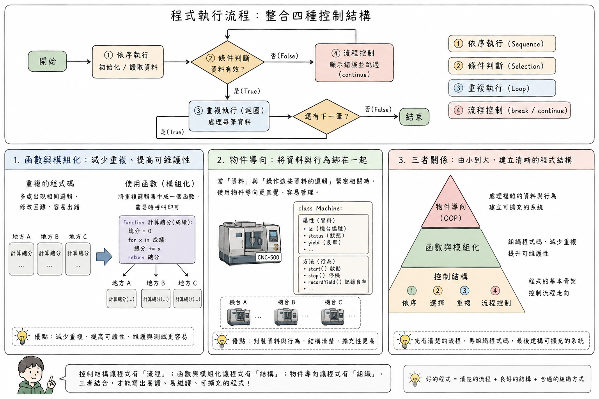

*本圖由 ChatGPT 生成，已由作者審核內容正確性*

---

## 第二篇：資料結構基礎

---

## 六、資料結構的角色

### 1. 為何需要資料結構？

到目前為止，我們討論的變數一次只儲存一個值。但實際工作中，我們往往需要處理 **一組同類型的資料**，例如：今天 24 小時內每小時的溫度量測值、本週五天的每日產量。這麼多資料要怎麼擺、怎麼取用，就是資料結構要回答的問題。

想像一間沒有任何整理系統的倉庫：所有零件散落各地，每次要找某個零件都需要翻遍整個倉庫。這種倉庫雖然能儲存零件，但效率極差。現在想像同一間倉庫，依照零件類型分區、每個儲位都有編號、入庫出庫都有記錄——找東西不再是問題。

[資料結構（Data Structure）](https://zh.wikipedia.org/zh-tw/資料結構) 就是程式中的「倉庫整理系統」：它決定了資料如何被組織、儲存，以及如何被存取（Cormen et al., 2022）。選擇正確的資料結構，往往是程式效能好壞的關鍵。

同樣是「儲存一批工單」，放進不同的資料結構，存取的效率與適用的操作就大不相同：放進 **列表** 可以依序處理；放進 **佇列** 可以確保先到先服務；放進 **映射** 可以用工單號碼瞬間查到工單內容。

### 2. 抽象資料型態（ADT）

[抽象資料型態（Abstract Data Type，ADT）](https://zh.wikipedia.org/zh-tw/抽象資料型別) 是從「使用者角度」定義資料結構：它 **能做什麼操作**，而不涉及內部如何實作。就像你使用電梯，只需要知道「按樓層按鈕，門會打開，電梯會移動到指定樓層」，不需要知道纜繩、馬達的運作細節。

這個概念讓程式設計者能夠專注在「我怎麼操作資料」，而不是「我要如何在記憶體中排列資料」，大幅降低了設計的複雜度。

**工業應用：訂單、庫存、工單管理**

| 管理場景 | 需要的操作 | 適合的資料結構 |
| --- | --- | --- |
| 訂單等候處理 | 先進先出、加入尾端、取出頭部 | 佇列（Queue） |
| 操作歷史紀錄（可復原） | 後進先出、加入頂端、取出頂端 | 堆疊（Stack） |
| 用工單號碼查詢工單 | 快速依鍵值查找 | 映射（Map） |
| 依優先序處理工單 | 取出最高優先的項目 | 優先佇列 |
| 組織物料清單層級 | 上下層關係、子節點存取 | 樹（Tree） |

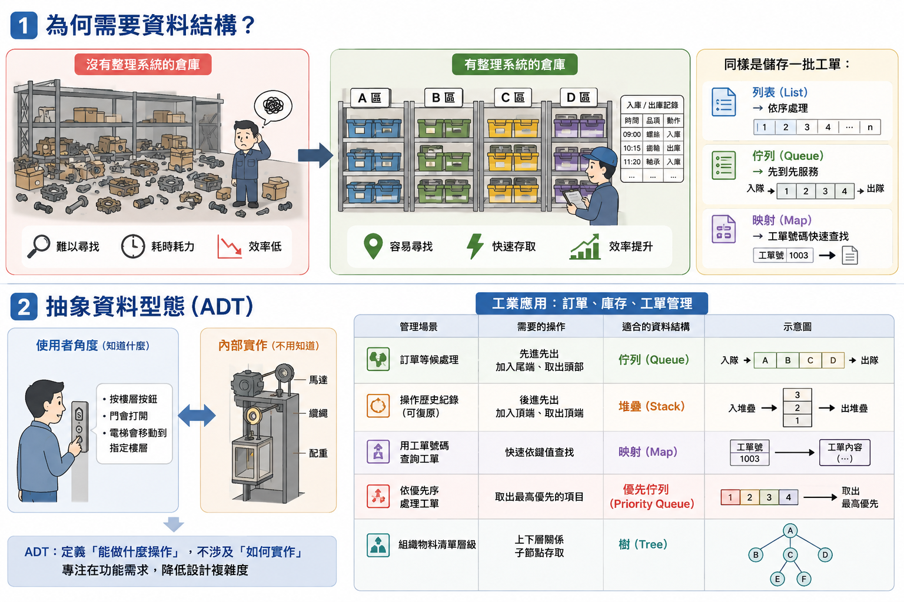

*本圖由 ChatGPT 生成，已由作者審核內容正確性*

> **動手做**：接下來介紹的列表，都可以在 [Computer-Program-Examples.ipynb](notebooks/Computer-Program-Examples.ipynb) 的〈第二篇：資料結構基礎〉直接執行看看。建議邊讀邊跑，改幾個數值觀察輸出怎麼變，會比只看文字有感覺得多。

---

## 七、陣列與列表（Array / List）

### 1. 順序儲存概念

[陣列（Array）](https://zh.wikipedia.org/zh-tw/陣列) 或 **列表（List）** 是最基本、最直觀的資料結構：在一個變數名稱下，將多個資料元素 **依照順序排列在一起**，並透過 **索引（Index）** 存取特定位置的值。先看偽代碼：

```text
每日產量 = [480, 512, 498, 467, 521]  ← 索引從 0 開始

每日產量[0] → 480（星期一）
每日產量[2] → 498（星期三）
每日產量[4] → 521（星期五）
```

寫成 Python 是這樣：

```python
每日產量 = [480, 512, 498, 467, 521]    # 用中括號把資料排成一個列表

print(每日產量[0])    # 480（星期一）
print(每日產量[2])    # 498（星期三）
print(每日產量[4])    # 521（星期五）
```

> **注意**：大多數程式語言的索引從 0 開始，而非從 1 開始。這是初學者最常見的混淆點之一，請特別留意。

每個元素所存放的內容，最終都落在記憶體裡；而記憶體本身也是一排排列整齊的儲存格，每一格都有專屬的 **記憶體位址（Memory Address）**，用來標示某筆內容究竟存在哪一格。只是記憶體位址數量龐大又不易記憶，程式一次通常只處理其中一小段資料，因此改用從 0 開始的索引來指稱「第幾個元素」，遠比直接記位址方便。

在記憶體中，陣列的元素通常是 **連續排列** 的，就像超市貨架上一排緊鄰的商品——你知道第一個的位置，就能直接計算第 n 個在哪裡，不需逐一搜尋。這使得 **依索引存取**（如「給我第 3 個元素」）的速度極快，無論陣列有多長，都能在固定時間內完成。

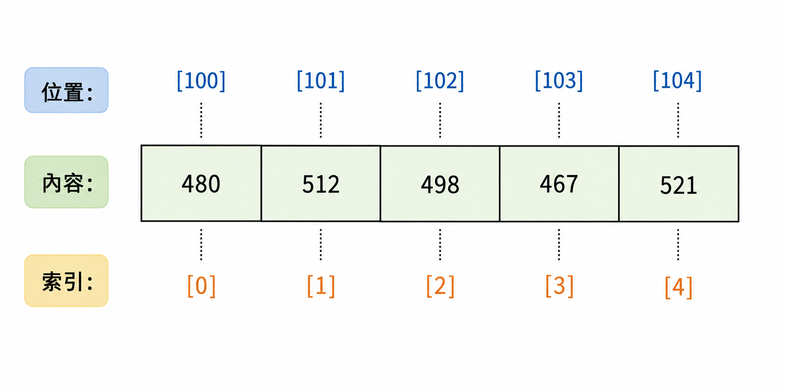

*本圖由 ChatGPT 生成，已由作者審核內容正確性*

### 2. 存取與走訪

對陣列最常見的兩種操作：

**隨機存取（Random Access）**：直接透過索引取得特定位置的元素。速度很快，不論陣列多長，存取任意一個元素的時間相同。

**走訪（Traversal，也稱遍歷）**：從頭到尾依序存取陣列中的每一個元素，通常搭配迴圈使用。

例如用迴圈走訪一整週的產量，逐一加總後算出平均。先看偽代碼：

```text
每日產量 = [480, 512, 498, 467, 521]
總產量   = 0

對 每日產量 中的每一個值:
    總產量 = 總產量 + 該值

平均產量 = 總產量 / 5    → 495.6
```

寫成 Python 是這樣：

```python
每日產量 = [480, 512, 498, 467, 521]
總產量 = 0

for 產量 in 每日產量:
    總產量 = 總產量 + 產量

平均產量 = 總產量 / len(每日產量)    # len() 算出列表有幾個元素，這裡是 5
print(平均產量)    # 495.6
```

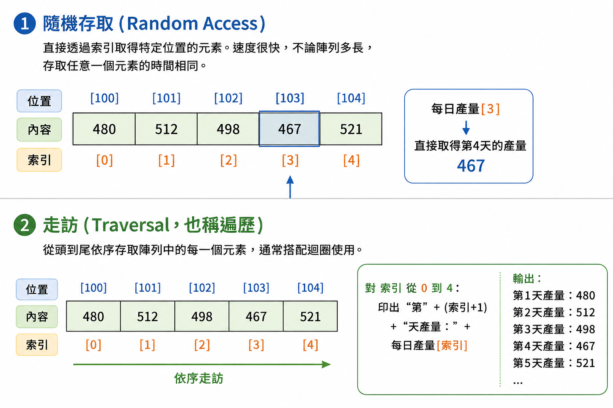

*本圖由 ChatGPT 生成，已由作者審核內容正確性*

### 3. 工業應用：生產紀錄與感測器資料

列表在工業資訊系統中無所不在：

- `感測器讀值 = [23.1, 23.4, 23.2, 24.8, 23.0, ...]`（每分鐘溫度）
- `工單清單 = ["WO-001", "WO-002", "WO-003", ...]`（待加工工單）
- `不良原因 = ["尺寸超差", "表面刮傷", "尺寸超差", "缺料", ...]`（品質記錄）

**每日產量記錄**：將一個月 30 天的每日產量存入列表，可以輕鬆計算月總量、月平均量、找出最高產日與最低產日。先看偽代碼：

```text
月產量紀錄 = [480, 512, 498, 467, 521, 489, 503, ...]  ← 共30個值

月總量   = 加總(月產量紀錄)
月平均   = 月總量 / 30
最高產日 = 找最大值的索引(月產量紀錄) + 1
最低產日 = 找最小值的索引(月產量紀錄) + 1
```

寫成 Python 是這樣：

```python
月產量紀錄 = [
    480, 512, 498, 467, 521, 489, 503, 476, 530, 495,
    508, 461, 517, 484, 499, 526, 470, 492, 511, 487,
    504, 468, 523, 496, 481, 515, 490, 502, 473, 519,
]

月總量 = sum(月產量紀錄)                              # 加總
月平均 = 月總量 / len(月產量紀錄)
最高產日 = 月產量紀錄.index(max(月產量紀錄)) + 1      # 最大值在第幾格，再加 1 變成第幾天
最低產日 = 月產量紀錄.index(min(月產量紀錄)) + 1

print(月總量, round(月平均, 1), 最高產日, 最低產日)    # 14897 496.6 9 12
```

`sum`、`max`、`min` 是 Python 內建的函式，分別算出總和、最大值與最小值；`index` 找出某個值在列表的第幾格。索引從 0 開始，所以要再加 1 才是「第幾天」。

**感測器時序資料**：每 10 秒記錄一次溫度，一天下來有 8,640 筆資料，存入列表後，可以用迴圈掃描找出異常時段，或計算各時段的平均溫度。

---

## 八、其他常見資料結構（延伸介紹）

> **給同學的提醒**：這一小節屬於延伸介紹，原則上不會考，目的是讓你知道列表之外還有哪些資料結構、各自用在什麼場景。

列表把資料一個接一個排好，但現實中的資料不是每一種都適合這樣擺。下面五種結構在工業資訊系統裡到處都是，這裡只講兩件事：它規定資料怎麼進出，以及它在工廠裡對應什麼場景。內部如何實作、效能如何分析，是系上「資料結構」課程的範圍。

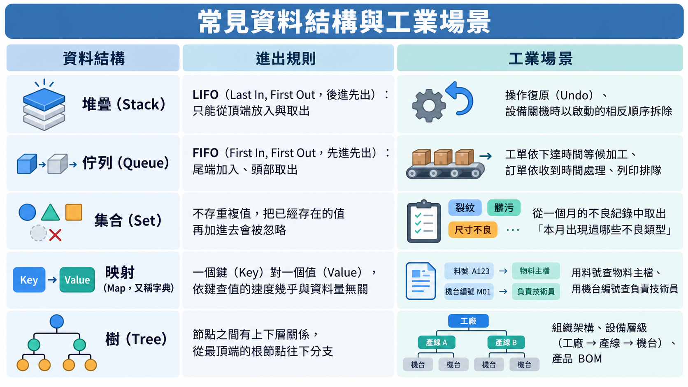

*本圖由 ChatGPT 生成，已由作者審核內容正確性*

---

## 第三篇：演算法基礎與效率概念

---

## 九、演算法基本概念

### 1. 演算法的定義與特性

[演算法（Algorithm）](https://zh.wikipedia.org/zh-tw/演算法) 是解決特定問題的 **一系列明確、有限、有序的步驟**（Cormen et al., 2022）。

> *問題：媽媽要你拿著購物清單去超級市場買東西*

```
演算法（語言無關）：
  1. 出門前看氣象預報，如果降雨機率達 70 %，就帶一把傘
  2. 拿出購物清單，從第一項開始
  3. 找到該項商品所在的貨架
  4. 確認品項與數量無誤後，放進購物車
  5. 在清單上把該項打勾，換到下一項
  6. 重複步驟 3–5，直到清單上所有品項都打勾
  7. 到收銀台結帳，完成採購
  8. 如果看到下雨，有帶傘就撐傘回家，沒有帶，就不撐傘淋雨跑回家
```


*本圖由 ChatGPT 生成，已由作者審核內容正確性*

看到這裡你應該會發現，演算法的基本概念其實很單純：把步驟一條一條列清楚、照著做，遇到不同情況就走不同的路徑。

一個好的演算法必須具備：

- **明確性（Definiteness）**：每個步驟清楚無歧義，電腦能理解並執行
- **有限性（Finiteness）**：必須在有限步驟後終止，不能無限執行下去
- **輸入（Input）**：有零個或多個明確定義的輸入
- **輸出（Output）**：有一個或多個明確定義的輸出結果
- **有效性（Effectiveness）**：每個步驟都是電腦可以實際執行的基本操作

### 2. 演算法與程式的關係

演算法是 **概念層面的解題步驟**，程式則是演算法的 **具體實作**。同一個演算法，可以用不同的程式語言（Python、Java、C++）寫出來；反過來說，同一個問題通常也有好幾種演算法可選，效率高低差很多。

也因為演算法屬於概念層面，它不一定要用程式語言表達。前面購物清單的例子只用中文描述步驟，一樣能把演算法的樣貌講清楚。接下來我們換一個跟資料處理有關的題目：

> *問題：在一個列表中，找出最大值*

```
演算法（語言無關）：
  1. 將「目前最大值」設為列表的第一個元素
  2. 從第二個元素開始，逐一與「目前最大值」比較
  3. 若當前元素比「目前最大值」還大，就更新「目前最大值」
  4. 重複步驟 2–3，直到所有元素都比較完畢
  5. 回傳「目前最大值」
```

如果把上面這段中文步驟改寫成 Python 程式，會長成這樣：

```python
每日產量 = [480, 512, 498, 467, 521]

目前最大值 = 每日產量[0]        # 步驟 1：先假設第一個元素最大
for 產量 in 每日產量[1:]:       # 步驟 2：從第二個元素開始逐一比較
    if 產量 > 目前最大值:       # 步驟 3：發現更大的就換掉
        目前最大值 = 產量

print(目前最大值)               # 步驟 5：輸出結果 → 521
```

程式碼幾乎是中文步驟的一句一句翻譯：「設為第一個元素」變成 `目前最大值 = 每日產量[0]`、「逐一比較」變成 `for` 迴圈、「若⋯⋯則更新」變成 `if` 判斷；至於步驟 4 的「重複」，`for` 迴圈本身就做完了，不必另外寫一行。

真正花腦力的是想出這五個步驟，把它翻成某種程式語言反而比較機械。所以學程式設計的重點在於先把解題步驟想清楚，語法是其次。

> **趣味小知識**：Python 其實允許用中文當變數名稱，上面的程式真的可以跑。這裡刻意這樣寫是為了跟中文步驟對照，實務上還是以英文命名為主，畢竟同事、套件與錯誤訊息都講英文，混用容易出錯。

**工業應用：SOP 就是工廠版的演算法**

工廠的 SOP 與演算法在結構上高度相似：

| 演算法特性 | SOP 對應 |
| --- | --- |
| 明確性 | 每個操作步驟清楚描述，不允許模糊 |
| 有限性 | 作業有明確的開始與結束 |
| 輸入 | 原料、半成品、設備參數 |
| 輸出 | 成品、品質量測結果、生產記錄 |
| 有效性 | 每個步驟都是操作員可實際執行的動作 |

將 SOP 轉化為電腦可執行的演算法，正是「流程數位化與自動化」的核心工作。

**演算法與程式設計的關係**

程式設計與演算法，其實是同一件事的兩面：

- **演算法決定「怎麼解」**
- **程式語言決定「怎麼把解法轉換電腦可以執行的形式」**

演算法本身只是「想法」，寫在紙上不會自己動起來，一定要有人或某個東西把步驟真的執行完，才會產生價值。人當然可以執行，前面買東西的例子就是人在跑演算法；但人一小時只能核對幾十筆資料，還會看錯、會累、會因為心情不同而做出不同判斷。電腦剛好相反：一秒鐘可以處理幾百萬筆，不會累也不會分心，同樣的輸入永遠給你同樣的輸出。

所以，把演算法寫成 **電腦程式**，是目前把「解題步驟」變成「實際產出」最快、最便宜也最可靠的方式。SOP 寫好了要靠作業員照著執行，還得訓練與稽核；演算法寫成程式後只要對一次，就能在每台電腦上重複執行。

---

## 十、基本演算法範例

這一節只挑兩個最簡單的演算法當例子：線性搜尋與泡沫排序。

實際上演算法的種類非常多，光是搜尋與排序就各有許多種做法，此外還有處理圖形、路徑、排程、最佳化等各類問題的演算法。多數程式語言已經內建常用的演算法，就連把資料存進列表這種看似簡單的動作，背後也有演算法在運作。這些演算法通常不必自己實作，但理解它們的原理，有助於判斷哪種寫法比較有效率。

這裡選最簡單的兩個，是為了讓你看懂演算法的基本樣貌，其餘的留給系上的「演算法」相關課程。

### 1. 搜尋——如何找到你要的資料

前面小節所說的「**問題：在一個列表中，找出最大值**」就是搜尋的概念。因此 **搜尋（Search）** 是在一組資料中，找出符合特定條件的元素。這是程式中最頻繁的操作之一。

[線性搜尋（Linear Search）](https://zh.wikipedia.org/zh-tw/線性搜索) 是最直觀的搜尋方式：從頭到尾逐一檢查每個元素，直到找到目標或確認不存在。

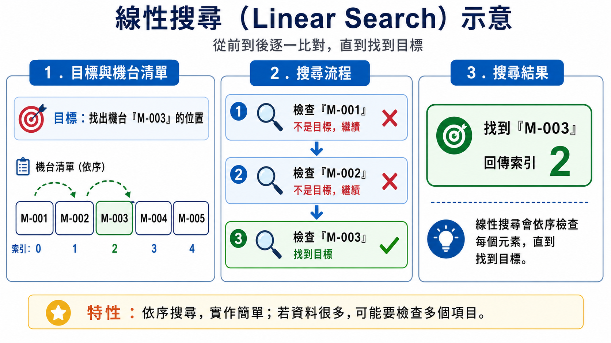

*本圖由 ChatGPT 生成，已由作者審核內容正確性*

線性搜尋的優點是邏輯簡單，不需要資料事先排序；缺點是若資料量很大，且目標在末端或不存在，需要逐一檢查每一筆資料，效率較低。這正是後面「效率分析」要討論的核心議題。

### 2. 排序——讓資料有序

[排序（Sorting）](https://zh.wikipedia.org/zh-tw/排序演算法)（Sedgewick & Wayne, 2011）是將一組資料依照特定順序（如數字大小、字母順序、日期先後）重新排列。排序後的資料往往更容易搜尋、分析和呈現。

以[泡沫排序（Bubble Sort）](https://zh.wikipedia.org/zh-tw/泡沫排序) 為例說明排序的基本概念（直觀但非最有效率）：

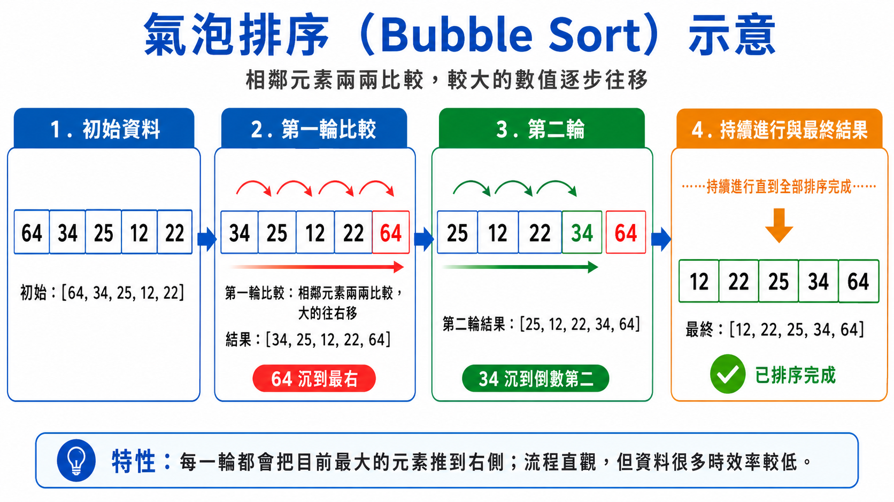

*本圖由 ChatGPT 生成，已由作者審核內容正確性*

> **重點在流程，不在細節**：本章的目的不是要你記住泡沫排序的每一個步驟，而是理解「排序是透過反覆比較與交換，逐漸將資料調整到正確位置」的這個基本流程。實際工作中，程式語言都已內建高效的排序函式，不需要自己實作。

**工業應用**：

- 將工單依照「截止日期」排序，確保緊急工單優先處理
- 將不良品依照「不良次數由多到少」排序，找出最嚴重的品質問題（柏拉圖分析的基礎）
- 將設備依照「OEE 數值由低到高」排序，找出最需要改善的機台

> **趣味小知識**：泡沫排序雖然直觀好懂，卻不是實務上常用的排序法——真正撐起現代程式語言內建排序功能的，多半是英國電腦科學家[東尼·霍爾（Tony Hoare）](https://zh.wikipedia.org/zh-tw/托尼·霍尔)於 1959 年發明的[快速排序（Quicksort）](https://zh.wikipedia.org/zh-tw/快速排序)。有趣的是，霍爾當時人在莫斯科國立大學擔任訪問學生，原本只是想寫一支「機器翻譯」程式把俄文詞典按字母排序，才意外發明了這個影響後世超過一甲子的演算法（Hoare, 1962）。相較於泡沫排序在資料量大時效能急速惡化，快速排序平均效能出色，至今仍是許多程式語言內建排序函式的核心邏輯之一。

### 3. 想一想：用偽代碼寫寫看

> **給同學的提醒**：這一小節不會考，目的是讓你練習把演算法的步驟寫成程式的樣子。

上面兩個演算法都只用文字和圖說明。請先想一想：如果用〈五、函式與模組化〉介紹過的偽代碼來寫線性搜尋與泡沫排序，你會怎麼寫？建議先自己在紙上寫一遍，再往下對照。

**參考寫法一：線性搜尋**

```text
程式：線性搜尋——找出指定機台的位置

【輸入】
  取得 機台清單 ← [M-001、M-002、M-003、M-004、M-005]
  取得 目標 ← M-003

【處理】
  位置 ← 「找不到」

  對 索引 從 0 到 (清單長度 - 1)：
      如果 機台清單[索引] = 目標：
          位置 ← 索引
          break           # 找到了，後面不必再檢查

【輸出】
  顯示 位置          # 2
```

寫成 Python 是這樣：

```python
機台清單 = ["M-001", "M-002", "M-003", "M-004", "M-005"]
目標 = "M-003"
位置 = "找不到"

for 索引 in range(len(機台清單)):
    if 機台清單[索引] == 目標:      # Python 用 == 判斷「是否相等」
        位置 = 索引
        break                       # 找到了，後面不必再檢查

print(位置)    # 2
```

整個程式只有一個迴圈加一個條件判斷：迴圈負責「從頭到尾逐一檢查」，條件判斷負責「是不是我要找的」。`位置` 一開始先設成「找不到」，如果迴圈跑完都沒有被換掉，就代表清單裡沒有這個目標。

**參考寫法二：泡沫排序**

```text
程式：泡沫排序——把數字由小排到大

【輸入】
  取得 資料 ← [64, 34, 25, 12, 22]
  n ← 資料的長度          # 5

【處理】
  對 輪次 從 1 到 (n - 1)：
      對 索引 從 0 到 (n - 輪次 - 1)：
          如果 資料[索引] > 資料[索引 + 1]：
              交換 資料[索引] 與 資料[索引 + 1]

【輸出】
  顯示 資料          # [12, 22, 25, 34, 64]
```

寫成 Python 是這樣：

```python
資料 = [64, 34, 25, 12, 22]
n = len(資料)    # 5

for 輪次 in range(1, n):              # 輪次 = 1, 2, 3, 4
    for 索引 in range(n - 輪次):      # 索引 = 0 到 (n - 輪次 - 1)
        if 資料[索引] > 資料[索引 + 1]:
            資料[索引], 資料[索引 + 1] = 資料[索引 + 1], 資料[索引]    # 交換兩個位置的值

print(資料)    # [12, 22, 25, 34, 64]
```

`range(1, n)` 產生 1 到 n - 1，`range(n - 輪次)` 產生 0 到 n - 輪次 - 1，剛好對上偽代碼的兩層範圍。交換那一行是 Python 的寫法，左右兩邊同時換值。

這裡是迴圈裡面再包一個迴圈。內層迴圈負責「把相鄰的兩個數字比一比，左邊比較大就交換」，跑完一輪，目前最大的數字就會被換到最右邊；外層迴圈負責「這件事要重複幾輪」。每一輪結束後的資料如下：

| 輪次 | 這一輪結束後的資料 | 說明 |
| --- | --- | --- |
| 第 1 輪 | [34, 25, 12, 22, 64] | 64 移到最右邊 |
| 第 2 輪 | [25, 12, 22, 34, 64] | 34 移到右邊第二個 |
| 第 3 輪 | [12, 22, 25, 34, 64] | 25 移到右邊第三個，資料已排好 |
| 第 4 輪 | [12, 22, 25, 34, 64] | 沒有任何交換 |

已經排到右邊的數字不必再比，所以內層迴圈的範圍每一輪少一格，這就是 `n - 輪次 - 1` 的由來。

偽代碼沒有標準答案。你寫的和上面不一樣沒關係，只要步驟明確、照著做能得到正確結果就可以。

---

## 十一、效率與時間複雜度概念

### 1. 為何需要效率分析？

同一個問題，可以用不同的演算法解決，但效率可能天差地別。當資料量小時，差異或許感覺不出來；當資料量增長到成千上萬，甚至數百萬筆時，低效率的演算法可能讓一個本來幾秒鐘就能完成的計算，變成需要等待幾小時。

**生活情境**：想像你手上有一本 2,000 頁的英文字典，要查「manufacturing」這個字。第一種找法是從第 1 頁開始一頁一頁翻，運氣最差時要翻 2,000 次才找得到。第二種是你實際上會用的方法：先翻到中間，發現翻過頭就往前找一半、還不夠就往後找一半，每翻一次就把還沒排除的範圍砍掉一半——這樣最多 11 次就能定位到那一頁（因為 2 的 11 次方是 2,048，已經超過 2,000）。

同一本字典、同一個單字，兩種找法的工作量是 2,000 比 11。而且字典越厚，差距拉得越開：加厚到 4,000 頁，第一種找法要多翻 2,000 次，第二種只要多翻 1 次——這正是效率分析真正在意的地方。

**工業情境**：你的工廠有 1,000 筆庫存品項，搜尋某個料號可能只要 0.001 秒。但當品項增長到 1,000,000 筆時，同樣的搜尋方法會需要 1 秒甚至更長。若每次領料都需要搜尋一次，系統的回應速度就會明顯變慢。

這就是為什麼電腦科學家要研究演算法效率——不是因為喜歡數學，而是因為 **規模增大時，效率的差異會被放大到無法忽視**。

### 2. 時間複雜度（Time Complexity）——直覺理解

[時間複雜度](https://zh.wikipedia.org/zh-tw/時間複雜度) 描述的是：當輸入資料量（通常以 n 表示）增加時，演算法所需的執行時間如何成長。我們用 [大 O 符號（Big-O Notation）](https://zh.wikipedia.org/zh-tw/大O符號) 來表示，它描述的是「最壞情況下的成長趨勢」。

> **趣味小知識**：大 O 符號其實不是電腦科學家發明的——它最早由德國數論學家保羅·巴赫曼（Paul Bachmann）於 1892 年提出，用來描述數學函數的成長趨勢，後來由另一位數論學家艾德蒙·蘭道（Edmund Landau）發揚光大。真正把它帶進電腦科學、成為分析演算法效率標準工具的，是被譽為「演算法分析之父」的美國電腦科學家[唐納·克努斯（Donald Knuth）](https://zh.wikipedia.org/zh-tw/高德纳)。他窮盡數十年心力撰寫的巨著《電腦程式設計的藝術（The Art of Computer Programming）》，至今仍是演算法領域公認的經典（Knuth, 1997）。

#### O(1)——常數時間

無論 n 有多大，執行時間 **固定不變**。

回到〈四、控制結構〉點名用的修課名單。如果老師只想知道名單上第 4 位是誰，不必從第 1 位往下數，直接看第 4 格就好：

```text
範例：直接取出修課名單的第 4 位

  修課名單[3]          # 索引從 0 開始，3 代表第 4 位

  名單有 60 人    → 看 1 次
  名單有 6,000 人 → 還是看 1 次
```

寫成 Python 是這樣：

```python
修課名單 = ["王小明", "陳小華", "林小美", "張小強", "黃小婷"]

print(修課名單[3])    # 張小強：不管名單多長，都是直接跳到第 4 格
```

這就是〈七、陣列與列表〉的隨機存取：只要知道索引，名單再長，取出一位的時間都一樣。

這個特性你在〈八、其他常見資料結構（延伸介紹）〉其實也見過：當時說映射「依鍵查值的速度極快，不論映射中有多少筆資料，查詢時間幾乎固定」——換成這一節的語言，那句話講的就是 O(1)。拿料號去查物料主檔，不管主檔裡有 100 筆還是 100 萬筆，查一次花的時間都差不多。

這是最理想的情況，但不是每種操作都做得到。

**工廠類比**：倉庫有固定編號的儲位，只要知道儲位號碼，直接走過去拿，不需要搜尋，不管倉庫有多大，時間一樣。

#### O(n)——線性時間

執行時間 **與 n 成正比**：資料量變成 2 倍，時間也大約變成 2 倍。

點名本身就是 O(n)。〈四、控制結構〉的 for 迴圈對名單上每一位同學各跑一次，名單多一個人，就多喊一次名字：

```text
範例：上課點名（for 迴圈）

  名單有 60 人    → 喊 60 次
  名單有 120 人   → 喊 120 次
  名單有 6,000 人 → 喊 6,000 次
```

寫成 Python 是這樣：

```python
修課名單 = ["王小明", "陳小華", "林小美", "張小強", "黃小婷"]

for 同學 in 修課名單:
    print(同學)    # 名單有幾個人，這一行就執行幾次
```

〈十、基本演算法範例〉的線性搜尋也是同一類：從頭到尾逐一檢查，資料有幾筆，最壞情況就得看幾次。前面查字典時一頁一頁翻的那種找法，同樣屬於這一類。

**工廠類比**：倉庫沒有分區，要找一個零件只能從頭開始逐一尋找。倉庫裡的零件越多，找到目標平均要花的時間就越長，且成正比。

#### O(n²)——平方時間

執行時間 **與 n 的平方成正比**：資料量變成 2 倍，時間變成 4 倍；資料量變成 10 倍，時間變成 100 倍。

開學第一堂課，老師要全班互相握手，每兩位同學都要握到一次：

```text
演算法：全班互相握手

  對班上的每一位同學 A：
      找出還沒和 A 握手的同學 B
      依序與這些同學握手

  全班 4 人   → 6 次握手
  全班 60 人  → 1,770 次握手
  全班 600 人 → 179,700 次握手
```

寫成 Python 是這樣：

```python
全班 = ["王小明", "陳小華", "林小美", "張小強"]
握手次數 = 0

for i in range(len(全班)):
    for j in range(i + 1, len(全班)):    # 只跟排在後面的同學握，避免重複
        print(全班[i], "和", 全班[j], "握手")
        握手次數 = 握手次數 + 1

print("總共", 握手次數, "次")    # 總共 6 次
```

迴圈裡面再包一個迴圈：外層每一位同學都要跑一次，每跑一次，內層又要跟其他同學握一輪。總次數約是 n × n 的一半，但大 O 只看成長趨勢，不管前面的 ÷ 2，所以仍是 O(n²)。人數變成 10 倍，握手次數就變成約 100 倍。

〈十、基本演算法範例〉的泡沫排序也是這種結構：每一輪要把相鄰元素兩兩比較過一遍，這樣的輪次又要跑將近 n 輪，比較次數同樣落在 n×n 的量級。那一節提醒「實務上直接用程式語言內建的排序函式」，原因就在這裡。

當 n 不大時，O(n²) 算法勉強可以接受；但一旦 n 變大，效能就會急速惡化。

**直覺式比較**（假設每次基本操作花 1 微秒）：

| n（資料量） | O(1) | O(n) | O(n²) |
| --- | --- | --- | --- |
| 10 | 1 μs | 10 μs | 100 μs |
| 1,000 | 1 μs | 1 ms | 1 秒 |
| 1,000,000 | 1 μs | 1 秒 | **11.6 天** |

這張表清楚地說明了為什麼效率分析很重要——對於百萬筆資料，O(1) 的演算法瞬間完成，O(n) 需要 1 秒，而 O(n²) 需要將近兩週。

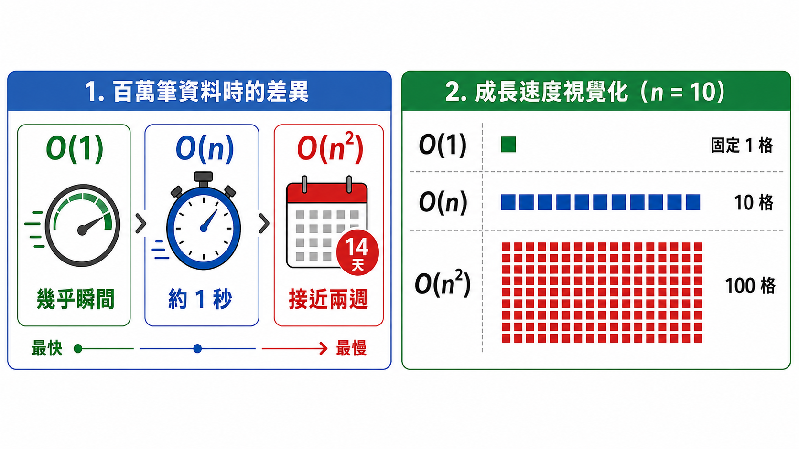

*本圖由 ChatGPT 生成，已由作者審核內容正確性*

### 3. 工業情境中的效率思考

效率這件事，工業工程其實早就講過一次，只是換了名字。

**效能瓶頸就是生產線的瓶頸**：[限制理論（Theory of Constraints，TOC）](https://zh.wikipedia.org/zh-tw/限制理論)（Goldratt & Cox, 1984）指出，一條生產線的產出由最慢的工站決定——工站 B 每分鐘只做 30 件，就算把工站 A 從 100 件拉高到 200 件，整體產出還是 30 件。程式也是同一回事：讀取資料 0.01 秒、資料分析 45 秒、輸出報表 0.05 秒，最佳化的力氣就該全押在那 45 秒上，其他地方再怎麼調都沒意義。

**排程是效率問題的極端版本**：生產排程要在工單、機台、人力、交期的層層限制下排出最好的順序。工單一多，可能的排法會以階乘成長——10 張工單有 10! = 3,628,800 種排法，20 張直接暴增到 2.4 × 10¹⁸ 種，這種現象叫做[組合爆炸（Combinatorial Explosion）](https://en.wikipedia.org/wiki/Combinatorial_explosion)，惡化的速度遠比 O(n²) 還快。所以真實工廠的排程系統不會硬去窮舉所有排法，而是採用[啟發式演算法（Heuristic Algorithm）](https://zh.wikipedia.org/zh-tw/啟發式演算法)：不保證最佳解，但能在合理時間內給出「夠好的解」。

**資料變多不等於決策變快**：工業4.0的感測器每天產生海量資料，但如果分析演算法的複雜度太高，資料越多反而讓系統越慢。生產線上的視覺檢測每秒要判斷數十個零件，演算法一旦跟不上生產節拍，自己就變成新的瓶頸；預測性維護若規劃每 10 分鐘依最新資料重訓一次模型，模型卻要訓練 30 分鐘，這套系統永遠追不上資料的腳步。

> **延伸閱讀**：這裡只先說明「窮舉不可行、需要啟發式方法」的效率困境；這類排程最佳化問題如何進一步結合機器學習與資料驅動的方式求解，請見 [06-Data-Science-AI-and-Smart-Manufacturing.md](06-Data-Science-AI-and-Smart-Manufacturing.md)〈二、資料科學與人工智慧〉。

> **小結**：效率分析不是電腦科學家專屬的學術課題，工業工程師在設計或評估資訊系統時同樣用得上。理解 O(1)、O(n)、O(n²) 的直覺含義，能幫助你在面對「為什麼系統越來越慢」、「機台數量增加一倍對系統效能有什麼影響」這類問題時，做出更有根據的判斷。

---

## 第四篇：程式設計與工業應用整合

---

前面三篇各自處理了一件事：第一篇是 **程式設計概念**（輸入→處理→輸出、變數、控制結構、函式），第二篇是 **資料結構**（以列表為主），第三篇是 **演算法與效率**（搜尋、排序、時間複雜度）。教材裡分開講，是為了一次只學一件事；但在工廠裡，這三樣東西永遠是綁在一起出現的。

這一篇就是把三條線收攏起來看。隨便挑一個工業應用（自動報表、異常預警），拆開來看，背後一定同時包含三個決定：

| 前三篇學到的 | 在工業應用裡決定什麼 | 本篇會看到的例子 |
| --- | --- | --- |
| **程式設計概念**（控制結構、函式） | 處理流程長什麼樣：資料進來後怎麼判斷、怎麼重複、怎麼拆分工作 | 異常偵測的條件判斷、報表自動生成的固定步驟 |
| **資料結構**（列表） | 資料怎麼擺：擺對了，後面每一步都省力 | 每日良率與溫度紀錄用列表存放 |
| **演算法與效率**（搜尋、排序、複雜度） | 算不算得完：同樣的功能，資料量放大十倍還撐不撐得住 | 對整份紀錄逐筆計算平均、篩選、找最小值 |

接下來兩節請帶著這三個問題讀：流程怎麼走、資料怎麼擺、算得夠不夠快。這樣看下來，工業資訊系統的骨架會清楚很多。

---

## 十二、資料驅動的流程改善

> **這一節用到的**：以程式設計概念為主。用迴圈走訪列表、用條件判斷篩選與比較，再做簡單的統計，把這套流程套用到生產資料上。資料結構只用到最基本的列表。

### 1. 用簡單程式分析生產資料

「資料驅動（Data-Driven）」是工業4.0的核心理念之一：決策不再單純依賴經驗與直覺，而是基於客觀的資料分析。即使是簡單的程式邏輯，也能從生產資料中萃取出有價值的洞見。

一個典型的分析流程：

```
原始資料（一個月的每日良率）：
良率記錄 = [0.976, 0.981, 0.968, 0.943, 0.972, 0.985,
            0.961, 0.978, 0.924, 0.969, ...]

分析步驟：
1. 計算月平均良率：平均(良率記錄)  → 0.962
2. 找出低於目標的日期：篩選(良率 < 0.95)  → [第4天:0.943, 第9天:0.924]
3. 計算低於目標的天數佔比：2/30 → 6.7%
4. 找出最低良率日：最小值(良率記錄) → 第9天 0.924
```

這個分析若每天手動進行，需要幾分鐘；若寫成程式，只需不到 1 秒，且可以在每天生產結束後自動執行，讓工程師能在隔天早上就看到昨天的分析結果。

### 2. 找出異常與趨勢

**異常偵測（Anomaly Detection）** 是資料分析中最直接的應用：設定正常範圍，自動標記超出範圍的資料點。

```
製程溫度監控：
上限 = 25.0°C
下限 = 20.0°C
溫度資料 = [22.1, 23.4, 21.8, 26.2, 22.9, 19.8, 23.1]

異常偵測：
對 每一筆溫度資料:
    如果 溫度 > 上限: 記錄「過高異常」，時間戳，溫度值
    如果 溫度 < 下限: 記錄「過低異常」，時間戳，溫度值

結果：
  過高異常：26.2°C（第4筆）
  過低異常：19.8°C（第6筆）
```

**趨勢分析（Trend Analysis）** 則是觀察資料隨時間的變化方向，例如良率是逐漸下滑還是穩定提升，這往往能在問題爆發前提供預警。

---

## 十三、自動化思維

> **這一節用到的**：一樣是程式設計概念，重點在「固定流程」與函式化。把每天重複的人工步驟，改寫成電腦可以自動跑完的步驟。

**自動化（Automation）** 是工業4.0三大核心特徵之一：透過軟硬體整合，讓更多原本需要人工執行的步驟，改由程式自動完成（Groover, 2019）。

### 1. 重複性工作自動化

如果你每天早上都要執行同樣的步驟——打開系統、匯出昨天的資料、貼到 Excel、計算幾個數字、填入報表、寄給主管——這正是程式自動化的最佳目標。

**適合自動化的工作特徵**：

- **重複性高**：每天、每週、每批次都要做一遍
- **規則明確**：步驟固定，判斷標準清楚，不需要複雜的人為判斷
- **資料量大**：人工處理費時費力，且容易出錯
- **時效性要求高**：需要在特定時間內完成（如班次結束後立即產出報表）

### 2. 工業應用：報表自動生成與資料整理

**報表自動生成** 是工廠最常見的自動化需求之一：

```
每日生產報表自動化流程：
1. 班次結束（觸發條件）
2. 自動連線 MES 資料庫
3. 查詢今日各機台的產量、良率、稼動率
4. 計算各項 KPI（OEE、達成率、不良率...）
5. 將結果填入標準報表模板
6. 儲存為 PDF 與 Excel 格式
7. 自動寄送給相關人員（班長、工程師、主管）

以往：班長花 30–60 分鐘手動整理
自動化後：程式 5 秒完成，班長可以專注在異常處理
```

**資料整理自動化**：

- 自動將不同機台匯出的 CSV 格式統一化（欄位名稱、日期格式、單位）
- 自動清除明顯的異常值（如感測器離線時回傳的 -999）
- 自動將資料依批次號、日期、機台分類存檔

> **銜接提示**：本篇（十二～十三）談的「資料驅動流程改善」「自動化思維」，會在全課程最後的 [06-Data-Science-AI-and-Smart-Manufacturing.md](06-Data-Science-AI-and-Smart-Manufacturing.md)〈五、工業4.0與智慧製造：把整條技術鏈放進工廠〉整合成一個完整的智慧工廠案例，和硬體、資訊系統、資料科學的內容放在一起。到時候可以回頭對照這裡學過的概念。

---

## 十四、動手實作與資料呈現

### 1. 把概念寫成程式

請打開 [Computer-Program-Examples.ipynb](notebooks/Computer-Program-Examples.ipynb)，把讀過的東西實際跑一遍。筆記本的編排刻意與本章對應：

| 筆記本段落 | 對應本章 | 練習內容 |
| --- | --- | --- |
| 第一篇：程式設計基礎 | 三～五節 | 變數與資料型態、循序／選擇／重複結構、函式模組化，以及教材中的程式範例 |
| 第二篇：資料結構基礎 | 七節 | 列表的索引與走訪、每日產量紀錄 |
| 第三篇：演算法基礎與效率概念（僅供參考，不會考） | 九～十一節 | 找最大值、線性搜尋、泡沫排序、查字典的兩種找法、索引存取、步驟數比較、全班握手、三種時間複雜度的耗時換算 |
| 練習題 | 三～五節、七節 | 庫存週轉率、一週溫度統計、OEE 計算、安全庫存比對、連續兩天未達標的區間 |

> **動手做**：讀得懂程式碼，跟寫得出程式碼是兩回事。建議每個範例都先自己猜一次「輸出會是什麼」，再按下執行鍵對答案——猜錯的地方，往往就是你真正還沒弄懂的地方。

---

## 十五、學習重點總結

讀完本章後，你應該能夠理解以下核心概念，並將其應用於工業場域的思考與決策：

**問題拆解與開發流程**

能夠面對一個複雜的工業問題（如「如何讓報表自動化」、「如何找出生產異常的原因」），先理解需求，再把大問題拆成小步驟，將其轉化為可執行的解決步驟。

**基本程式邏輯理解**

能夠閱讀並理解基本程式邏輯（變數、條件判斷、迴圈、函式），即使不限定特定語言，也能表達清楚的程式設計思路。在與 IT 人員溝通系統需求時，能夠精確描述「程式應該如何判斷」、「資料應該如何流動」。

**資料結構的直覺理解**

理解列表這種最基本資料結構的特性與適用情境（索引存取與走訪），知道一整組資料要怎麼存放、怎麼逐筆處理。

**效率概念的應用**

能夠用直覺理解 O(1)、O(n)、O(n²) 的差異，在評估工業資訊系統的效能問題時，理解「資料量增加對系統速度的影響」，並以此作為系統設計或採購評估的依據之一。

**程式設計與工業流程的連結**

能夠將程式設計的基本概念（輸入→處理→輸出、函式與模組化、資料結構選擇）與工廠的實際流程（生產記錄、品質管制、排程、庫存管理）連結，並能提出合理的自動化改善方向。

---

> **給同學的話**：本教材刻意避免語法細節與複雜的數學推導。程式語言的語法可以查手冊，但思考問題的方式、選擇合適資料結構的直覺、判斷系統效能瓶頸的能力，才是真正有價值、長期有效的核心素養。建議搭配實際動手練習（哪怕只是用 Excel 或線上程式編輯器），理解才能真正落地。

---

## 參考文獻

- Böhm, C., & Jacopini, G. (1966). Flow diagrams, Turing machines and languages with only two formation rules. *Communications of the ACM, 9*(5), 366–371. https://doi.org/10.1145/355592.365646
- Cormen, T. H., Leiserson, C. E., Rivest, R. L., & Stein, C. (2022). *Introduction to algorithms* (4th ed.). MIT Press.
- Dijkstra, E. W. (1968). Go to statement considered harmful. *Communications of the ACM, 11*(3), 147–148. https://doi.org/10.1145/362929.362947
- Goldratt, E. M., & Cox, J. (1984). *The goal: A process of ongoing improvement*. North River Press.
- Groover, M. P. (2019). *Automation, production systems, and computer-integrated manufacturing* (5th ed.). Pearson.
- Hoare, C. A. R. (1962). Quicksort. *The Computer Journal, 5*(1), 10–16. https://doi.org/10.1093/comjnl/5.1.10
- Knuth, D. E. (1997). *The art of computer programming: Fundamental algorithms* (3rd ed., Vol. 1). Addison-Wesley.
- Sedgewick, R., & Wayne, K. (2011). *Algorithms* (4th ed.). Addison-Wesley.
- Turing, A. M. (1936). On computable numbers, with an application to the Entscheidungsproblem. *Proceedings of the London Mathematical Society, s2-42*(1), 230–265. https://doi.org/10.1112/plms/s2-42.1.230
- von Neumann, J. (1993). First draft of a report on the EDVAC (M. D. Godfrey, Ed.). *IEEE Annals of the History of Computing, 15*(4), 27–75. https://doi.org/10.1109/85.238389

## 延伸書目

- Abelson, H., & Sussman, G. J. (1996). *Structure and interpretation of computer programs* (2nd ed.). MIT Press.
- Aho, A. V., Lam, M. S., Sethi, R., & Ullman, J. D. (2006). *Compilers: Principles, techniques, and tools* (2nd ed.). Addison-Wesley.
- Brooks, F. P. (1995). *The mythical man-month: Essays on software engineering* (Anniversary ed.). Addison-Wesley.
- Gamma, E., Helm, R., Johnson, R., & Vlissides, J. (1994). *Design patterns: Elements of reusable object-oriented software*. Addison-Wesley.
- Goodrich, M. T., Tamassia, R., & Goldwasser, M. H. (2013). *Data structures and algorithms in Python*. Wiley.
- Hopcroft, J. E., Motwani, R., & Ullman, J. D. (2006). *Introduction to automata theory, languages, and computation* (3rd ed.). Pearson.
- Kernighan, B. W., & Ritchie, D. M. (1988). *The C programming language* (2nd ed.). Prentice Hall.
- Knuth, D. E. (1998). *The art of computer programming: Sorting and searching* (2nd ed., Vol. 3). Addison-Wesley.
- Lutz, M. (2013). *Learning Python* (5th ed.). O'Reilly Media.
- Martin, R. C. (2008). *Clean code: A handbook of agile software craftsmanship*. Prentice Hall.
- McConnell, S. (2004). *Code complete: A practical handbook of software construction* (2nd ed.). Microsoft Press.
- Sipser, M. (2013). *Introduction to the theory of computation* (3rd ed.). Cengage Learning.
- Skiena, S. S. (2020). *The algorithm design manual* (3rd ed.). Springer.
- Wirth, N. (1976). *Algorithms + data structures = programs*. Prentice Hall.

---

*本教材為大一程式設計概論課程用途，著重概念理解與工業應用情境，建議搭配實際案例討論與程式練習，以加深理解與應用能力。*