# 網路與網際網路

從連上宿舍 Wi-Fi 開始，理解資料如何在網路中流動

課程教材：[GitHub](https://github.com/billy1125/Introduction-of-Information-Technology)

---

## 前言：從連上宿舍 Wi-Fi 談起

各位同學從出生開始就是網路世代，沒有網路，不只沒辦法玩電玩、和朋友線上交流，甚至無法線上購物、請假、查資料。

網路看似像家中水龍頭，一開機就有；但每次你打開筆電連上校園 Wi-Fi，短短幾秒內其實發生了許多事——基地台驗證密碼、分配 IP、DNS 翻譯網址、封包經過多個路由器逐一送達並重組顯示。

---

## 不懂網路，你可能會……

- 網路突然斷線，分不清是 Wi-Fi、路由器、IP 設定還是電信業者的問題
- 買路由器、網路線時，看不懂 Wi-Fi 6、Cat6 這些規格差在哪裡
- 在外面連免密碼的公用 Wi-Fi 刷卡購物，不知道資料可能外洩
- 工作後看到設備規格上的「Modbus TCP」，不知道那代表什麼

---

## 懂網路，你可以……

- 理解 **IP 位址**、**子網路**、**路由器** 的基本概念，初步診斷連線問題
- 知道 **封包** 如何從一台裝置送到另一台，評估延遲的可能原因
- 讀懂路由器與電腦的網路設定畫面，知道每個欄位在做什麼
- 判斷哪些連線方式安全、哪些有風險

> **理解網路，讓你從「會用網路」走向「看懂網路怎麼運作」**

---

## 你的動作 對應 網路概念

| 你的動作 | 對應的網路概念 |
|---------|--------------|
| 選擇 Wi-Fi 並輸入密碼 | 無線存取點（AP）的認證機制 |
| 等待連線圖示出現 | DHCP 協定分配 IP 位址 |
| 打開瀏覽器輸入網址 | DNS 將域名解析為 IP 位址 |
| 網頁開始載入 | TCP/IP 封包路由與傳輸 |
| 影片流暢播放 | 封包重組與串流解碼 |

---

## 課程主線定位

- 整門課只在講一件事：把 **資料** 有效處理成 **資訊**，再變成能支援決策的 **知識**
- 本章負責的是：讓資料流動起來——分散在不同裝置的資料連起來，才能匯集成有用的資訊
- 讀的時候問自己：這項技術為什麼出現？解決了什麼問題？解決之後又帶出什麼新問題？

> **資料 → 資訊 → 知識，是整門課唯一的主軸。**

---

# 第一篇：網路（Network）——基礎架構與連線技術

---

## 為什麼會有網路？

- 1950、60 年代的電腦一台動輒數十萬到數百萬美元，每一台都各自獨立
- 要把 A 電腦的結果交給 B 電腦，只能存到打孔卡或磁帶上，再由人親手搬過去
- 冷戰時期，1957 年蘇聯發射 **史普尼克 1 號** 人造衛星，美國隔年成立 ARPA 大量資助電腦研究
- 各單位的電腦機型互不相容，讓它們連起來、共享運算資源，成了推動 **ARPANET** 的直接動機
- 同時期 RAND 的 Paul Baran 提出把訊息切成小塊、各走不同路徑的構想——封包交換的源頭之一

---

## 趣味小知識：一張辦公桌上的三台終端機

- 1966 年，負責 ARPA 電腦研究經費的 Bob Taylor，辦公室裡擺了三台終端機
- 三台各連到三所不同機構的電腦，登入方式與操作指令都不一樣
- 想跟三邊的研究人員溝通，就得在三台終端機之間來回切換

> **他因此想到：何不讓一台終端機就能連到所有電腦？這成了 ARPANET 計畫的起點**

---

# 一、網路基本概念

網路是把兩台以上的裝置連起來、交換資料的系統。這一章先釐清「網路」到底是什麼、能做什麼，再區分它和大家日常說的「網際網路」有何不同。

理解這個區分，是後續所有網路知識的地基。

---

## 什麼是網路？

**網路（Network）** 是兩台或以上的裝置，透過某種傳輸媒介（有線或無線）相互連接，以交換資料、共享資源的系統。

- 網路中每一個連接裝置稱為 **節點（Node）**：電腦、印表機、感測器、手機，甚至生產機台
- 最簡單的網路只有兩台電腦直接相連
- 最複雜的網路，是連結全球數十億台裝置的網際網路

> **不論規模大小，所有網路的核心目的都相同：讓裝置之間能夠溝通與共享**

---

## 網路的四項根本功能

- **資料傳輸（Data Transfer）**：把資訊從一個裝置傳到另一個
- **資源共享（Resource Sharing）**：多台裝置共用印表機、資料庫或軟體授權，降低成本
- **集中管理（Centralized Management）**：從單一位置監控、設定、更新多台遠端裝置
- **協同作業（Collaboration）**：不同地點的人即時存取同一份資料，共同完成工作

---

## 網路 v.s. 網際網路

Internet（注意 I 要大寫） = inter-（之間）＋ network（網路），直譯就是「網路與網路之間」

| 面向 | 網路（Network） | 網際網路（Internet） |
| --- | --- | --- |
| 定位 | 把裝置連起來的系統 | 把眾多網路連起來的架構 |
| 範圍 | 局部（一棟建築、一個工廠） | 全球數十億台裝置 |
| 通訊協定 | 可自行選用 | 必須共同遵守 TCP/IP |
| 所有權 | 通常單一組織 | 無單一所有者 |

---

<!-- ## 網路與網際網路 -->

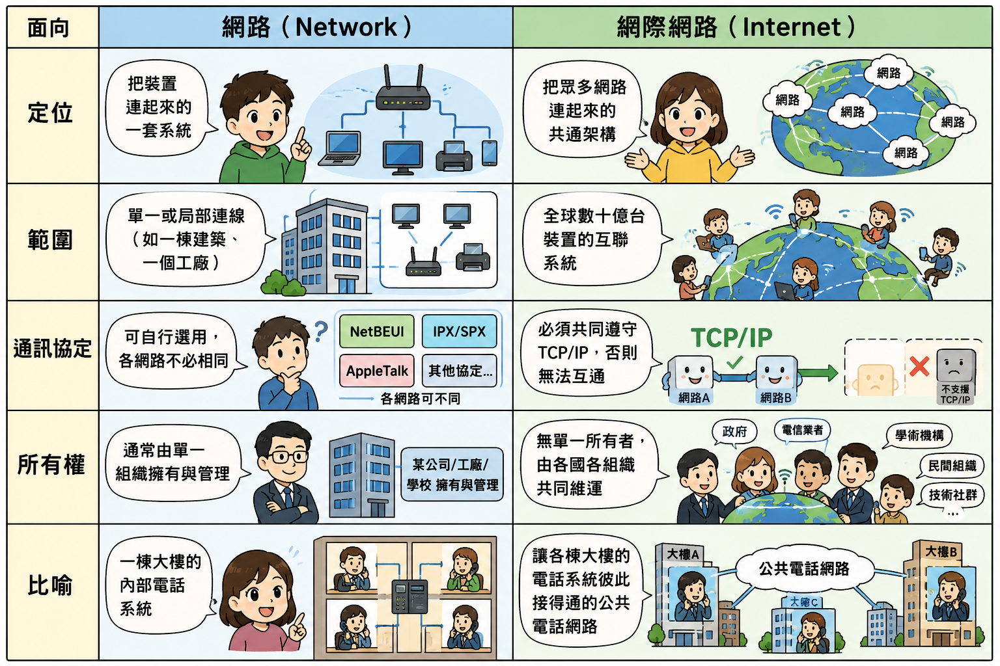

---

# 二、網路拓樸（Topology）

知道網路是「把裝置連起來」之後，緊接著的問題就是：要怎麼連？裝置一多，每兩台都拉一條線的做法很快就行不通。

**網路拓樸** 描述各節點如何相互連接，不同拓樸就是在「線路成本」和「連線可靠度」之間的不同取捨。

---

## 為什麼不能每兩台都直接相連？

n 台裝置兩兩相連，需要 n × (n − 1) ÷ 2 條線：

| 裝置數量 | 需要的線路 |
| --- | --- |
| 10 台 | 45 條 |
| 100 台 | 4,950 條 |

> **實際的網路不會只用一種拓樸，而是混合搭配；下面四種是四種工具，不是四選一的考題**

---

<!-- ## 常見網路拓樸 -->

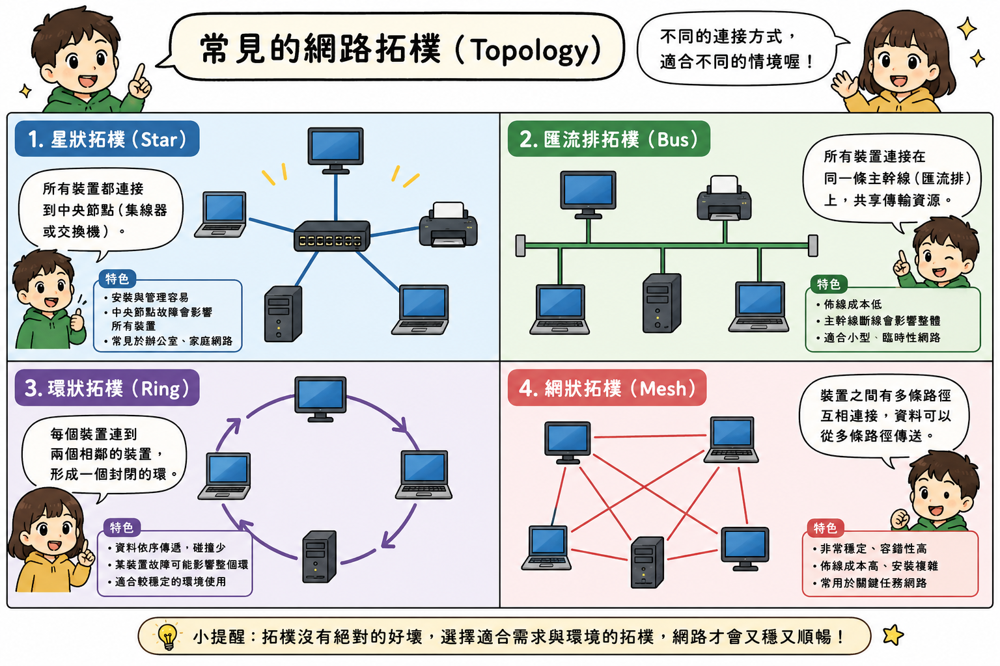

---

## 星狀拓樸（Star）

所有節點都連到一個中央裝置（通常是 **交換器**），彼此不直接相連，通訊都經中央轉發

- **優點**：任一節點故障不影響他人；新增節點容易；故障診斷簡單
- **缺點**：中央交換器是單點故障（SPOF）；纜線用量大

> **星狀是現代家庭、辦公室與企業內部網路最常見的選擇，常見的 Wi-Fi 也是星狀**

---

## 匯流排拓樸（Bus）

所有節點共用一條主幹線，訊號沿線傳播，只有目標節點會處理

- **優點**：佈線簡單、成本低
- **缺點**：主幹線斷線即全線癱瘓；節點越多，碰撞與延遲越嚴重
- 早期乙太網路廣泛使用，今日一般辦公網路已少見

> **老師 1999 年的宿舍就是匯流排：一個人的網路線鬆脫，整條走廊一起斷線，大家只好沿路敲門抓「兇手」**

---

## 環狀與網狀拓樸

**環狀（Ring）**：每個節點只與前後相鄰節點連接，形成封閉環

- 資料傳輸時間可預測；但任一節點故障可能中斷整個環
- 電信骨幹網路常用光纖串成環，並佈雙向路徑以繞過斷點

**網狀（Mesh）**：每個節點與多個節點直接相連，資料可走多條路徑

- 容錯性極高，適合關鍵基礎設施與無線感測網路；但佈線複雜、成本極高

---

# 三、網路硬體設備

拓樸是網路的「配置圖」，要落實成能運作的網路，得靠實體設備。

從一張巴掌大的網路卡，到機房整櫃的交換器、路由器與防火牆，各自扮演不同角色。以下介紹五種最基礎的設備：網路卡、交換器、路由器、存取點與閘道。

---

## 網路卡（NIC）

**網路介面卡（NIC）** 讓裝置能連接網路，把資料轉換為可傳輸的訊號

- 每台連網裝置都需配備 NIC，今日多已整合進主機板或晶片
- 每張 NIC 有全球唯一的 **MAC 位址**（48 位元，如 `3C:22:FB:A1:0D:5E`）
- MAC 位址像裝置的「身分證號碼」，用於區域網路中識別裝置
- 前 3 個位元組是廠商代碼（OUI），查得出是哪家廠牌

---

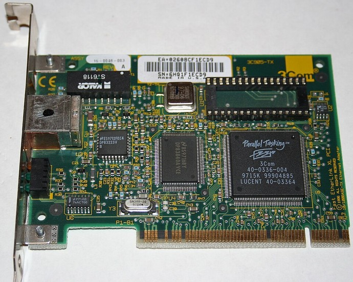

一張標準網路卡

---

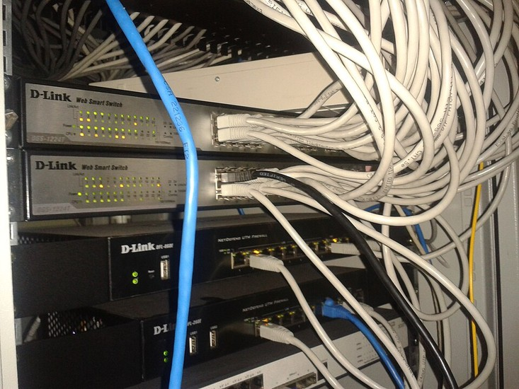

## 交換器（Switch）

**交換器** 是區域網路的核心連接裝置，提供多個連接埠讓裝置互通

- 會學習並記錄每個埠對應的 MAC 位址
- 只將資料送到目的裝置所在的埠，而非廣播給所有人
- 相較舊式集線器（Hub）的廣播，交換器精確傳送、效率更高

---

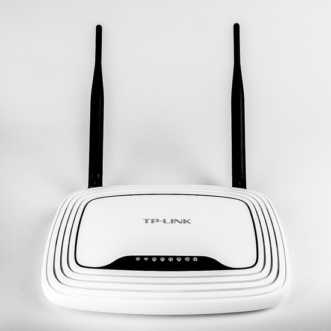

## 路由器（Router）

**路由器** 負責在 **不同網路之間** 轉發資料，是網際網路的核心設備

- 依封包中的 **IP 位址** 決定最佳轉發路徑
- 家用路由器其實一機三用：對外路由、Wi-Fi 存取（AP）、內部有線埠（交換器）
- 這也是為什麼「路由器」「AP」「分享器」常被混著講
- 想買的話，建議至少選 **Wi-Fi 6（802.11ax）** 以上的機種

---

<!-- ## 機房中的 Cisco ASR 9006 路由器 -->

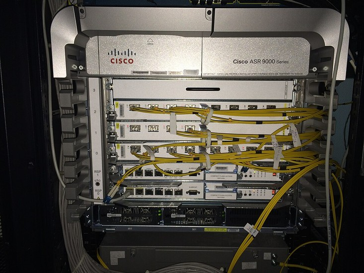

> **電信業者等級的路由器：模組可抽換、接整束光纖、控制模組雙備援**

---

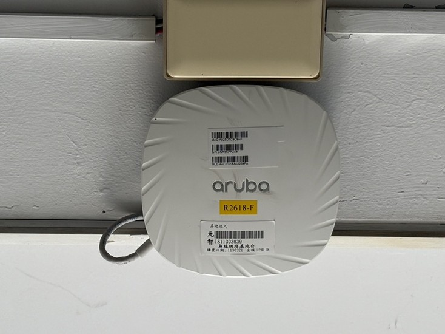

## 存取點（Access Point，AP）

**無線存取點** 將有線網路延伸為無線，讓 Wi-Fi 裝置加入有線網路

- 嚴格意義的 AP 只負責無線訊號收發，**不含路由功能**
- 常用 **乙太網路供電（PoE）**：同一條線既傳資料也供電，省下拉電源的施工
- 大型場所部署數十上百台，由 **無線控制器（WLC）** 統一管理

---

## 趣味小知識：YZU 的 Wi-Fi 為什麼這麼卡？

卡住的不是學校骨幹頻寬，而是 **教室裡的 AP**。

- 以 Aruba AP-505 為例：規格寫每個頻段最多 256 台，實際每個頻段只能穩定服務 15–25 台，雙頻合計約 **50 台**
- 每位同學帶手機、平板、筆電，每台裝置各占一個連線，很快就滿了
- 要是大家都還在看串流影音、下載大檔案，能穩定連線的裝置還會更少，因為同一台 AP 的頻寬是所有裝置共用的

最快的解法：
- 多裝幾台 AP（要花錢，而且不是越多越好）
- 限制每個帳號只能連一台裝置（避免一個帳號站了一堆連線）
- 限制 QoS（限流、降速...)

---

## 閘道（Gateway）

**閘道** 是連接兩個使用 **不同通訊協定** 網路的橋梁，除了轉發還要做協定轉換

- 外觀常與路由器、交換器相似，光看外表往往分不出來
- 交換器看 MAC、路由器看 IP、閘道則要讀懂兩種協定並翻譯
- 家用「無線路由器」也內建了閘道的角色

> **設備的區別不在長相，而在它負責做什麼事**

---

<!-- ## Juniper Networks SRX3400 服務閘道器 -->

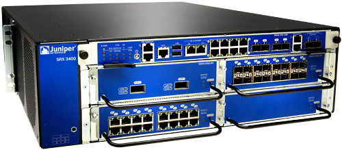

> **Juniper SRX3400 服務閘道器：裝在企業網路與外部網路的交界，同時負責路由與防火牆**

---

<!-- ## 常見網路硬體設備 -->

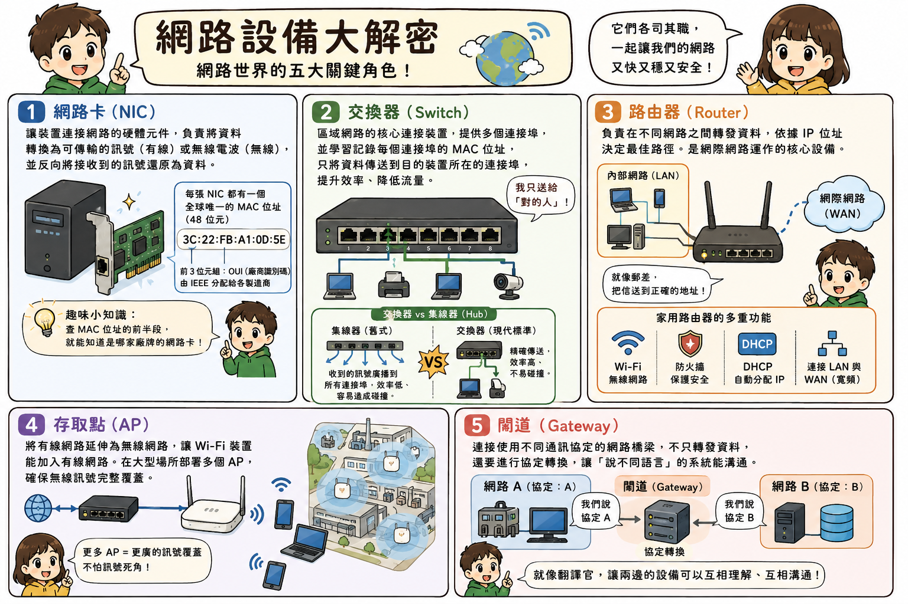

---

# 四、區域網路（LAN）

**區域網路（LAN）** 是在有限範圍內（一個房間、一棟建築、一個廠區）連接多台裝置的網路，特點是速度快、延遲低、管理集中。

目前常見的區域網路分成兩種：

- 有線的 **乙太網路（IEEE 802.3）** 
- 無線的 **Wi-Fi（IEEE 802.11）**

這一章先認識乙太網路，再認識 Wi-Fi 的世代與頻段、家用無線路由器的安裝與設定、無線網路安全，以及無線感測網路。

---

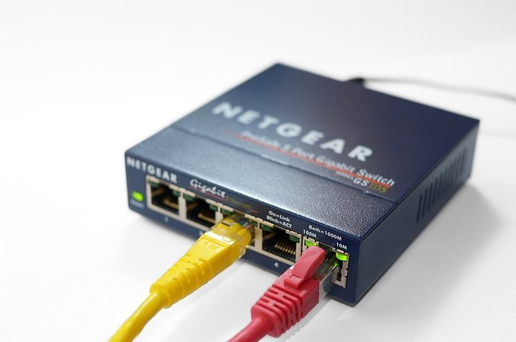

## 有線區域網路：乙太網路

**乙太網路（Ethernet）** 是有線 LAN 的主流標準（IEEE 802.3）

- 使用雙絞線（Cat5e、Cat6）或光纖，透過 **RJ-45** 接頭連到交換器
- 速度演進：10 Mbps → 100 Mbps → **1 Gbps（主流）** → 10/25/100 Gbps
- 今日的主機板、筆電與家用路由器幾乎都內建 1 Gbps 網路埠

---

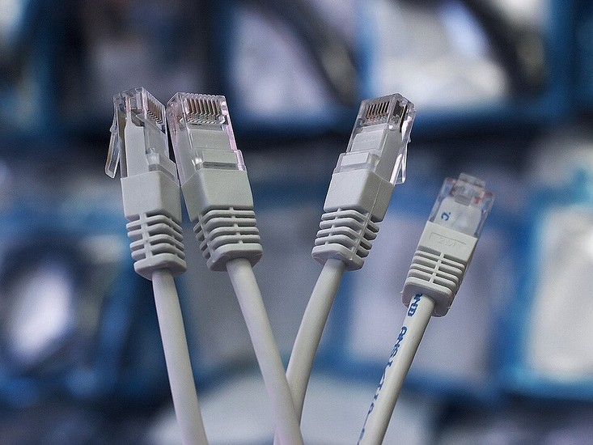

## 選購小提醒：網路線

- **Cat5e 就足以跑滿 1 Gbps**（100 公尺內），不必額外花錢
- 拖後腿的通常是老舊 Cat5、劣質線材、接頭壓接不良或線身壓折
- 新買建議直接選 **Cat6**，為升級 2.5G／10G 預留餘裕
- 陷阱：**TIA 從未制定「Cat6e」標準**，那是廠商自創的行銷名稱；Cat6 之上是 Cat6A

---

<!-- ## 10BASE2 的 BNC T 型接頭 -->

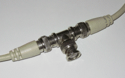

> **乙太網路一開始不是星狀：早期的 10BASE2 用 T 型接頭把整層樓串成一條線**

---

<!-- ## 10BASE2 網路的牆上接孔 -->

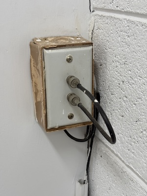

> **元智大學辦公室牆上至今還留著的 10BASE2 接孔**

---

<!-- ## Acorn AEH70 10BASE2 乙太網路卡 -->

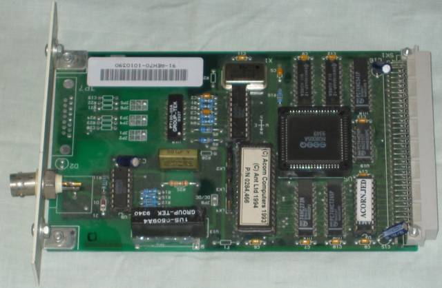

> **1990 年代初期的 10BASE2 網路卡：接頭是圓形的 BNC，不是方形的 RJ-45**

---

## 無線區域網路（WLAN）

**無線區域網路** 用無線電波取代網路線，在同一個區域內連接多台裝置

- 組成：裝置上的無線網路卡 + 負責收發訊號的 **AP**，再由 AP 接回有線網路
- 好處：不用拉線，裝置可在訊號範圍內自由移動，新增裝置只要輸入密碼
- 代價：速度與穩定度通常不如有線，訊號會被牆擋、被干擾，AP 頻寬由所有裝置共用
- 無線電波往四面八方傳出去，必須靠 **加密** 保護資料

> **固定、要穩定的設備接網路線；手機、筆電等行動裝置用無線**

---

## Wi-Fi 世代演進

基於 IEEE 802.11 系列標準，每代都比上一代更快、效能更好

| Wi-Fi 世代 | 標準 | 最高速度 | 主要特性 |
| --- | --- | --- | --- |
| Wi-Fi 4 | 802.11n | 600 Mbps | 雙頻（2.4/5 GHz），MIMO |
| Wi-Fi 5 | 802.11ac | 3.5 Gbps | 5 GHz 專用，MU-MIMO |
| Wi-Fi 6 | 802.11ax | 9.6 Gbps | 高密度最佳化、低延遲、省電 |
| Wi-Fi 7 | 802.11be | 46 Gbps | 2.4/5/6 GHz 三頻，多連結操作（MLO） |

> **目前主流是 Wi-Fi 6；Wi-Fi 7 要手機或筆電也支援，才用得到新功能**

---

## 2.4 GHz 與 5 GHz

- **2.4 GHz**：穿透力強、速度較慢
- **5 GHz**：速度快、穿透力弱
- 搜尋 Wi-Fi 時看到 `MyHome` 與 `MyHome-5G`，是同一台路由器在兩個頻段各發一個名稱
- 離路由器近選 5G，隔了幾道牆就選 2.4G

> **這裡的「5G」是 5 GHz 頻段，和手機行動網路的 5G 是兩回事**

---

<!-- ## 華碩 RT-BE3600S 無線路由器正面 -->

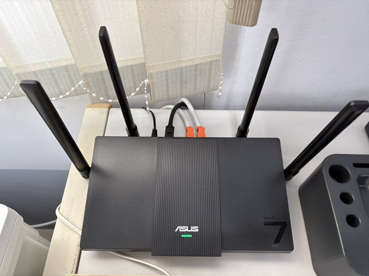

> **四根天線不是為了「訊號更遠」，而是對應 MIMO：同時收發多路資料，一次服務多台裝置**

---

## 一個盒子裡的三種設備

從無線路由器的埠與天線，看懂它身兼多職：

- **WAN 埠**：接電信業者的線路，是「路由器」的部分
- **LAN 埠**：接電腦、電視，合起來是一台小「交換器」
- **四根天線**：就是「AP」的部分

> **一個盒子裡，同時住著路由器、交換器與 AP**

---

<!-- ## 無線路由器安裝五步驟 -->

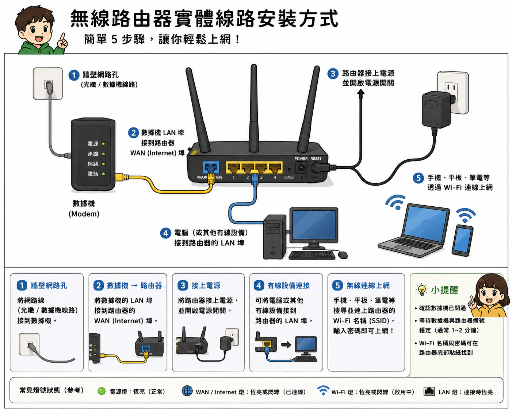

---

## 數據機（Modem）

- 把電信業者送進來的光纖或電話線訊號，轉成電腦看得懂的乙太網路訊號
- 依〈閘道〉一節的定義，它也是一種閘道器
- 左圖是中華電信光世代的 I-040GW，**PON** 燈號顯示光纖線路狀態
- 這一台其實也可以當 Wi-Fi 路由器使用

> **WAN 埠朝外接數據機，LAN 埠朝內接設備**

---

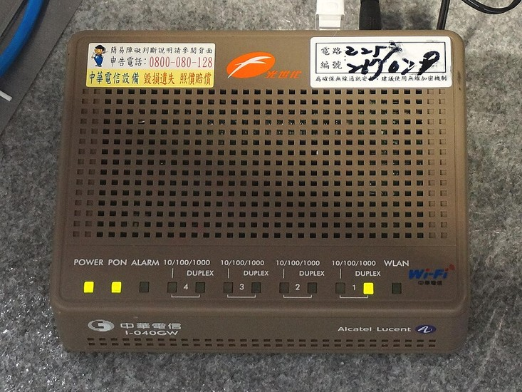

一台中華電信的光世代數據機

---

## 趣味小知識：兩層路由器

- 很多電信業者提供數據機與路由器合一的機器，家裡只會看到一台
- 如果再自己接一台無線路由器，就會形成「兩層路由器」
- 通常還是能上網，但偶爾會讓某些連線遊戲出狀況

---

<!-- ## 路由器的外部網路（WAN）設定畫面 -->

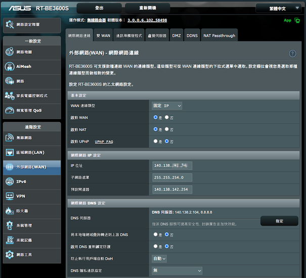

> **用瀏覽器連上路由器的位址，就能登入設定畫面**

---

## 讀懂 WAN 設定畫面

- **WAN 連接類型**：固定 IP，`140.138` 開頭的 **公用 IP**，不是家中常見的 `192.168` 私有位址
- **啟動 NAT**：讓多台私有 IP 裝置共用這一個對外位址
- **DNS 伺服器**：`140.138.2.104` 與 Google 的公用 DNS `8.8.8.8`
- **兩個 IP**：路由器對外是公用 IP，對內是家中裝置的預設閘道

> **路由器站在兩個網路的交界，把封包從一邊轉送到另一邊**

---

## 無線網路安全性

有線網路要接上線才能偷看資料；Wi-Fi 訊號往四面八方發送，隔壁鄰居、樓下路人都收得到

- **無線網路一定要加密**：目前最新的是 **WPA3**，比上一代 WPA2 更難破解
- 改掉路由器管理頁面的預設密碼、定期更新韌體
- 隱藏 Wi-Fi 名稱，或只允許登記過 MAC 位址的裝置連線
- 連免密碼的公用 Wi-Fi 刷卡、登入網銀時：改連信任的網路、切到行動網路，或開 VPN

> **沒有加密的網路，資料都有外洩的可能**

---

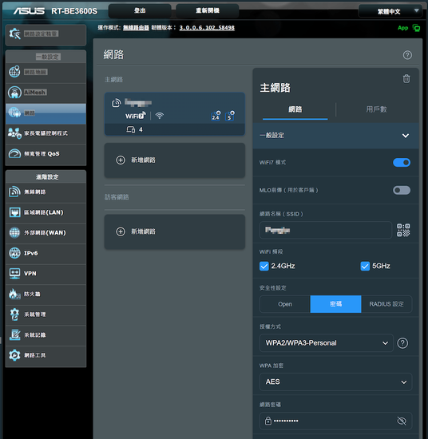

## 讀懂 Wi-Fi 設定畫面

- **網路名稱（SSID）**：手機搜尋 Wi-Fi 時看到的名字
- **安全性設定**：Open 不用密碼、誰都能連；密碼是一般家庭的做法；RADIUS 是學校與公司每人各用自己帳密的做法
- **授權方式**：WPA2/WPA3-Personal，新裝置用 WPA3、舊裝置用 WPA2，新舊都連得上

---

## 無線感測網路（WSN）

Wi-Fi 是為了讓「人」上網；另一種需求是讓大量感測器把讀值送出來

- **WSN** 由許多低功耗無線節點組成，能感測溫度、濕度、震動並傳出去
- 適合佈線困難的大型場地、需要追蹤位置的移動設備、不方便加裝有線網路的舊建築
- 主要挑戰是 **電池壽命**：不用耗電的 Wi-Fi，改用 Zigbee、LoRaWAN 等低功耗協定，平時休眠、定時醒來傳資料

> **WSN 是物聯網（IoT）的基礎設施**

---

# 五、廣域網路（WAN）

**廣域網路（WAN）** 跨越城市、國家甚至全球，通常由電信業者提供，企業租用骨幹線路連接各地分支機構。

網際網路本身可視為全球最大的廣域網路。這一章看企業串接各地分支的幾種主要方式，以及台灣的實例：臺灣學術網路。

---

<!-- ## 廣域網路（WAN） -->

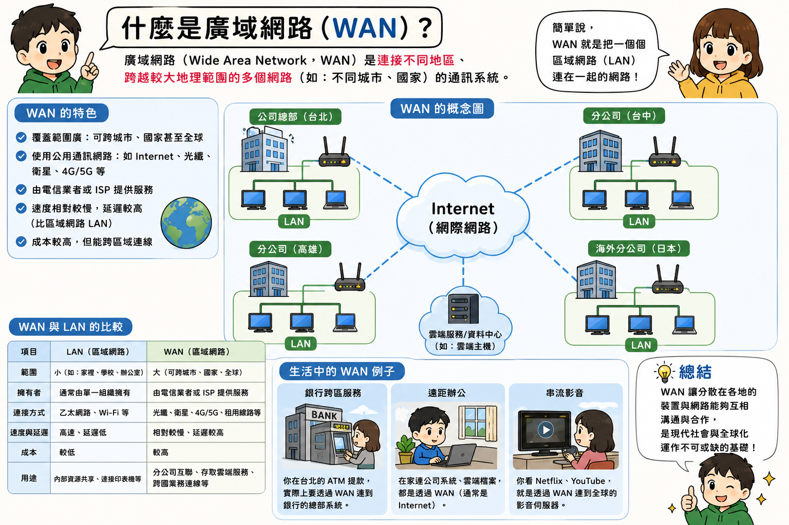

---

## 企業使用 WAN 的主要方式

- **專線（Leased Line）**：租用點對點專用線路，頻寬固定、可靠性高，但費用昂貴
- **MPLS／SD-WAN**：讓多個分支透過電信骨幹互聯，有 QoS 保障；SD-WAN 用軟體調度多條線路，成本較低也較彈性
- **VPN（虛擬私人網路）**：在公共網際網路上建加密「虛擬專線」，成本低，中小企業常用

---

## 趣味小知識：跨國流量是上天還是入海？

答案是 **入海**。

- 全球約 **99% 的國際網路資料** 是透過海底光纖電纜傳輸，而非衛星
- 這些海纜總長超過百萬公里，是名副其實的全球網路命脈
- 某條海纜被船錨或地震扯斷時，一整個地區的網路都可能瞬間變慢
- 台灣對外的網路，也高度倚賴幾條登陸的海底電纜

---

## 台灣的 WAN 實例：臺灣學術網路（TANet）

**TANet** 是教育部主導建置的全國性學術網路，1990 年開始規劃，也是台灣最早的網際網路系統

- 以 TCP/IP 為基礎，連接大專院校、高中職、中小學與教育機關
- 全國 13 所大學設立 **區域網路中心**，作為各區的骨幹匯集點
- 各縣市設立 **縣市教育網路中心**，連接轄區內的中小學
- 即時流量可在 [臺灣學術網路流量圖](https://traffic.tanet.edu.tw/) 上查看

---

# 六、行動通訊技術（1G–5G）

行動通訊歷經數十年演進，每一代（Generation，G）都帶來速度、容量與功能的重大躍升。

我們用同一系列的手機來對照——從將近一公斤重的「黑金剛」，到薄得能塞進口袋的智慧型手機，中間隔了三十七年、五個世代。

---

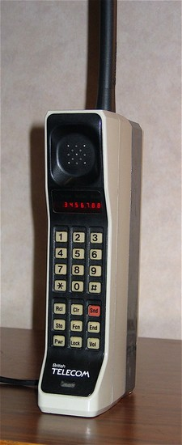

## 1G 與 2G

**1G（1980 年代）**：類比訊號，只能傳語音，無加密

- 代表：Motorola「黑金剛」，重約 794 公克至 1.13 公斤，售價可抵一輛小汽車
- 螢幕是 LED 數字管，只顯示得出數字

**2G（1990 年代）**：轉為數位，支援簡訊（SMS）與低速資料

- 代表：Nokia 3310，以「摔不壞」聞名；鍵盤上的字母催生了簡訊文化

---

<!-- ## Nokia 3310 行動電話 -->

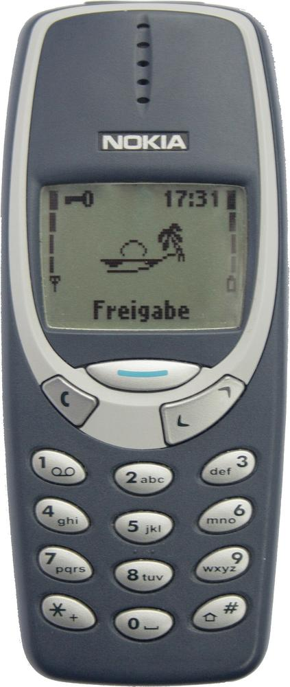

> **2G 代表機種 Nokia 3310：有了單色液晶螢幕，能顯示文字與圖案**

---

## 3G 與 4G

**3G（2000 年代）**：速度達數 Mbps，開啟行動網際網路時代

- 代表：iPhone 3G（2008），名字直接取自網路規格
- 實體鍵盤消失，正面只剩觸控螢幕——上網需要的是大螢幕

**4G LTE（2010 年代）**：數十至上百 Mbps，串流影音、視訊通話成為日常

- 代表：iPhone 5，螢幕明顯變長——網路快到能隨時看影片

---

<!-- ## Apple iPhone 3GS -->

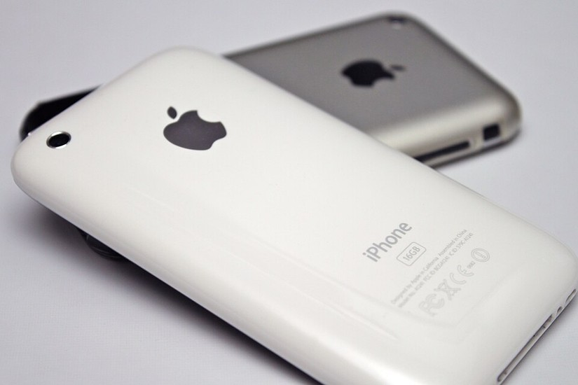

3G 代表機種 iPhone 3GS

---

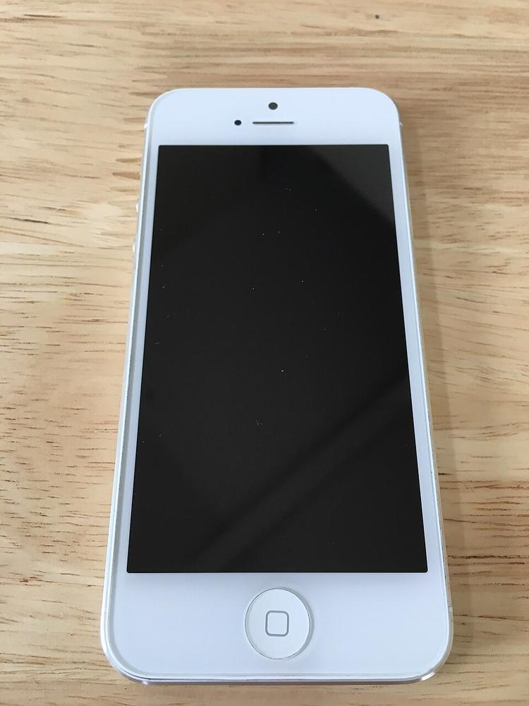

4G 代表機種 iPhone 5：Apple 第一款支援 4G LTE 的機型

---

## 5G 的三大關鍵特性（2020 年代起）

| 特性 | 數字 | 意義 |
| --- | --- | --- |
| 超高速（eMBB） | 最高 20 Gbps | 4G 的 20 倍，超高清影像即時傳輸 |
| 超低延遲（URLLC） | < 1 毫秒 | 工業機器人即時控制、自動駕駛 |
| 大規模連接（mMTC） | 每平方公里 100 萬台 | 大規模 IoT 感測器部署 |

---

<!-- ## Apple iPhone 12 -->

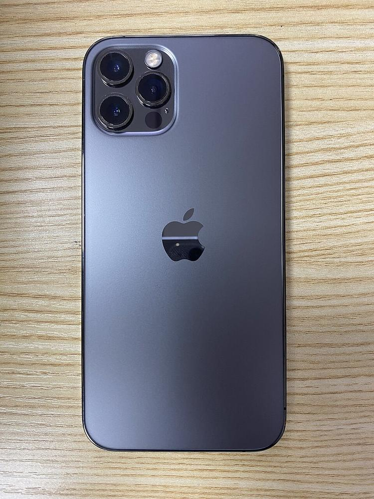

5G 代表機種 iPhone 12：從黑金剛到它，中間隔了三十七年、五個世代

---

## 私有 5G 網路

- 傳統 Wi-Fi 的延遲約 10–50 毫秒，有些即時控制需要小於 5 毫秒
- 過去只有拉實體線才跨得過這道門檻，而拉線就代表設備不能移動
- **私有 5G**：企業在自己的場域內部署專屬 5G 基地台，只服務自己
- 優點：資料不外流、服務品質更可預測、更大的客製彈性

---

# 七、個人網路與短距離通訊

有一類網路範圍只有你伸手可及的幾公尺、甚至幾公分，圍繞著「一個人」打轉。

戴 AirPods 聽音樂、嗶悠遊卡進站、刷學生證開門——背後是同一組概念：以個人為中心、覆蓋範圍極小的短距離無線通訊。

---

<!-- ## 個人區域網路（PAN） -->

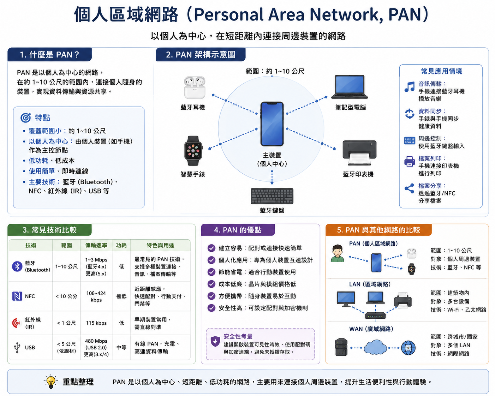

---

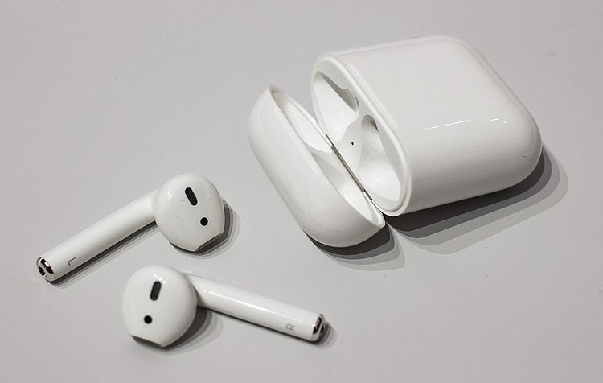

## PAN 與藍牙

**個人區域網路（PAN）**：以個人為中心、範圍通常 10 公尺內，連接隨身裝置

**藍牙（Bluetooth）**：最廣泛的短距離無線技術，使用 2.4 GHz

- **藍牙低功耗（BLE）**：省電版本，一顆鈕扣電池可撐數年
- AirPods 一邊用藍牙接收音訊，一邊靠 BLE 交換電量與配對狀態
- 名字來自 10 世紀統一丹麥與挪威的「藍牙王」，寓意統一各家通訊標準

---

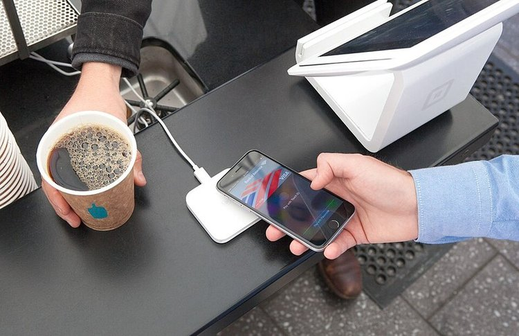

## NFC（近場通訊）

**NFC** 是極短距離（4 公分內）的無線通訊，「碰一下」就能完成資料交換

- 悠遊卡、門禁卡的感應刷卡
- 手機行動支付（Apple Pay、Google Pay）
- 電子票券

> **左圖：手機靠近櫃台的讀卡機，不用插卡也不用連線設定，就完成付款**

---

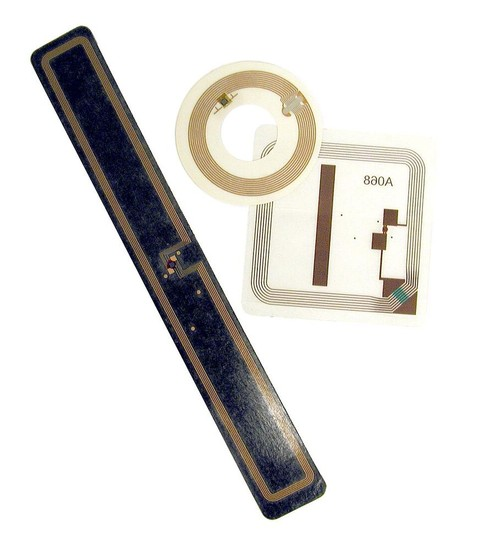

## RFID（無線射頻識別）

你的學生證、感應卡、接觸式信用卡、悠遊卡多半都是 RFID 技術，由 **標籤（Tag）** 與 **讀取器（Reader）** 組成

- **被動式**：無電池，靠讀取器的電波感應供電；成本低、距離短（< 1 公尺）
- **主動式**：內建電池，主動發送訊號；距離可達數十公尺，但成本較高
- 和條碼相比：不需對準、能穿透非金屬包裝、可一次讀取多個標籤

---

# 八、物聯網與低功耗網路

**物聯網（IoT）** 把感測器、處理器與通訊模組嵌入實體物件，讓它們蒐集資料並透過網路相互通訊。

其實它離大家的生活一點也不遠：會自己記住家裡格局的掃地機器人、用手機遠端開關的冷氣，都是物聯網。

---

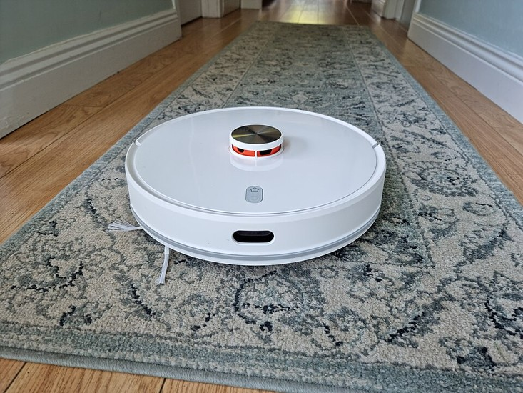

## 生活中的 IoT：掃地機器人

- 頂部的圓形凸起是 **光達（LiDAR）** 感測器
- 一邊旋轉一邊用雷射測量四周距離，畫出家裡的平面地圖
- 靠這張地圖記住格局、規劃清掃路線
- 再透過 Wi-Fi 把地圖與進度傳到手機 App

> **把「只會做一件事」的機器接上網路，讓它感知自己的狀態、也能和手機互通**

---

## 從 IoT 到 IIoT、AIoT

- **IoT**：讓物品感知自己的狀態並與外界溝通（掃地機器人、智慧插座、智慧燈泡）
- **工業物聯網（IIoT）**：IoT 用在工業場域，對可靠性、即時性、資安的要求嚴苛得多
- **AIoT（AI + IoT）**：在 IoT 之上再加一層人工智慧，讓系統不只「回報數據」，還能「看懂數據」

> **IoT 負責「感知與蒐集」，AI 負責「判斷與決策」**

---

## 低功耗廣域網路（LPWAN）

IoT 設備數量龐大、分布廣、電池供電、每次只傳少量資料——Wi-Fi/4G 功耗太高

- **LoRaWAN**：極低功耗，覆蓋數公里至十幾公里，一顆 AA 電池撐數年；適合農業、智慧城市
- **NB-IoT**：基於 4G/5G，電信業者提供覆蓋，訊號能穿透建築；適合智慧電錶
- **Zigbee**：低功耗短距離，可形成網狀網路互相中繼，常用於智慧家庭與大量感測器

---

<!-- ## 物聯網概念 -->

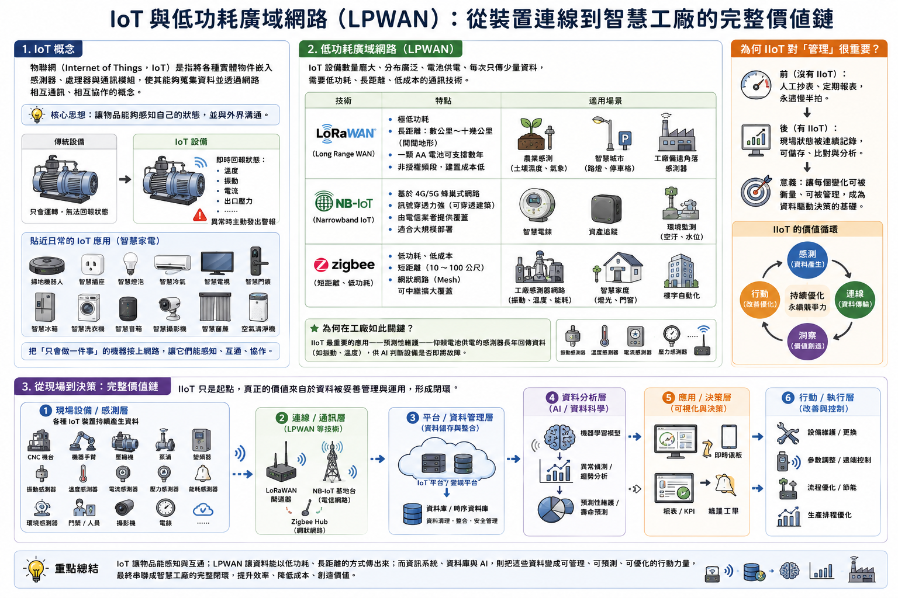

> **網路把資料「送出來」，送出來之後能長出多少價值，是後面資訊系統、資料科學、智慧製造三章要回答的問題**

---

# 九、低軌衛星與新型網路

傳統通訊衛星在 35,786 公里高的靜止軌道（GEO），訊號往返延遲 600 毫秒以上，不適合即時互動。

**低軌衛星（LEO）** 把軌道降到 200–2,000 公里，延遲降到 20–40 毫秒，第一次讓衛星網路真正可用。

---

## 低軌衛星（LEO）概念

- 距離大幅縮短，延遲僅 **20–40 毫秒**，與地面寬頻相近
- 單顆覆蓋範圍小，需數百至數千顆組成 **衛星星座**
- 代表系統：SpaceX 的 **Starlink**（已部署超過五千顆）、Amazon 的 Kuiper
- 右圖：一枚火箭一次載運 60 顆 Starlink 衛星

---

<!-- ## Starlink 衛星群劃過夜空的光軌 -->

> **剛發射的衛星排成一串「星鏈列車」，光軌會干擾天文望遠鏡的觀測**

---

<!-- ## Starlink 地面終端機 -->

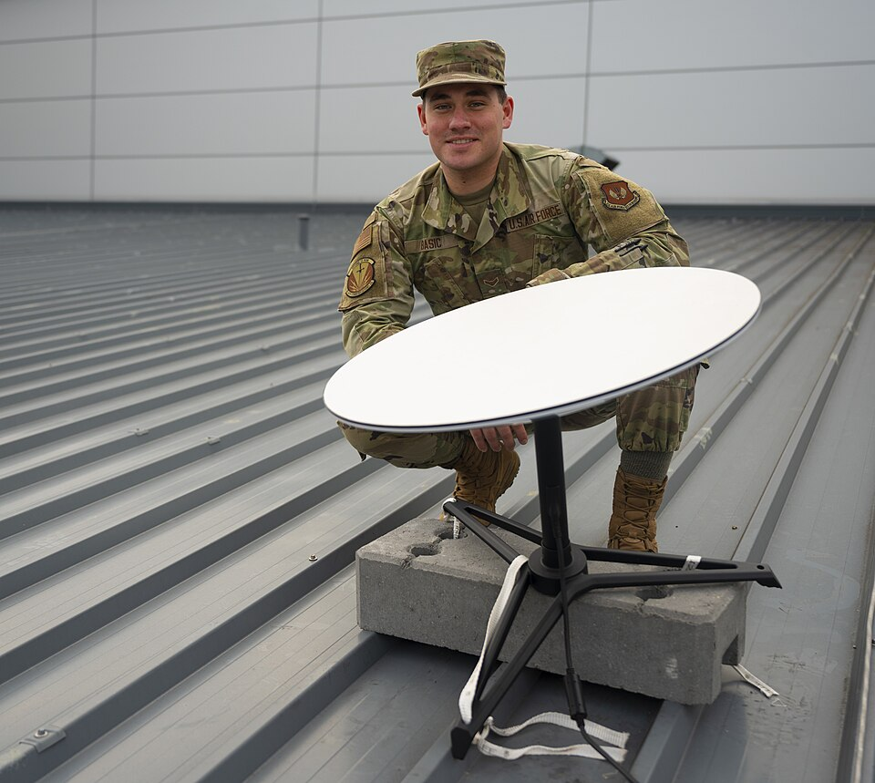

> **有了地面終端機，沒有光纖與基地台的地方也能連上網路**

---

## GEO vs LEO 比較

| 比較項目 | GEO 衛星 | LEO 衛星 |
| --- | --- | --- |
| 軌道高度 | 約 35,786 km | 200–2,000 km |
| 延遲 | 600+ ms | 20–40 ms |
| 覆蓋範圍（單顆） | 全球約 1/3 | 小，需大量衛星 |
| 衛星數量需求 | 少（3 顆覆蓋全球） | 數百至數千顆 |
| 適用應用 | 廣播、氣象、GPS | 寬頻網際網路、IoT |

---

## 台灣為什麼還用不到 Starlink？

這不是技術問題，而是卡在法規與國家安全

- 《電信管理法》要求公眾電信網路業者董事長須具中華民國國籍，外資持股受限（≤ 49%）
- SpaceX 堅持在台成立 100% 獨資公司經營，與法規正面衝突，協商破局
- 也有國安疑慮：擔心關鍵通訊基礎設施交由單一外商掌握

> **一項網路技術能不能落地，往往不只取決於技術本身，還牽涉法規、產業政策與地緣政治**

---

# 第二篇：網際網路（Internet）——全球互聯與通訊機制

---

# 十、網際網路基本概念

**網際網路** 是全球規模的網路系統，由數十億台裝置、數百萬個局部網路，透過共同的 TCP/IP 協定互相連接而成。

它不是某個組織擁有的單一系統，而是無數個局部網路透過共同語言相互串聯的「網路的網路」。

---

## Network vs Internet 的本質差異

- **網路**：把裝置連起來的局部系統（單一組織、可自選協定）
- **網際網路**：讓眾多獨立網路能透過共通的 TCP/IP 互相連通的全球架構

> **網路像一棟大樓的內部電話系統；網際網路是讓各棟大樓的電話系統彼此接得通的公共電話網路**

---

# 十一、網際網路簡史

網際網路的起源可追溯到冷戰時期的軍事研究，一路演變為支撐全球經濟、文化與社會運作的關鍵基礎設施。

從 ARPANET 的第一則訊息，到 TCP/IP 成為共通語言，再到 WWW 讓一般人也能輕鬆上網。

---

## 從 ARPANET 到 WWW

- **1969**：美國國防部建立 **ARPANET**，第一次電腦網路通訊從 UCLA 傳到 SRI
- **1970–80 年代**：**TCP/IP** 發展成熟，1983 年 ARPANET 全面採用，成為網路共通語言
- **1989–1991**：CERN 的伯納斯-李提出 **全球資訊網（WWW）**
- **1993**：第一個圖形化瀏覽器 **Mosaic** 發布，讓普通人也能輕鬆上網

> **人類史上第一則網路訊息是個美麗的意外：想傳 "LOGIN"，系統在傳出 "LO" 後就當機了**

---

<!-- ## 1977 年 3 月的 ARPANET 邏輯連線圖 -->

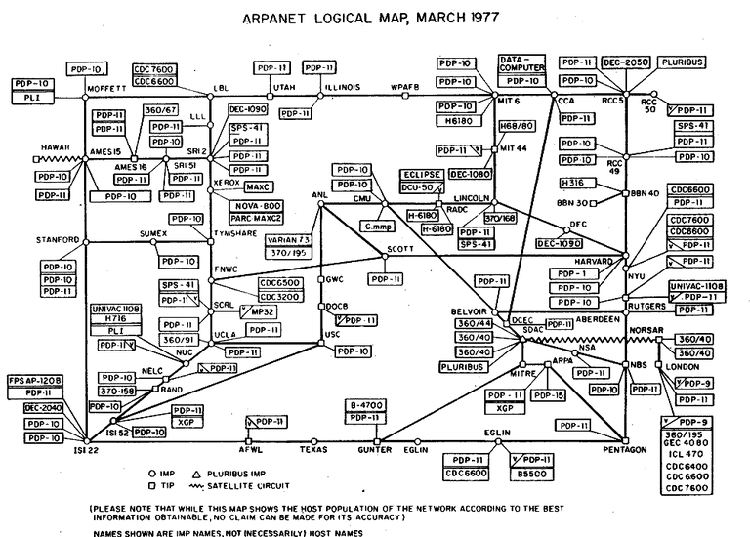

---

<!-- ## 全球第一台網站伺服器 -->

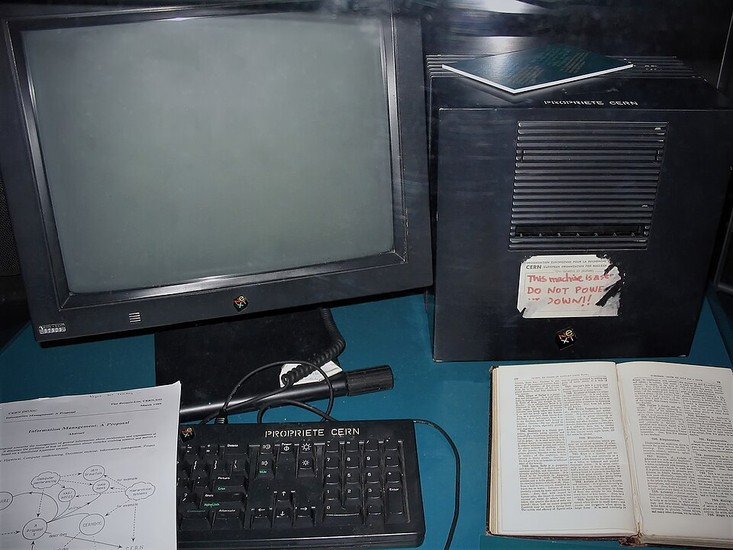

> **伯納斯-李架設全球第一個網站的 NeXT 電腦，機身貼著「這台機器是伺服器，請勿關機！」**

---

<!-- ## 賈伯斯與 iPhone -->

> **2007 年賈伯斯發表 iPhone，開啟了行動網際網路時代**

---

# 十二、封包交換（Packet Switching）

在網際網路上，資料並非整塊傳送，而是被切割成許多小的 **封包**。

這種設計是網際網路能高效、有韌性運作的關鍵。這一章看封包如何傳遞，以及它和傳統電話網路的根本差異。

---

## 封包的概念

每個封包都包含兩部分：

- **標頭（Header）**：來源與目的地 IP 位址、封包編號、大小等控制資訊
- **資料（Payload）**：實際要傳的內容（檔案的一個片段、網頁的一部分）

一份 10 MB 的報告，可能被切成數千個封包，每個約 1,500 位元組，各自獨立在網路上傳送，最後在目的端重新組合。

---

<!-- ## 封包傳遞流程 -->

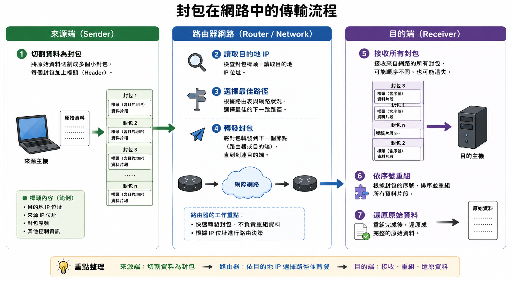

---

## 封包交換 vs 電路交換

| | 電路交換 | 封包交換 |
| --- | --- | --- |
| 做法 | 通話期間獨佔一條專屬電路 | 多使用者共享線路，封包交錯通過 |
| 效率 | 低（沉默時仍佔用） | 高（沒資料時線路可讓別人用） |
| 韌性 | 電路斷就中斷 | 單一鏈路故障可自動繞道 |
| 代價 | 浪費，但可預測 | 有延遲與抖動 |

> **共享線路的代價是延遲與抖動；需要精確時序的應用，要靠 QoS 機制或專用網路來保障**

---

<!-- ## 封包交換與電路交換的差異 -->

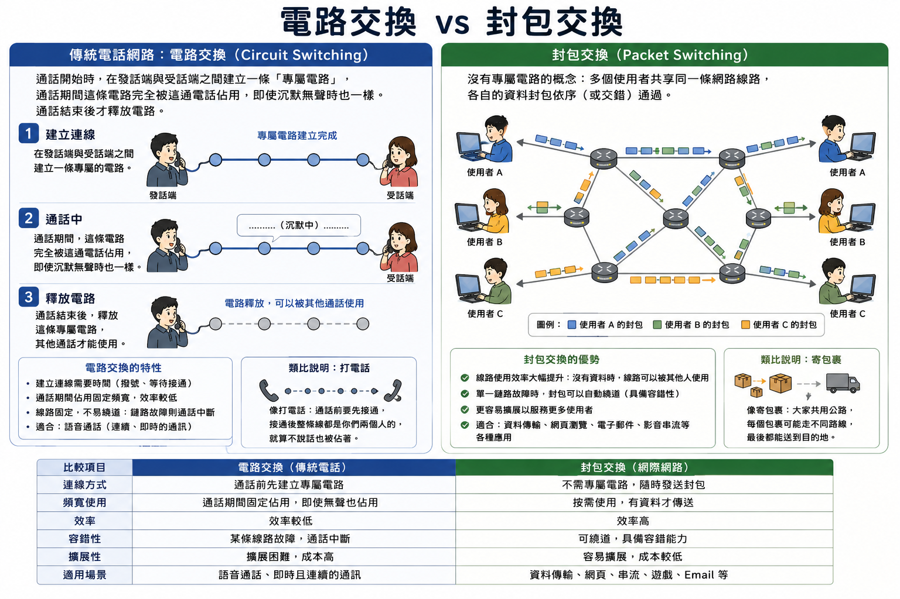

---

# 十三、通訊協定與分層架構

**通訊協定** 是通訊雙方必須共同遵守的規則，就像人與人溝通要說「同一種語言」。

網路的複雜功能被拆解成多個 **分層**，每一層只負責特定功能。這個「分層」的設計思想，是現代網路最重要的觀念之一。

> **沒有統一協定，不同廠商的設備就無法互通；TCP/IP 等開放標準，正是全球數十億台裝置能互相通訊的關鍵**

---

## 協定不只一種

- 耳機和手機配對用 **藍牙** 協定
- 隨身碟接電腦用 **USB** 協定
- 工廠的 PLC 常用 **Modbus**、**PROFIBUS** 等工業協定
- 但只要資料要在 **網際網路** 上傳送，就一定要遵守 **TCP/IP**

> **TCP/IP 不是單一協定，而是一整組協定的統稱，名字取自最核心的 TCP 與 IP**

---

## 趣味小知識：當年連線打電動要選 IPX

- 1990 年代連線打《星海爭霸》、《毀滅戰士（DOOM）》，常要先選連線方式，其中一個選項是 **IPX**
- IPX 是 Novell 為自家 NetWare 網路設計的協定，當年在區域網路相當普及
- 以前同學們要玩電腦連線遊戲，就會像下頁這樣，電腦搬到同一個房間，網路線接到中間的交換器，建立臨時的區域網路，然後將每一台的遊戲（例如有名的 DOOM 遊戲）都設定好通訊協定，這樣才能連線開戰
- 現在線上遊戲連線就簡單多了，你連設定都不用，這是因為後來 TCP/IP 隨網際網路成了共同標準，現在的遊戲都是用 TCP/IP 通訊協定

> **協定可以有很多種，但只有大家共同採用的那一種，才能讓所有人連得起來**

---

<!-- ## 小型私人連線聚會 -->

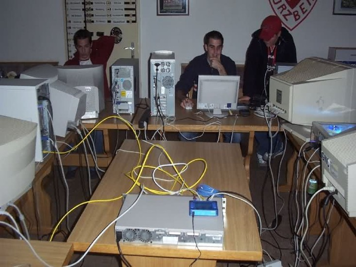

---

<!-- ## 分層：用寄一封信來理解 -->

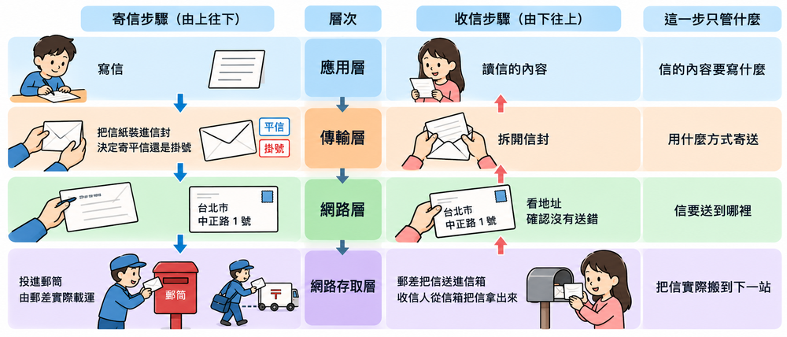

> **寄信由上往下、收信由下往上；每一層只管自己的事，不需要知道其他層怎麼做**

---

## 分層的最大好處：可獨立汰換

**改變其中一層，只要動那一層就好，不必換掉整套系統**

- 插網路線改連 Wi-Fi：換掉的只是網路存取層，瀏覽器、LINE 一行都不必改
- 中華電信基地台從 4G 升 5G：手機支援 5G，App 就照常使用
- 網頁從 HTTP 改成 HTTPS：沿途路由器不需要為此更新
- 寫 IoT 程式抓工廠設備資料：照 TCP/IP 寫好連線、知道設備 IP，不必管有線或無線

> **每一層的軟體或硬體都可以單獨汰換、各自進步，只要它和上下層之間的介面不變**

---

## TCP/IP 四層架構

| 層次 | 功能 | 代表協定 | 直觀說明 |
| --- | --- | --- | --- |
| **應用層** | 提供使用者各種服務，例如電子郵件、瀏覽網站 | HTTP、DNS、SMTP | 你實際使用的服務 |
| **傳輸層** | 可靠或快速送達 | TCP、UDP | 決定「如何寄送」 |
| **網路層** | 跨網路路由與定址，就像是現實的地址和運送路線 | IP | 決定「走哪條路」 |
| **網路存取層** | 同一網路內傳輸，實體的電路或電波通訊 | Ethernet、Wi-Fi | 搬運資料的「貨車與道路」 |

發送端逐層封裝、接收端逐層拆解，正是寄信比喻的實際運作

---

## 補充：另一套分層標準——OSI 七層

- ISO 於 1984 年提出 **OSI 參考模型**，把通訊分成 **七層**
- TCP/IP 其實發展得更早，ARPANET 在 1983 年就已全面改用 TCP/IP

| OSI 七層 | TCP/IP 四層 |
| --- | --- |
| 應用層、表現層、會議層 | 應用層 |
| 傳輸層 | 傳輸層 |
| 網路層 | 網路層 |
| 資料鏈結層、實體層 | 網路存取層 |

工程師說的「L7 問題」「L2 交換器」，用的都是 OSI 的層號

---

<!-- ## OSI 七層模型與 TCP/IP 四層架構的對照 -->

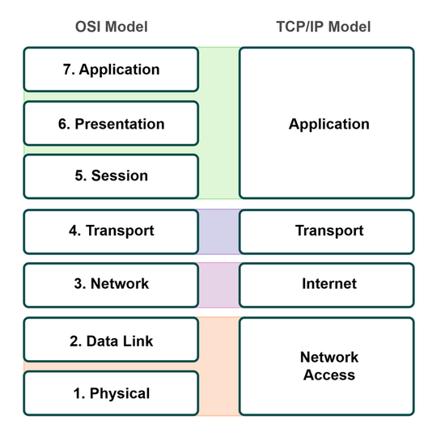

---

# 十四、TCP/IP 基本概念

TCP/IP 這個名稱，取自四層架構中間兩層的核心協定：網路層的 IP 與傳輸層的 TCP。分工可以這樣記：**IP 負責「送到哪裡」，TCP 負責「送得完整」**。

延續寄信的比喻，IP 像信封上的地址，TCP 像掛號信的回執。傳輸層還有另一個選擇 UDP，就像寄平信，不確認、不重送，換來的是速度快。

---

## IP——定位與位址

**IP（Internet Protocol，網際協定）**：負責把封包送往正確的目的地

- **IP 位址（IP Address）**：網路上每台裝置都有一個，就像家庭住址
- **路由（Routing）**：路由器依照 IP 位址，一站一站把封包轉送到目的地
- **盡力而為（Best-Effort）**：盡量把封包送到，但不保證送達、不保證順序，也不保證沒有重複
- 這些保證交給上一層的 TCP 負責
- IP 位址的格式與 IPv4、IPv6 的差異，留到下一節〈十五、IP 位址系統〉說明

---

## TCP——可靠傳輸

**TCP（Transmission Control Protocol，傳輸控制協定）**：建立在 IP 之上，讓資料完整、依序送達

- **三向交握（Three-Way Handshake）**：傳資料前，雙方先來回確認三次，確定彼此都準備好
- **確認應答（Acknowledgment, ACK）與重傳（Retransmission）**：接收端收到就回傳確認，發送端等不到確認就重送
- **流量控制（Flow Control）**：依接收端的處理能力調整發送速度
- **擁塞控制（Congestion Control）**：網路壅塞時自動放慢發送速度
- 網頁瀏覽、電子郵件、檔案傳輸、資料庫查詢這類不能缺資料的應用，都用 TCP

---

## UDP——快速但不保證

**UDP（User Datagram Protocol，使用者資料包協定）**：不確認收到、不重送遺失的封包，送出去就不管了

- **無連線（Connectionless）**：不做三向交握，資料直接送出
- **低延遲（Low Latency）**：少了確認與重送的步驟，資料送得更快
- **DNS 查詢**：問答都很短，沒有回應再問一次就好
- **即時影音與線上遊戲**：遺失的部分由軟體自己補救，例如預先多送備援資料，或依前後畫面推算缺少的部分

---

<!-- ## TCP/IP 基本概念 -->

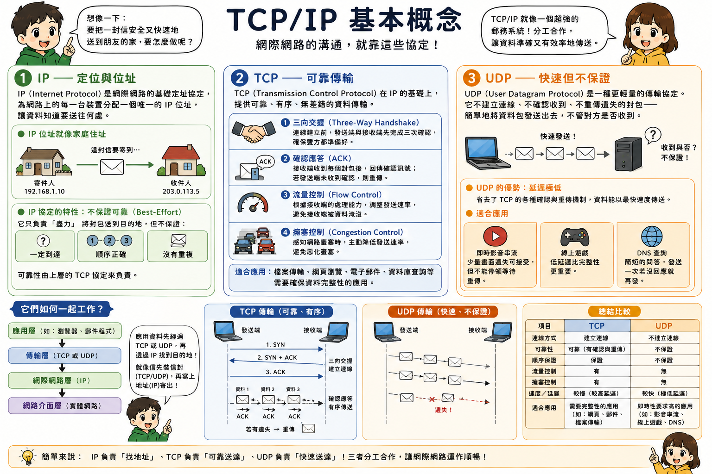

---

## 該選 TCP 還是 UDP？

| 應用場景 | 適合協定 | 原因 |
| --- | --- | --- |
| 上傳報告到雲端硬碟 | TCP | 少一個封包，檔案就可能打不開 |
| 網頁瀏覽、電子郵件 | TCP | 內容必須完整 |
| 視訊通話、看直播 | UDP | 畫面要一直往前播，不能停下來等重送 |
| 線上遊戲 | UDP | 低延遲比完整性更重要 |

> **要完整選 TCP，要即時選 UDP**

---

# 十五、IP 位址系統

IP 是「網路上的門牌」。這一章拆解它的結構——目前仍廣泛使用的 IPv4、位址空間近乎無限的 IPv6，以及一台裝置連網需要的基本設定。

最後打開真正的電腦與手機設定畫面，把學到的名詞一一對上。

---

## IPv4 與 IPv6

**IPv4**：32 位元，四組 0–255 的數字，如 `192.168.1.100`

- 最多約 **43 億** 個位址，已於 2011 年全球耗盡
- **私有 IP**（如 `192.168.x.x`）＋ **NAT**，讓多台裝置共用一個公共 IP
- 元智大學校內的 IP 幾乎都是 `140.138` 開頭

**IPv6**：128 位元，十六進位，如 `2001:0db8:...:7334`

- 約 **3.4 × 10³⁸** 個位址，地球上每一粒沙都能分到數百億個

---

## 一台裝置連網的基本設定

- **IP 位址**：裝置在網路中的地址
- **子網路遮罩**：定義哪些位址屬於同一個網路
- **預設閘道**：資料要送到外部時先送往哪裡（通常是路由器）
- **DNS 伺服器**：把網域名稱轉換為 IP

這些可手動設定，也可交由 **DHCP** 自動分配

---

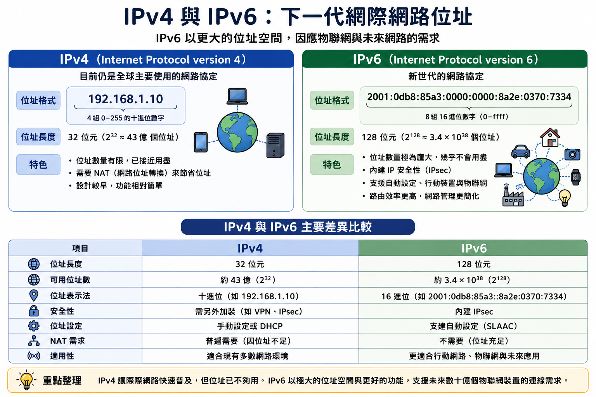

---

<!-- ## Windows 的網路連線詳細資料 -->

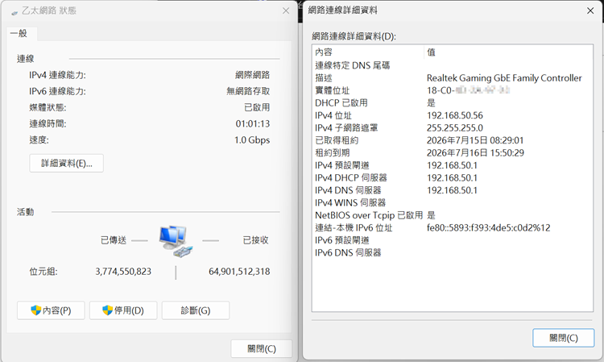

> **預設閘道、DNS 伺服器、DHCP 伺服器都是 192.168.50.1——家用路由器一台身兼多職**

---

<!-- ## iPhone 的 Wi-Fi 網路設定畫面 -->

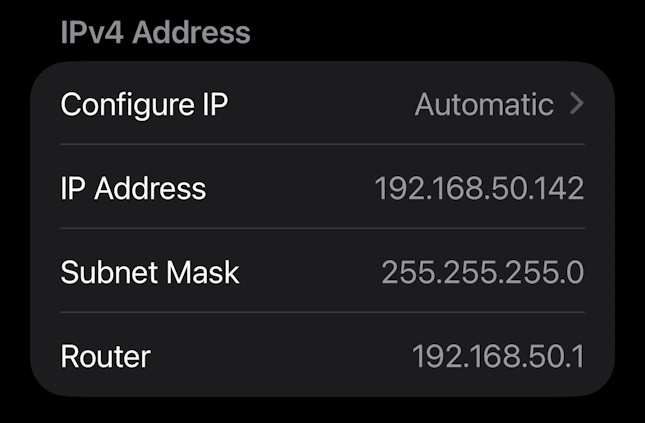

> **同樣的概念，不同作業系統用不同的名字：Windows 稱為「預設閘道」，iPhone 直接叫它「Router」**

---

# 十六、全球資訊網（WWW）與瀏覽器

在 WWW 出現之前，每種網路服務各用一套專屬協定，使用者得為每種服務各裝一套軟體、各學一套操作。

WWW 帶來革命性的便利：只要一個瀏覽器、輸入網址，就能進入任何網站。現代網路服務也逐漸「由 HTTP 統一」。

---

## 從專用協定到 WWW

WWW 之前，每種服務各用一套應用層協定：

- 電子郵件用 SMTP／POP、遠端登入用 Telnet、傳檔用 FTP、聊天用 IRC……
- 每接觸一種新服務，就得另裝軟體、另學操作——桌面擺滿彼此不相通的程式

1990 年代初 WWW 出現，只需一個瀏覽器＋網址就能進入任何網站

> **許多原本需要專屬協定的服務紛紛改以網頁提供，現代網路服務逐漸「由 HTTP／HTTPS 統一」**

---

<!-- ## WWW 改變世界 -->

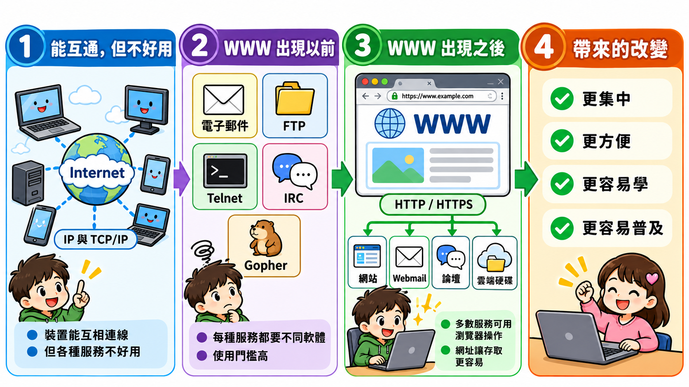

WWW 改變世界

---

## WWW 的三大技術標準

| 技術標準 | 角色 | 說明 |
| --- | --- | --- |
| **HTML** | 呈現 | 描述網頁內容與結構的語言 |
| **HTTP／HTTPS** | 傳輸 | 瀏覽器與伺服器間傳輸網頁的協定，HTTPS 是加密版 |
| **URL** | 定位 | 定位網頁資源的位址格式（網址） |

> **URL 負責「定位」、HTTP 負責「傳輸」、HTML 負責「呈現」——使用者不必懂細節就能漫遊網頁世界**

---

## 瀏覽器的出現與演進

要讓三大標準真正被使用者用到，需要一個把三者整合起來、操作簡單的工具——**瀏覽器**

- **1990**：伯納斯-李寫出第一個瀏覽器 WorldWideWeb，只能在 NeXT 電腦跑
- **1993**：圖形化的 **Mosaic** 問世，讓一般人也能輕鬆上網，引爆 WWW 普及
- **1990 末～2000**：**Netscape** vs 微軟 **IE** 的「瀏覽器大戰」
- **今日**：Chrome、Safari、Firefox、Edge，已是能跑 Web App 的平台

---

## 三十年的變化：Netscape → Chrome

左：（瀏覽器大戰時期）

- 現在最常用的瀏覽器背後只由少數幾種 **瀏覽器引擎** 驅動
- **Blink**（Chrome、Edge、Opera）約 78%
- **WebKit**（Safari、所有 iOS 瀏覽器）約 15%
- **Gecko**（Firefox）約 3%

> **Blink 與 WebKit 就涵蓋全球九成以上的網頁瀏覽（Statcounter, 2026/6）**

---

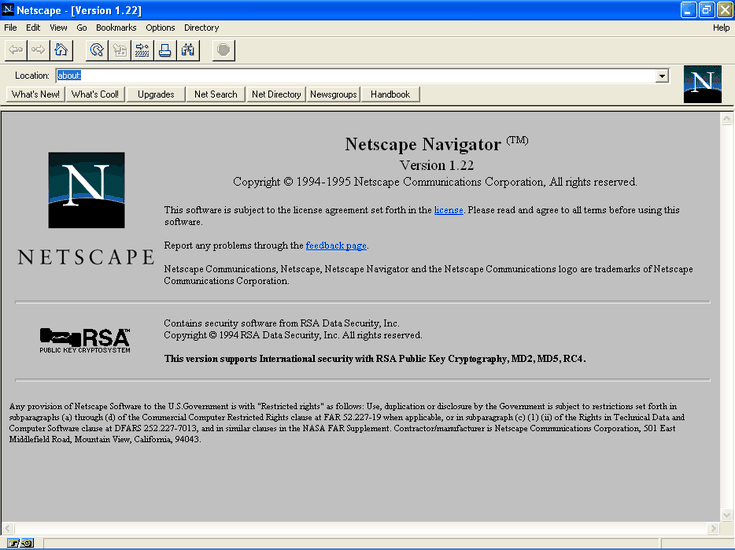

1990 年代非常流行的瀏覽器，Netscape Navigator 1.22

---

<!-- ## 在 Windows 11 上執行的 Google Chrome -->

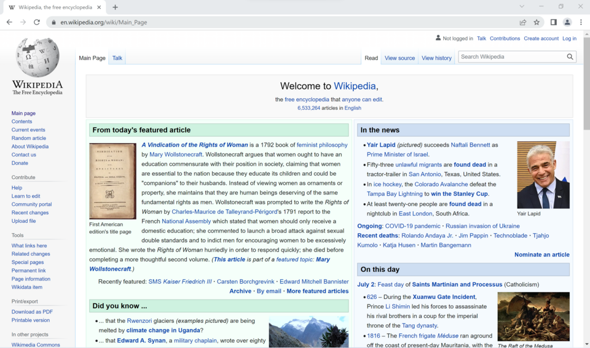

現在很常見的 Google Chrome 瀏覽器

---

## 趣味小知識：PTT 是活到 21 世紀的 Telnet

- 台灣人熟悉的 **PTT**，正是至今仍有人在用的 Telnet 服務——BBS 時代的「活化石」
- 沒有 Threads、Dcard 的年代，像老師這輩的大學生靠 PTT 追時事、討論課業、揪團
- 如今 PTT 也 WWW 化了：官方推出網頁版（PTT Web），打開瀏覽器就能看板讀文
- 流量仍高、常帶動新聞話題，但使用者年齡偏長，年輕世代轉向新平台

---

<!-- ## 以 Telnet 登入 PTT 的文字介面 -->

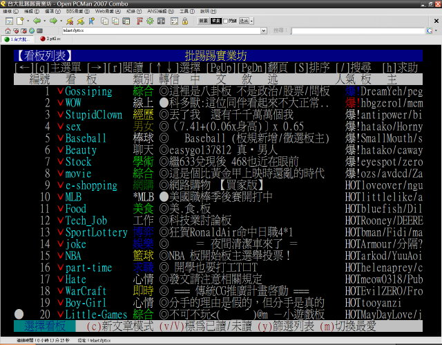

---

## 用戶端與伺服器（Client-Server）

WWW 運作在 **用戶端—伺服器** 架構之上

- **用戶端（Client）**：提出請求的一方（你的瀏覽器）
- **伺服器（Server）**：回應請求、提供服務的一方（網站主機）
- 職責分工：用戶端負責介面與操作，伺服器負責儲存資料與業務邏輯

> **同一台伺服器可以同時服務成千上萬個用戶端，這正是雲端服務能大規模提供的基礎**

---

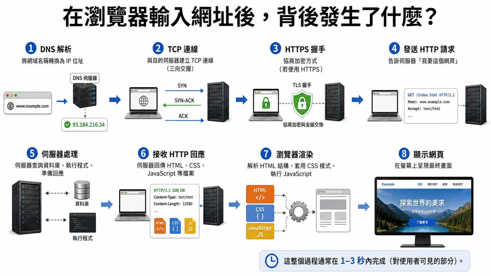

> **從 DNS 解析、TCP 連線、HTTPS 握手到瀏覽器渲染，整個過程通常在 1–3 秒內完成**

---

# 十七、網址與網域名稱系統（DNS）

網址（URL）好記，但電腦只認識 IP 位址。**DNS** 就是「網際網路的電話簿」，把人類好記的網域名稱翻譯成電腦能識別的 IP。

這一章拆解 URL 的結構，並看 DNS 如何在你按下 Enter 的瞬間默默運作。

---

## URL 結構

`https://www.example.com/products/item?id=123`

- **協定**：`https://` 是加密版，現代網站應全面採用
- **網域名稱**：人類可讀的主機名稱，如 `www.google.com`
- **路徑**：伺服器上的資源位置
- **查詢參數**：傳給伺服器的額外資訊

---

## URL 結構

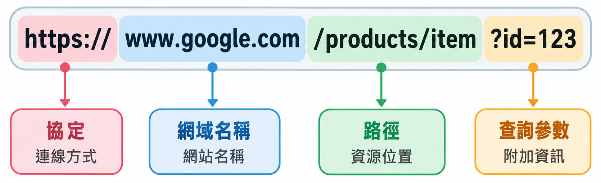

---

## DNS 的角色

電腦只認識 IP，不認識 `www.google.com`——**DNS** 負責在中間翻譯

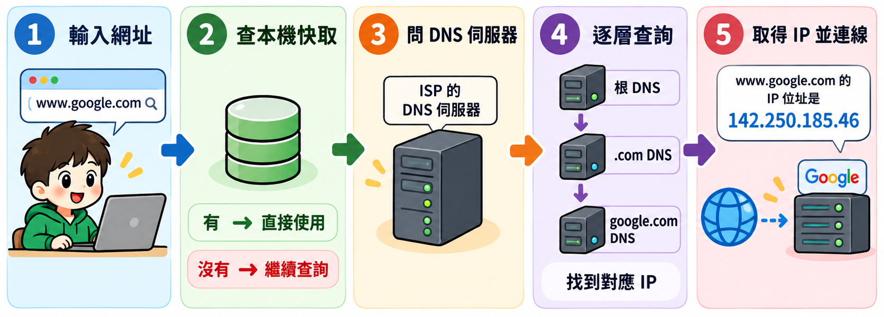

---

## 趣味小知識：好記的 8.8.8.8

- `8.8.8.8` 是 Google 提供的免費公用 DNS 伺服器
- 當年特地爭取到這組「四個 8」，就是看中它極度好記（8 在華人文化裡格外吉利）
- 覺得電信業者的 DNS 太慢時，改成 `8.8.8.8` 往往能讓「查地址」更快

---

# 十八、當代常見的網際網路服務

我們日常「上網」所做的每一件事，背後都是某種 **網際網路服務**——它們都建立在 TCP/IP 之上，卻各自發展出不同的協定與型態。

這一章綜覽常見服務、深入 VPN，並點出所有服務共同的關鍵趨勢：全面走向 HTTPS 加密。

---

## 網際網路服務百花齊放

---

## VPN——在公共網路上打造安全通道

**VPN** 在公共網際網路之上，建立一條經過加密的「虛擬專線」

- **通道化（Tunneling）**：把封包再包一層外殼，像把信裝進不透明公文袋
- **加密（Encryption）**：只有兩端能解密，途中被攔截也讀不到
- **遠端存取 VPN**：讓個別使用者連回公司內網
- **站對站 VPN**：讓兩個網路整體互聯（如分公司與總部）

> **VPN 本身不提供內容，而是為其他連線多加一層安全保護**

---

## 企業 VPN vs 消費型 VPN

底層技術相同，但目的與連線方向正好相反

| 比較面向 | 企業 VPN | 消費型 VPN（如 NordVPN） |
| --- | --- | --- |
| 主要目的 | 安全存取公司內部資源 | 隱藏身分、保護隱私、跨區存取 |
| 連線方向 | 連回「自己公司」內網 | 繞經「服務商」伺服器再上網 |
| 信任對象 | 自家 IT 部門 | 外部 VPN 服務商 |

---

## HTTPS 加密

**HTTPS** 是在 HTTP 之上加一層 **TLS** 加密，同時做到 **加密** 與 **驗證**（確認是正牌網站）

- 過去只用在登入、付款；如今是所有網站的 **預設標準**
- Google 瀏覽器把 HTTP 標為「不安全」、Let's Encrypt 提供免費憑證、搜尋排名優勢，不只網頁——電子郵件、API、VPN 也大量採用同一套 TLS
- 加密已從「特殊需求」變成「基本配備」

---

<!-- ## Chrome 把 HTTP 網站標示為不安全 -->

現在的瀏覽器如果連到非 HTTPS 的網站，都會顯示「不安全」

---

# 十九、行動裝置與網際網路

智慧型手機的普及，把上網從「坐在電腦前」變成隨時隨地。手機隨時隨地都能連線，催生了豐富的 App 生態系。

行動裝置不只是資料的「消費者」，也是強大的「蒐集者」，並帶動了邊緣運算的興起。

---

## App 生態與邊緣運算

- **App 生態系**：每個 App 是針對行動裝置最佳化的軟體
- **API 經濟**：不同的 App 和服務透過 API 相互呼叫、互相整合
- **行動感測平台**：手機配備 GPS、加速度計、攝影機、麥克風等感測器
- **邊緣運算（Edge Computing）**：部分處理不傳回中央伺服器，直接在裝置端完成，降低延遲、減少頻寬需求

---

# 二十、當代網路議題

網路連線普及，資訊安全成為所有組織必須認真對待的議題。

這一章認識常見的網路威脅、工業控制系統安全、資料隱私，以及網路壅塞與數位落差。

---

## 網路安全基本概念

常見威脅：

- **惡意軟體**：病毒、木馬、勒索軟體
- **釣魚攻擊**：偽裝可信寄件者誘騙洩漏帳密
- **DDoS**：大量偽造請求淹沒伺服器
- **中間人攻擊**：暗中攔截通訊、竊聽或竄改

防護：強密碼、多因素驗證（MFA）、定期更新、使用 HTTPS

---

---

## 工業控制系統（ICS）安全

- 傳統上 ICS 與外部實體隔離，被認為天然安全
- 但 ICS 越來越多連上企業網路甚至網際網路，暴露於更多資安風險
- 一旦遭攻擊，後果遠比辦公室電腦被駭嚴重：設備損毀，甚至人員傷亡
- 2010 年 **Stuxnet（震網）** 針對核設施 PLC，是工業資安史上的重大警示

---

## 資料隱私與數位落差

**資料隱私與保護**：

- 各國制定法規：歐盟 **GDPR**、台灣 **個人資料保護法**
- 要求取得同意、說明用途、安全儲存、不再需要時刪除

**數位落差（Digital Divide）**：

- 不同地區、群體在網路存取能力上的差距
- Starlink 這類 LEO 衛星，讓拉不到光纖的偏遠地區也能接上高速網路

---

# 第三篇：整合觀點（Network + Internet + 工業4.0）

---

# 二十一、從設備到雲端的資料流

一筆感測器資料從產生到支援決策，要歷經多個層次的網路傳輸。

以一台機床的溫度感測器為例，看前面學到的網路類型與協定如何串成一條完整的旅程。

**每一個箭頭都是一段網路傳輸，用了不同的網路類型（LAN、WAN、網際網路）與協定（Modbus、TCP/IP、HTTPS）**

---

<!-- ## 工業物聯網資料流 -->

---

# 二十二、智慧製造網路架構

前一節追的是「一筆資料」的動態旅程；這一節把它凝結成一張靜態的分層地圖。

現代智慧工廠的網路架構，通常以「四層」模型描述，從底層的物理設備到頂層的雲端分析。

---

## 四層架構

| 層次 | 內容 | 通訊特點 |
| --- | --- | --- |
| **現場層** | 機台、感測器、機器人 | 即時性極高（毫秒／微秒），工業協定 |
| **控制層** | PLC、SCADA | 低延遲，工業乙太網路 |
| **管理層** | MES、ERP | TCP/IP，延遲寬鬆（秒級） |
| **雲端層** | 大數據、AI 分析 | 網際網路，HTTPS、MQTT |

由下而上，即時性要求逐層放鬆、資料的抽象層次逐層提高

---

<!-- ## 四層架構圖 -->

---

# 二十三、學習重點總結

讀完本章，你應該能理解以下核心概念。

---

## 核心概念（一）

**網路（Network）是連線技術與架構**：從拓樸、硬體設備，到有線（乙太網路）與無線（Wi-Fi、藍牙、LoRaWAN）技術，再到 5G 與 LEO 衛星

**網際網路（Internet）是跨網路的全球通訊系統**：本質是「網路的網路」，靠 TCP/IP 讓全球系統溝通；理解封包交換、TCP/UDP、IP、DNS、WWW

---

## 核心概念（二）

**封包、協定與 IP 位址是基礎**：資料以封包傳輸、由路由器逐跳轉發；協定是共同語言，分層設計讓複雜功能可管理

**網路技術的選擇牽涉安全與取捨**：加密與否決定資料會不會外洩；要完整還是要即時，決定用 TCP 還是 UDP

---

## 給同學的話

> **本章把重點從「會用網路」推進到「看懂網路怎麼運作」**

- 下次網路變慢、連不上，試著想想：卡在 Wi-Fi、路由器、DNS，還是電信業者那一端？
- 下一步，這些網路技術會在最後的智慧工廠案例中，與計算機結構、程式設計、資訊系統、資料科學整合成一條完整的產線
