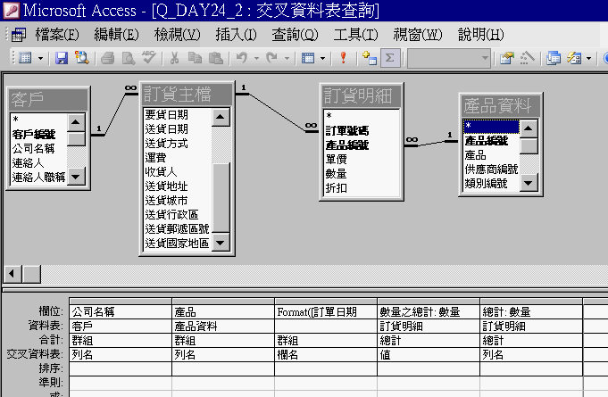

# 資訊系統與資料庫

從校園 Portal 到工廠 ERP——資料如何被蒐集、儲存、處理，最後變成支援決策的資訊

課程教材：[GitHub](https://github.com/billy1125/Introduction-of-Information-Technology)

---

## 前言：從校園系統談起

你每天都在使用一套資訊系統——**元智大學的 Portal 校務系統**。

用學號登入、查課表、看成績、繳選課志願，其實都是在和「資訊系統與資料庫」互動：

- 輸入學號密碼，系統到資料庫查帳號、比對密碼
- 查詢成績，系統彙整各科教師上傳的分數，計算平均並判斷是否及格
- 繳交選課志願，系統把資料寫進資料庫，再與其他學生的志願比對衝突

---

## 不懂資訊系統與資料庫，你可能會⋯⋯

- 遇到「系統維護中」「資料匯入失敗」只能乾等，不知道背後出了什麼問題
- 主管要你「去 ERP 拉一份上個月的生產報表」，你不知道報表從哪來、資料怎麼存
- 向 **資訊科技（Information Technology，IT）** 部門提需求，卻說不清要哪張表、哪個欄位、哪段時間
- 公司評估要換哪套 MES 或 ERP，你無法從系統架構的角度給出意見

---

## 懂資訊系統與資料庫，你可以⋯⋯

- 理解 **資訊系統（Information System，IS）** 的三層架構：使用者介面、應用邏輯、資料庫，判斷問題出在哪一層
- 知道「查詢成績」背後是一段 **結構化查詢語言（Structured Query Language，SQL）** 指令在資料庫執行
- 向 IT 部門說清楚：「我需要 A 資料表的 B 欄位，條件是 C，按照 D 排序」
- 評估 **企業資源規劃（ERP）**、**製造執行系統（MES）**、**顧客關係管理（CRM）** 時，能從資料流與系統整合的角度提問

> **理解資訊系統與資料庫，讓你從「系統使用者」走向「系統理解者」。**

---

## 你在 Portal 的操作，背後是什麼

| 你習以為常的功能 | 背後的資訊系統概念 |
|---|---|
| 輸入學號密碼登入 | 身分驗證與資料庫查詢 |
| 查詢課表 | 關聯式查詢（學生 × 課程 × 教室） |
| 查詢成績 | 資料彙整運算與條件判斷 |
| 繳交選課志願 | 資料寫入與衝突比對（交易處理） |
| 查詢出缺席 | 跨系統資料整合（簽到系統 → 校務系統） |

---

## 整個章節就一張圖


##### [大圖](https://github.com/billy1125/introduction-of-information-technology/blob/main/images/05-Information-Systems-and-Database/integration-of-is.png)
---

# 一、資料、資訊與資訊系統

整門課只在講一件事：把資料處理成資訊，再轉化成能支援決策的知識。本章處理的是這條路上的儲存與轉化——資料庫讓大量資料能被有系統地存放與查詢，資訊系統則把它整理成各層級決策需要的資訊。

本節先複習資料、資訊與知識的差別，再用「系統觀念」拆開資訊系統的骨架，最後看 AI 怎麼把這條轉化鏈往上推。

---

## 資料、資訊、知識（複習）

- **資料（Data）**：未經處理的原始事實，可以是數字、文字、符號、圖片或聲音，本身通常沒有明確意義
- **資訊（Information）**：資料經過整理、分析與脈絡化後，能提供意義、協助決策的結果
- **知識（Knowledge）**：資訊與經驗、專業判斷結合後，可反覆套用於類似情境的理解與能力

> **知識不只是「知道發生了什麼」，而是「理解為什麼發生，以及下次如何應對」。**

---

## 三者的差別

| | 資料 | 資訊 | 知識 |
|---|---|---|---|
| 定義 | 原始、未處理的事實 | 有意義、可用於決策的結果 | 可反覆套用的判斷能力 |
| 校園範例 | `58`、`張小明`、`缺席` | 「本學期平均 71 分，微積分 58 分未及格」 | 「期中考後缺席變多的學生，期末不及格比例偏高，應提早約談」 |
| 工業範例 | `26.1`、`467`、`OK` | 「14:00–15:00 溫度超標，良率下滑 4%」 | 「切削液流量不足時，午後會累積熱量而超標，調整流量約 30 分鐘可恢復」 |

---

<!-- ## 資料、資訊與知識的關係 -->


---

## 沒有電腦，也能把資料變成知識

以高中班導為例，只用紙筆也能完成三層轉換：

- **資料**：全班每學期三次段考的成績
- **資訊**：每學期結算一次的學習成果報表
- **知識**：分析好幾個學期的成績趨勢，預測學測可能的表現

不過紙筆作業相當費工。現在這些轉換多半交給電腦完成，做法就是建立 **資訊系統**。

---

## 什麼是資訊系統？

**資訊系統** 是一套將資料轉換成資訊、再將資訊轉變成知識的整合性系統。

理解它最好的切入點是 **系統觀念（Systems Concept）**，源自 **一般系統理論（General System Theory）**：任何系統，不論是一台機器、一條產線還是一套軟體，都能拆成「輸入 → 處理 → 輸出」，再加上支撐流程的 **儲存**，以及讓輸出反過來修正輸入的 **回饋**。

資訊系統，就是把系統觀念套用在「把資料變成資訊、再將資訊轉變成知識」這件事上，所有的資訊系統，都是這個系統觀念的實作。

---

<!-- ## 系統觀念 -->


---

## 系統觀念的五個環節

- **輸入（Input）**：蒐集原始資料，例如表單、感測器讀數、其他系統傳來的訊息
- **處理（Process）**：依規則運算、比對、彙整或篩選，把資料轉換成資訊
- **儲存（Storage）**：把資料與處理結果存進資料庫或檔案，供日後取用
- **輸出（Output）**：以報表、畫面、警報或訊息交給使用者或下一個系統
- **回饋（Feedback）**：把結果或使用者的反應送回輸入端，調整下一輪處理

> **輸入、處理、儲存、輸出再加上回饋，是現代資訊系統的基本標準型態。**

---

## 資訊系統無所不在

手機裡的 App、學校的 Portal、動輒上百個模組的 ERP，骨架都是同一套系統觀念。差別只在規模大小，以及輸入什麼資料、做什麼處理、輸出什麼資訊。

> **面對陌生系統，先問它輸入什麼、怎麼處理、存在哪裡、輸出什麼、如何回饋，就能抓到它的骨架。**

---

## 大系統，是由子系統串起來的

系統觀念有一個關鍵延伸：**一套系統的輸出，可以成為另一套系統的輸入**。多個系統這樣一個接一個串連，就組成規模更大的系統。

- **校園**：簽到系統的刷卡紀錄 → 校務系統的出缺席 → 導師輔導系統
- **工廠**：MES 的生產與品質資料 → ERP 計算成本與排程 → 倉儲系統進出貨

下一頁是 **美國退伍軍人事務部（United States Department of Veterans Affairs，VA）** 的財務管理系統框架：預算、會計、採購、支付等子系統彼此串接、資料互通。

---

<!-- ## 財務管理系統框架：大系統由子系統組成 -->


---

## 校園例子：圖書館借還書系統

- **輸入**：刷學生證、掃描書本條碼
- **處理**：比對借閱權限、計算應還日期
- **儲存**：把這筆借閱紀錄寫進資料庫
- **輸出**：螢幕顯示借閱明細、更新可借冊數
- **回饋**：逾期未還時寄出催還通知，你還書的動作又成為新的輸入

<!-- ## 圖書館借閱系統的個人借閱紀錄 -->


---

## 工業例子：工廠的生產報表系統

- **輸入**：各機台感測器資料、操作員手動輸入的產量紀錄
- **處理**：計算良率、**設備綜合效率（Overall Equipment Effectiveness，OEE）**、稼動率
- **儲存**：每日資料存入資料庫，供日後查詢與比對
- **輸出**：每日生產報表與異常警報
- **回饋**：管理者依報表調整生產參數，再反映到隔日的機台資料

---

## 從資訊到知識：過去卡在哪？（1/2）

很早傳統資訊系統能自動把資料變成資訊，例如將一個病患過去的健康檢查紀錄，轉變成圖表讓醫生判斷病情。但從資訊得出知識，長期要靠人的經驗與判斷。

雖然業界很早就嘗試讓電腦接手：

- **專家系統（Expert System，ES）**：把專家的判斷寫成「若…則…（If-Then）」規則，但規則只能靠人一條一條寫，例如：讓電腦自己看病患健康檢查紀錄，取代醫生判斷病情
- **知識管理系統（Knowledge Management System，KMS）**：集中保存文件與案例，但只能用關鍵字搜尋，例如：勞動法規的知識系統，你可以直接查詢若已在一家公司上班三年半，可以獲得多少特休日？

---

## 從資訊到知識：過去卡在哪？（1/2）

不過受限於當時的資料量與演算法，規則只能靠人一條一條寫，文件也只能用關鍵字搜尋，遇到沒寫進規則的狀況就無法判斷。

專家系統、知識管理系統過去始終沒能成為資訊系統的主流。

近年兩個條件改變了局面：**大數據（Big Data）** 提供足夠的歷史資料，**機器學習（Machine Learning，ML）** 讓電腦能從資料中自動歸納規律。

---

## 當代資訊系統的演進

- **自動化**：資料 → 資訊，系統彙整數字、產生報表、發出警報
- **智慧化**：資訊 → 知識，**AI 專家系統（AI-based Expert System）** 從資料中歸納判斷規則
- **自主化**：知識 → 行動，**AI 代理人（AI Agent）** 感知環境、擬定計畫、呼叫工具，並依結果持續修正

> **現在的資訊系統不只把資料處理成資訊，也逐漸能產生知識，甚至依知識採取行動。**

---

<!-- ## 資料、資訊、知識與 AI -->


---

## 資訊系統的組成要素

一套資訊系統不只有電腦和軟體，而是由 **硬體、軟體、人員、流程、資料** 五個要素共同組成。

> **導入資訊系統不只是買軟體，還要同步調整流程、訓練人員、整合資料。許多工廠導入 ERP 或 MES 失敗，問題出在人員與流程，而不是技術。**

---

<!-- ## 資訊系統的組成要素 -->


---

# 二、資訊系統的類型

一個組織裡通常同時運作好幾套資訊系統。要看懂它們各自的角色，最常用的做法是依服務的組織層級與用途，分成作業、管理、策略三個層次。

這套分類在 1960 至 1980 年代就已成形，至今仍是最清楚的框架，因為它依「決策的性質」切分，決策的層次不會因為技術更替而消失。本節逐層介紹各類系統，並補上大數據與 AI 對每一種系統的影響。

---

## 三個層級

| 層級 | 一句定義 | 例子 |
|------|---------|------|
| **作業層級（Operational）** | 服務第一線，處理日常、大量、重複的交易，是全組織的資料源頭 | 選課登記、庫存進出、生產紀錄 |
| **管理層級（Management）** | 服務中階主管，把作業層資料彙整成報表與分析 | 產能達成率報表、各系及格率統計 |
| **策略層級（Strategic）** | 服務高階主管，整合內外部資訊，支援長期方向性決策 | 是否增設產線、要不要跨足新市場 |

由下而上，資訊越濃縮、使用頻率越低，但每次決策的影響越大。

---

<!-- ## 資訊系統的層次 -->


---

## 三個層級是「地圖」，不是硬性歸類

- **誤會一：每種人只用某一層的系統。** 中階主管照樣登入作業系統填請假單，高階主管也會看每日營運日報。層次分的是「決策的性質」，不是「使用者的職級」
- **誤會二：每套系統只屬於某一層。** 現代系統越做越大，一套 ERP 就同時橫跨作業、管理、策略三層

> **請把這套分類當成理解資訊系統的地圖，而不是每套系統、每個人的硬性歸類。**

---

## 分類沒被 AI 推翻，而是被強化

當代的 AI 與大數據沒有推翻這套分類，而是讓每一層原本的功能變得更強：

- 作業層蒐集得更即時
- 管理層分析得更深入
- 策略層看得更長遠

接下來介紹每一種系統時，都會補上一行「大數據與 AI 的影響」。

---

## 作業層級：資料的源頭

作業層級處理日常、大量、重複的交易，例如每一筆訂單、每一次進出貨、每一張刷卡紀錄。上層看到的每一個數字，都是從這一層一筆一筆累積上來的。

它的資料 **不一定靠人輸入**：感測器自動回報溫度與轉速、條碼與 **無線射頻辨識（Radio Frequency Identification，RFID）** 讀取器自動記下物料進出、上游系統直接把訂單送進來。

判斷是不是作業層級，看的是它是否處理「日常、大量、重複的交易」，不是看交易由人還是機器產生。

---

## 垃圾進，垃圾出

操作員漏掃一批不良品，MIS 算出的良率就會虛高。因此企業導入系統時，會反覆推敲三個問題：

- **如何有效輸入**：減少人工鍵入，改用感測器或條碼自動採集
- **如何保證資料品質**：輸入當下就檢查格式、範圍與必填欄位
- **如何驗證資料正確**：交叉比對、異常偵測或人工抽查

> **垃圾進，垃圾出（Garbage In, Garbage Out，GIGO）：輸入錯誤的資料，再精密的報表也只是包裝過的錯誤。**

---

## 電子資料處理系統（EDP）

**電子資料處理系統（Electronic Data Processing，EDP）** 把人工的重複性資料處理工作自動化，核心目的是以電腦代替人工執行固定流程，提高速度與準確性。

- **校園**：每學期上千筆選課登記、成績登錄、學雜費繳費紀錄自動建檔與計算
- **工業**：物料入出庫紀錄、排班表計算、計件薪資核算
- **大數據與 AI 的影響**：資料放大到每日數百萬筆後，AI 能在建檔當下自動挑出重複或異常紀錄

---


## 交易處理系統（TPS）

**交易處理系統（Transaction Processing System，TPS）** 記錄企業最底層的日常交易，是 ERP 與 MES 的資料基礎。

最常見的 TPS 是商店櫃檯的 **銷售時點情報系統（Point of Sale，POS）**：店員刷條碼、跳出金額、印出收據的那一刻，一筆交易被完整記錄，同時扣庫存、累計營收、寫入明細。

---

## TPS 的三種處理方式

| 處理方式 | 說明 | 校園範例 | 工業範例 |
|---------|------|---------|---------|
| **批次處理（Batch Processing）** | 累積資料後一次處理 | 學期末一次結算全校成績 | 班次結束後一次計算所有機台 OEE |
| **分時處理（Time-Sharing）** | 多人同時共用系統資源 | 上千名學生同時上線選課 | 多條產線同時向 MES 回報進度 |
| **即時處理（Real-Time Processing）** | 收到資料後立即處理 | 刷卡進圖書館，門禁立即驗證 | 感測器偵測異常後立即觸發警報 |

**大數據與 AI 的影響**：交易即時串流進資料庫，AI 能在毫秒間判斷是否異常（如盜刷）並攔截。

---

## 管理層級：把交易變成報表

管理層級把作業層累積的交易資料彙整、分類、統計，轉成主管看得懂、用得上的報表與分析，例如上週的產能達成率、這個月的成本結構、各產線的良率排名。

它服務的是課長、廠長、部門經理這些既要盯第一線、又要向上負責的中階主管。這一層從回顧過去的例行報表，延伸到分析方案、累積組織知識，以及給出專家般的判斷，涵蓋 MIS、DSS、KMS、ES 四種系統。

---


## 管理資訊系統（MIS）

**管理資訊系統（Management Information System，MIS）** 把 TPS 的大量交易資料彙整成定期報表。TPS 是逐筆記帳的「記帳員」，MIS 就是把流水帳整理成月報、季報的「彙整者」。

- **結構固定、定期產生**：日報、週報、月報，時間到了自動生成
- **處理已發生的資料**：回答「上週產能達成率多少」這類回顧性問題
- **任務是監督與控制**：拿實際結果對照計畫，及早發現偏差

---

## MIS 在忙什麼

- **校園**：教務處彙整各班成績，產出「各系及格率」「必修課當掉人數」「新生註冊率」
- **工業**：每週產能達成率報表、各機台不良品統計、原物料消耗分析
- **大數據與 AI 的影響**：報表從定期產出走向即時彙整，還能用自然語言回答「這週哪條線最該注意」

> **MIS 回答的是「發生了什麼」，讓作業層資料看得見、管得住。**

---


## 決策支援系統（DSS）

**決策支援系統（Decision Support System，DSS）** 協助處理較複雜、非例行的半結構化決策。

MIS 把資料整理成報表，回答「發生了什麼」；DSS 更進一步，透過模擬、情境分析與多方案比較，回答「該往哪個方向走、哪個方案比較好」。

例如輸入「漲價 10%」「換供應商」「調整產品組合」等假設，DSS 模擬出各方案的預期結果。

---

## 生活中的 DSS：Google 財經

投資人常用的 Google 財經就具備 DSS 的功能：

- 左側可切換時間區間、疊加其他標的比較走勢、加上技術指標
- 右側「研究」面板以 **大型語言模型（Large Language Model，LLM）** 為核心，用文字提問，AI 就把分析寫成文字回答，還能繼續追問

> **有了 LLM，DSS 開始能寫出決策建議，但最後拍板的仍是使用者自己。**

---

<!-- ## Google 財經的 VT 個股頁面 -->


---

## 研究機構的 DSS：約翰戴水庫

**美國地質調查局（United States Geological Survey，USGS）** 為約翰戴水庫（John Day Reservoir）建置的決策支援系統，搭配二維水力模型，評估水位與放流量變化對棲地的影響。

研究人員勾選不同的水位、放流量與水力特徵組合，系統就在地圖上畫出對應結果——這正是 DSS「模擬不同情境、比較方案」的典型用法。

---

<!-- ## 約翰戴水庫決策支援系統畫面 -->


---

## DSS 的三個部分

- **資料庫**：內部的銷售、成本、庫存紀錄，以及外部的市場行情、原物料價格
- **分析工具**：又稱模型庫，用統計模型、模擬工具、AI 模型或大型語言模型算出各情境的結果
- **使用者介面**：讓決策者輸入假設、調整參數，互動比較方案

決策者在介面輸入「如果⋯⋯會怎樣」，分析工具從資料庫取資料計算，再把結果送回介面。

---

<!-- ## DSS 概念 -->


---

## DSS 的應用

- **校園**：把某門必修從大二下移到大三上，會不會拉低畢業率、又會不會衝堂？
- **工業**：若原料漲價 15%，是否應調整生產組合？
- **大數據與 AI 的影響**：迴歸、時間序列等傳統統計模型仍是主力，另外加入機器學習預測模型，能吸收更多外部資料、處理非線性關係

---

## 知識管理系統（KMS）

**知識管理系統** 蒐集、整理、保存與分享組織內的知識資產。知識分成兩類：

- **內隱知識（Tacit Knowledge）**：個人經驗、技巧與判斷，難以文字化，例如資深工程師對設備異音的判斷
- **外顯知識（Explicit Knowledge）**：可文件化、可分享，例如設備操作手冊、故障排除 **標準作業程序（Standard Operating Procedure，SOP）**

---

## 早期的 KMS：數位檔案庫

早期 KMS 把文件、手冊、案例報告集中存放，建立分類與關鍵字索引，讓員工需要時搜尋調閱。

- **侷限**：得先猜對關鍵字，文件還得有人事先整理歸檔；散落在 PDF、簡報、會議錄音裡的知識往往搜不到
- **身邊的例子**：[元智大學秘書室的校內法規知識庫](https://www.yzu.edu.tw/admin/so/index.php/tw/regulation)，把各類規章依類別整理成文件。資料齊全、分類清楚，但「找」跟「讀」都得靠你自己

---

## 現代 KMS：RAG 與 LLM

**檢索增強生成（Retrieval-Augmented Generation，RAG）** 與 LLM 加入後，KMS 有了明顯改變：

- 資料庫、文件、影音逐字稿統一轉成向量，依「意思相近」而非「字面相同」檢索
- 使用者用自然語言提問，系統撈出相關片段，交給 LLM 整理成附引用來源的回答

> **知識的取用從「搜尋關鍵字、自己讀文件」變成「直接問、直接得到整理好的答案」。**

---

<!-- ## RAG 為基礎的 KMS -->


---

## KMS 的應用

- **校園**：系上的助教經驗共享區、歷屆考古題與解題筆記庫，讓新任助教與學弟妹快速上手
- **工業**：設備故障案例知識庫，記錄歷次故障的現象、診斷過程與解決方法，新進工程師查詢後能更快處理類似問題
- **大數據與 AI 的影響**：LLM 能把散落在各案例中的重複現象歸納成新的故障模式或最佳實務，讓知識庫自己長出新內容

---

## 真實世界：系辦被砍，改問 AI

2026 年 9 月，[世新大學把各系系辦整併成聯合院辦](https://tw.news.yahoo.com/%E7%B3%BB%E8%BE%A6%E8%A2%AB%E7%A0%8D-%E6%94%B9%E5%95%8Fai-%E5%AD%B8%E7%94%9F%E6%8A%B1%E6%80%A8%E9%80%A3%E9%80%A3-%E4%B8%96%E6%96%B0%E5%A4%A7%E5%AD%B8-%E5%9B%9E%E6%AD%B8-134642655.html)，每系只留 1 位院秘，法規查詢、FAQ、表單導引改交給 AI 處理——一套標準的 RAG 為基礎的 KMS。

- **學生的抱怨**：問院辦常得不到答案，只能自己找老師、在各單位之間奔走
- **AI 的表現**：機器人還回出「16>22」這種明顯錯誤的答案

> **想一想：這套 KMS 能取代系辦秘書的真人服務嗎？**

---


## 專家系統（ES）

專家系統模擬特定領域的專家判斷，由三個部分構成。以 AI 醫療診斷為例：

- **知識庫（Knowledge Base）**：醫師累積的判斷規則，如「發燒＋咳嗽＋X 光陰影 → 高度懷疑肺炎」
- **推理機（Inference Engine）**：把病人的症狀一條條套進規則，推導最可能的結論
- **使用者介面（User Interface，UI）**：讓醫師輸入症狀、看到可能病名與建議

它不取代醫師，而是替醫師縮小範圍、提醒容易漏掉的可能性。

---

## 專家系統的來頭與限制

專家系統是 1980 年代第二波 AI 浪潮的主角。1970 年代史丹佛大學的 **MYCIN** 能推薦抗生素療法，測試準確率勝過部分醫師，卻從未用於臨床，因為沒人能回答「開錯藥，責任算誰的」。

- 專家的經驗難以逐條寫成規則
- 超出預設領域就容易出錯
- 規則一多就難以維護，也無法從新案例中自我學習

這些限制讓專家系統在 1990 年代的「AI 寒冬」沉寂，直到機器學習與 LLM 出現才以新面貌回到應用中。

---

## 專家系統的應用

- **校園**：選課諮詢系統依「先修科目規則」與「畢業學分規則」推理，推薦下學期該修哪些課
- **工業**：操作員輸入「主軸振動加大、電流升高、表面粗糙」，系統推理出「刀具磨耗，建議更換並複查主軸軸承」
- **大數據與 AI 的影響**：判斷規則不再全靠專家手寫，機器學習能從大量歷史案例中自動歸納

---

## ES、DSS 與 KMS 的比較

三者的分界在於決策交給誰，以及輸出是什麼：

| | ES | DSS | KMS |
| --- | --- | --- | --- |
| 目的 | 模擬特定領域專家的判斷 | 協助分析半結構化決策 | 蒐集、儲存、分享組織知識 |
| 輸出 | 結論或建議，可附推理過程 | 分析結果與情境比較 | 相關文件、案例或可詢問的人 |
| 決策者 | 系統（人可採納或否決） | 人 | 人（系統不涉入決策） |
| 例子 | 醫療診斷、設備故障排除 | 預算規劃、生產排程 | 企業知識庫、常見問題（FAQ） |

---

## 策略層級：看全局，也把資訊當武器

策略層級服務站在組織最高點的高階主管，提供跨部門、跨廠區甚至跨市場的整體視野，例如該不該蓋新廠、要不要進軍新市場。

這類決策沒有標準答案、影響長達數年。這一層的系統一面把內外部資訊濃縮成一眼看得懂的全局，一面把資訊科技本身當成競爭武器，涵蓋 EIS 與 SIS。

---


## 主管資訊系統（EIS）

**主管資訊系統（Executive Information System，EIS）** 整合內部 MIS、DSS 資料與外部市場資訊，為沒時間看細節的高階主管打造：

- **高度摘要與視覺化**：上萬筆數字濃縮成少數指標與紅綠燈號
- **支援逐層鑽取（drill-down）**：紅燈亮起時，從全公司一路追到單一產線
- **重視例外與趨勢**：主動凸顯異常與變化，不平鋪正常數字

---

## EIS 很像「站得更高的 MIS」

兩者都是把下層資料摘要成綜觀資訊，差別在服務對象與摘要程度：

- **MIS** 服務中階主管，整理某個部門或產線的例行報表
- **EIS** 服務最高層，把整個組織、甚至跨廠跨國的資料濃縮成儀表板

> **作業、管理、策略是幫助理解的地圖，實務上相鄰層級的系統往往界線模糊、彼此重疊。**

---

## EIS 的應用

- **校園**：教務長透過校務儀表板，看全校各系的註冊率、休退學率、師生比與畢業生就業率
- **工業**：集團董事長一眼看到全球三座工廠的即時產能、良率、庫存水位與成本差異
- **大數據與 AI 的影響**：儀表板從每日更新走向即時串流，AI 能主動預警異常趨勢

---

## 策略資訊系統（SIS）

**策略資訊系統（Strategic Information System，SIS）** 整合內部營運與外部市場、競爭環境資訊，支援企業識別策略機會。

MIS、DSS、EIS 都在「把公司管好」，眼睛向內看；SIS 則把資訊系統當成 **競爭武器**，用它改變公司在市場上的地位，築起對手一時跨不過的門檻。

---

## SIS 的經典例子

- **美國航空 SABRE**：把訂位終端機鋪進全美旅行社，搶先掌握消費者訂票的入口
- **沃爾瑪**：即時串連門市與供應商的補貨系統，把庫存與物流成本壓到同業難以匹敵，撐起「天天低價」
- **校園**：學校分析少子化與各校招生競爭，搶先設立熱門科系或整併招生不足的系所
- **大數據與 AI 的影響**：AI 即時分析輿情、市場與供應鏈資料，讓趨勢預測與風險預警更快、更全面

> **SIS 的價值不在產出報表，而在替企業取得對手追不上的結構性優勢。**

---


---

# 三、企業應用系統

前一節是依決策層級由下而上看資訊系統；換到企業經營的立場，還能依管理功能橫向劃分。層級面問「決策有多重大」，功能面問「這是哪個部門、管哪一塊業務」，兩者像是對同一套系統做縱切與橫切。

本節從整合各部門的 ERP 談起，再介紹把整合延伸到工廠現場、上游供應商與下游顧客的 MES、SCM 與 CRM。

---

## 五管與 ERP 的由來

企業管理常把公司運作歸納成「五管」：**生產、行銷、人力資源、研發、財務**。每一塊都有對應的資訊系統，多半是各部門為了自己的業務各自發展出來的。

系統一多，部門之間的資料就難以互通、經常重複輸入。**企業資源規劃（Enterprise Resource Planning，ERP）** 正是為此而生：把各自為政的系統整合起來，讓資料一次輸入、全公司共用。

---

## 企業資源規劃（ERP）

ERP 是以企業功能為觀點，對組織進行 **模組化** 與 **整合** 的企業應用系統：

- **模組化**：把生產、採購、庫存、銷售、財務、人力資源各自做成獨立模組
- **整合**：讓這些模組共用同一套資料，串成連貫的資訊流

代表性產品：SAP S/4HANA、Oracle ERP、Microsoft Dynamics 365。

---

<!-- ## 企業資源規劃 -->


---

## ERP 的核心價值：打破資訊孤島

過去採購部門不知道生產計畫、財務部門不知道庫存成本，各看各的資料；整合之後，資訊即時流通，全公司據以決策的是同一份資料。

公司小、部門單純時，幾套獨立的小軟體就夠用；規模擴大、跨部門流程越來越糾纏，才真正需要 ERP。

> **一套 ERP 的資訊流程，幾乎就等於這家公司的營運模式。**

---

## 導入 ERP：改的不只是軟體

大型企業導入 ERP 時，通常在兩條路之間抉擇：

- **量身打造**：雇用顧問或軟體廠商，讓系統貼合既有的作業流程
- **直接套用**：採用產品內建的「最佳實務」，反過來調整自己的作業去配合它

不論哪一條，ERP 動到的都是企業最核心的營運邏輯。一旦失敗，輕則系統形同虛設，重則衝擊日常營運。

> **導入 ERP 常常不是裝軟體，而是改組織。**

---

## ERP 廠商：不只有外商

- **SAP**：全球最大的 ERP 廠商，德國公司，1972 年由五位前 **國際商業機器公司（International Business Machines，IBM）** 工程師創立
- **鼎新電腦（Digiwin）**：台灣本土規模最大的 ERP 廠商，成立於 1982 年，產品涵蓋中小企業到大型製造業
- **本土廠商的優勢**：更貼近台灣中小企業的作業習慣與在地法規（如統一發票、報稅格式），導入成本通常較低

---

## ERP 不一定就叫「ERP」

只要把多個部門的功能整合進同一套系統、共用同一份資料，就是 ERP，名稱與場域都不限：

- **公司**：常直接叫產品名稱（「上 SAP 開單」「用鼎新查庫存」）；「進銷存系統」是只有採購、銷售、庫存的精簡版 ERP
- **學校**：元智大學 Portal 要打通教務、學務、總務、人事與會計，某種程度上就是校園版的 ERP
- **政府機關**：把各科室的行政、公文與預算串在一起，稱為 **政府資訊系統（Government Information System）**
- **醫院**：掛號、批價、檢驗、藥局到病歷全部整合，稱為 **醫院資訊系統（Hospital Information System，HIS）**

> **判斷依據是有沒有把多個部門整合在同一份資料上，而不是名稱。**

---

## 圍繞 ERP 的三套系統

ERP 擅長整合企業內部，但公司不會關起門來運作：上游有供應商、下游有顧客，工廠裡還有一台台機器。三套系統各自把整合延伸到一個方向：

- **MES 向下**：把 ERP 的生產計畫落實到工廠現場的每一台機台
- **SCM 向上游**：把整合延伸到供應商與物料採購
- **CRM 向下游**：把整合延伸到顧客與市場需求

> **ERP 顧內部，MES 顧生產，SCM 顧供應，CRM 顧顧客。**

---

## 製造執行系統（MES）

**製造執行系統（Manufacturing Execution System，MES）** 位於 ERP（計畫層）與 **可程式邏輯控制器（Programmable Logic Controller，PLC）**、**資料採集與監控系統（Supervisory Control and Data Acquisition，SCADA）**（控制層）之間，負責管理工廠車間的即時執行狀況。

> **MES 是工業4.0「垂直整合」的關鍵中間層：向上對接 ERP 的計畫，向下連結機台的即時資料。**

---

## MES 的功能

| 功能 | 說明 |
|------|------|
| 工單管理 | 接收 ERP 下達的工單，分解為具體生產任務 |
| 排程派工 | 即時排程，分配工作到各機台 |
| 生產追蹤 | 即時掌握每張工單的進度 |
| 品質管理 | 記錄量測結果，支援品質追溯 |
| OEE 計算 | 即時計算設備綜合效率 |

---

## 供應鏈管理（SCM）

**供應鏈管理（Supply Chain Management，SCM）** 管理產品從原料到消費者的整個流程，整合供應商、製造商、物流商與銷售端，讓供應鏈能更有效率地規劃、控制與協作。

**工業應用**：MES 回報某原料即將耗盡，SCM 自動計算補貨量、向合格供應商詢價，再依庫存策略決定是否下單，整個流程幾分鐘內完成，不需人工介入。

---

## 顧客關係管理（CRM）

**顧客關係管理（Customer Relationship Management，CRM）** 蒐集與分析顧客資料，協助企業掌握顧客偏好、改善行銷與銷售流程、提升顧客滿意度。

| CRM 類型 | 說明 |
|---------|------|
| **操作型** | 自動化銷售、行銷與客服流程 |
| **分析型** | 分析顧客行為與偏好，支援行銷決策 |
| **協作型** | 整合電話、Email、門市等接觸點的顧客互動紀錄 |

---

# 四、資料庫基礎概念

不論哪一種資訊系統，做的事都是把資料轉換成資訊、再轉換成知識，所以每一套系統都得先回答：資料要存在哪裡、由誰來管？

早期資料分散成一個個獨立檔案，同一筆資料常存好幾份，改了一處漏了另一處就對不起來。現代資訊系統把資料集中存進資料庫，同一筆資料只存一份，由專門的軟體統一管理。

系上也有開設「資料庫管理系統」課程，若同學需要深入學習，建議在大二可以選修該課程。

---

## 資料的層級

資料在電腦裡由小到大分成五個層級：

- **字元（Character）**：一個數字、字母或符號
- **欄位（Field）**：一個屬性，例如「學號」「機台編號」
- **紀錄（Record）**：多個相關欄位的組合，例如一位學生的完整資料、一筆工單
- **資料表（Table）**：同類紀錄的集合，例如學生資料表、工單資料表
- **資料庫（Database）**：一個或多個彼此相關資料表的集合，可供不同使用者與程式共享

---

<!-- ## 資料的層級 -->


---

## 實際看一張資料表

下一頁是在 **Microsoft Access** 裡打開的「產品資料」資料表：

- 每一列是一筆 **紀錄**（一項產品）
- 每一欄是一個 **欄位**（產品編號、產品、單價等）
- 視窗下方顯示共有 77 筆紀錄

多張資料表放在同一個檔案、透過欄位互相關聯，就是一個資料庫。Portal 背後的校務資料庫，就是用學號、課程代碼把學生、課程、成績三張表連在一起。

---

<!-- ## Microsoft Access 的產品資料表 -->


---

## 一整個資料庫：多張表加上關聯

下一頁是同一個 Access 檔案的查詢設計畫面：

- 上半部是「客戶」「訂貨主檔」「訂貨明細」「產品資料」四張資料表，以連線串在一起
- 連線兩端的 1 與 ∞ 表示對應筆數（∞ 代表「多」）：一位客戶有多張訂單，一張訂單有多筆明細，多筆明細指向同一項產品
- 下半部是利用這些關聯設計的查詢，統計每位客戶在不同期間各訂購了多少產品

> **四張資料表加上它們之間的關聯，合起來才是一整個資料庫**

---

<!-- ## Microsoft Access 的查詢設計畫面 -->



---

## 資料是怎麼被管理的

1. **資料寫死在程式裡**：資料少時最省事，但資料一改就得改程式、重新編譯
2. **資料搬進獨立的檔案**：把「怎麼處理」的資料（程式）和「被處理」的資料分家，改資料不必動程式
3. **交給資料庫系統**：檔案多到管不動，就比照 **作業系統（Operating System，OS）** 的做法，用一套軟體把資料存取的複雜性一手包下

ERP、MES、CRM 能彼此共用同一份資料，靠的就是資料庫系統。

---

<!-- ## 為什麼需要資料庫 -->


---

## 資料庫、DBMS 與資料庫系統

三個名詞範圍不同，是層層包含的關係：

| 名詞 | 角色 | 說明 |
|------|------|------|
| **資料庫（Database，DB）** | 資料本身 | 長期儲存、有組織且彼此關聯的資料集合 |
| **資料庫管理系統（Database Management System，DBMS）** | 管理資料庫的軟體 | 建立、維護、操作與管理資料庫 |
| **資料庫系統（Database System，DBS）** | 完整的運作環境 | 資料、軟體、硬體、人員四要素的整體 |

---

## DBMS 與資料庫系統在做什麼

- **DBMS**：一切查詢、新增、刪除都要透過它，由它統一處理權限控管、資料安全、備份還原與 **並行控制（Concurrency Control）**
- **常見的 DBMS**：MySQL、PostgreSQL、Oracle Database、Microsoft SQL Server
- **資料庫系統**：除了資料與 DBMS，還包含伺服器等硬體、網站後端等應用程式，以及操作與維護它的人員

> **資料庫系統裡的「人」在大公司是正式職務，稱為資料庫管理員（Database Administrator，DBA）。**

---

## 用圖書館來想

| 名詞 | 在圖書館裡相當於 | 說明 |
|------|------|------|
| **資料庫** | 書架與所有藏書 | 書籍本身與保存書籍的書架 |
| **DBMS** | 圖書館管理規定 | 借還、上架、盤點、控管進出都依規定進行 |
| **資料庫系統** | 整座運作中的圖書館 | 建築、藏書、管理機制，再加上館員，缺一不可 |

日常口語常把整套系統都叫「資料庫」，本章往後也沿用這個習慣。

---

## 開源的 DBMS：MySQL

DBMS 有商業軟體，例如 Oracle、Microsoft SQL Server；也有 **開放原始碼（Open Source）**、可免費使用的軟體。

**MySQL** 是目前最常見的開源免費 DBMS。全球大量網站採用的 **WordPress**，背後就是用 MySQL 存放每一篇文章與留言。下一頁是用管理工具打開 WordPress 網站的 MySQL 資料庫，每篇文章一列一列存放在資料表裡。

---

<!-- ## WordPress 網站的 MySQL 資料庫 -->


---

## 使用資料庫的優點

這些好處都來自同一個關鍵：**同一筆資料只存一份、大家共用**。

| 優點 | 說明 |
|------|------|
| **資料共享** | 同一份資料供多個部門與系統使用 |
| **避免重複** | 只存一份，不會各部門各自維護不同版本 |
| **維持一致性** | 修改一處，全系統同步更新 |
| **資料獨立** | 資料結構改變不影響應用程式運作 |
| **安全控制** | 依角色設定存取權限，保護敏感資料 |
| **標準化** | 統一欄位名稱、格式與單位，便於跨系統整合 |

---

## 只存一份的好處

- **校園**：地址電話若分別存在教務處、學務處、圖書館的 Excel，搬家就得通知三個單位；集中到校務資料庫後，在 Portal 改一次就全校生效
- **工廠**：同一項庫存，品管記 500 個、倉庫記 430 個、生產記 480 個；導入 ERP 與資料庫後只剩一份，不再矛盾
- **遊戲**：角色、裝備、背包都存在伺服器的資料庫，換電腦登入角色不變；交易道具只是把紀錄從你的背包移到對方的背包

> **三個例子講的都是避免重複與維持一致性。**

---

## 遊戲情境：伺服器怎麼讀寫資料表

換上一把新武器時，伺服器接收操作、重新計算攻擊力，再把結果寫回「角色」「裝備」「背包」三張資料表；下次打開角色畫面，數值也是從這些表讀出來的。

三張表都記著同一個角色編號 RoleID 1001，資料庫靠這個欄位把它們串成同一個角色。做法的細節見〈五、資料庫模型〉。

---

<!-- ## 遊戲情境：伺服器讀寫角色、裝備、背包資料表 -->


---

## 資料還在長大：邁向大數據

資料庫解決了「怎麼把資料管好」，但資料本身還在快速增加，種類也越來越雜：

- **量**：中大型企業或網路平台的資料，常以 **TB（terabyte，兆位元組）**、甚至 **PB（petabyte）** 計算
- **型態**：除了文字與數字，還有圖片、影片、語音、3D 模型與感測器串流，很難放進關聯式資料庫的二維表格

當資料的規模與複雜度超過傳統資料庫的負荷，就出現了 **大數據** 的觀念，詳見〈八、大數據如何改變資訊系統〉。

---

# 五、資料庫模型

資料庫技術的演進，藏在幾種資料庫模型的更替裡。1960 年代的階層式與網狀模型結構複雜、牽一髮動全身；1970 年 IBM 研究員 Edgar F. Codd 提出關聯式模型，改用人人看得懂的二維表格存放資料，1980 年代起成為主流，一路使用至今。

本節依這條由繁入簡的順序介紹各種模型，最後談關聯式不夠用時登場的 NoSQL。

---

## 早期模型：階層式與網狀

在關聯式資料庫普及之前，主要有兩種模型，如今多已退居幕後：

- **階層式資料庫（Hierarchical Database）**：資料組織成 **樹狀結構**，一個父節點可有多個子節點，但子節點只能有一個父節點。結構清楚、查詢快，但無法表達多對多關係
- **網狀式資料庫（Network Database）**：改用 **圖形結構**，允許多個父節點，能處理多對多關係；代價是關係複雜、維護困難

IBM 為阿波羅登月計畫開發的資訊管理系統（Information Management System，IMS）就是這個時代的代表。

---

## 關聯式資料庫

**關聯式資料庫（Relational Database）** 是目前最主流的資料庫模型，以 **二維表格** 儲存資料。每張資料表由列（紀錄）與欄（欄位）構成，不同資料表之間透過共通欄位建立關聯。

> **IBM 起初對 Codd 的關聯式構想興趣缺缺，反而讓一家小公司搶先商品化，那家公司後來叫做甲骨文（Oracle）。**

Codd 在 1981 年獲頒電腦界最高榮譽的 **圖靈獎（Turing Award）**，被稱為關聯式資料庫之父。

---

## 用選課與成績來看

三張表各管一件事：

- **學生資料表**：每個人的基本資料
- **課程資料表**：每門課的名稱與學分
- **選課成績資料表**：誰修了哪門課、得幾分，同時記著學號與課程代碼

查「S1101 修了哪些課、各得幾分」：從選課成績表找出 S1101 的紀錄，再透過學號取得姓名、透過課程代碼取得課程名稱。姓名、課程名稱都不必在成績表裡重複儲存。

---

<!-- ## 學生、課程、選課成績三張表的關聯 -->


---

## 同樣的結構，搬到工廠

把「學生」換成「機台」、「課程」換成「產品」、「選課成績」換成「工單」，結構完全一樣。

想知道「WO1001 是哪台機器做的、在哪條產線、做的是什麼產品」，從工單資料表找到 WO1001，再透過機台編號、產品代碼查另外兩張表即可。

機台與產品的資料各存一份，不必在每張工單上重複抄寫。

---

<!-- ## 機台、產品、工單三張表的關聯 -->


---

## 主鍵與外來鍵

- **主鍵（Primary Key，PK）**：唯一識別每筆紀錄的欄位，不能重複、不能空白，例如「學號」「工單編號」。找不到現成不重複的欄位時，就另外補一個「流水號」
- **外來鍵（Foreign Key，FK）**：其值對應另一張資料表的主鍵，用來建立表格間的關聯，例如成績表的「學號」、工單表的「機台編號」

實務上建表之前，會先用 **實體關係模型（Entity-Relationship Model，ER 模型）** 把「有哪些資料表、怎麼關聯」在圖上規劃清楚。

---

<!-- ## 實體關係模型（ER 模型） -->


---

## 關係的三種類型

ER 圖中每個方框是一個 **實體（Entity）**，對應一張資料表；方框之間的連線是 **關係（Relationship）**。依兩邊對應的筆數分成三種：

- **一對一（1:1）**：一個角色只有一個背包，一個背包也只屬於一個角色
- **一對多（1:N）**：一個玩家帳號可以建立多個角色，每個角色只屬於一個帳號
- **多對多（M:N）**：一個角色可以裝備多件物品，同一件物品也可以被多個角色裝備

> **多對多要在中間加一張表，拆成兩個一對多；選課成績表就是學生與課程之間的中間表。**

---

<!-- ## 遊戲資料庫的 ER 圖 -->


---

## 為什麼要拆得這麼細

遊戲資料庫裡，物品的名稱、類型、攻擊力只在「物品」表存一份，「角色裝備」與「背包物品」兩張中間表都只記物品編號 ItemID。

遊戲公司要調整「勇者之劍」的攻擊力時，只要改「物品」表一處，所有持有這把劍的角色就同步生效。

---

## 物件導向式資料庫

**物件導向式資料庫（Object-Oriented Database）** 把現實世界的實體視為 **物件**，物件包含資料（屬性）與行為（方法）。

適合處理大型、複雜或多媒體型的資料，例如工業相機的影像與標注資料。不過在一般企業應用中，關聯式資料庫仍是主流。

---

## NoSQL：當關聯式不夠用的時候

關聯式資料庫有個前提：**資料要先套進固定的表格結構**。工業4.0與物聯網的資料常常不符合這個前提：

- **格式很雜**：感測器數值、機台日誌文字、產品影像混在一起
- **數量爆炸**：一座工廠可能有數百萬個感測器不停寫入
- **結構會變**：這台機器回報 5 個參數、那台回報 12 個，欄位對不齊
- **速度要求高**：資料得在毫秒之間寫進去

---

## NoSQL 是什麼

**NoSQL** 是「非關聯式資料庫」的統稱，不是單一產品。

它最大的特點是 **不要求固定的表格結構**：資料可以像一份份文件、一組組鍵值或一張張關係圖那樣彈性存放，多一個欄位、少一個欄位都沒關係，也更容易靠增加伺服器來分攤大量資料。

**校園例子**：學號與成績是結構整齊的關聯式資料；校園 App 的貼文、社團照片、系統操作日誌格式雜、數量大，就適合交給 NoSQL。

---

## 關聯式與 NoSQL：不是對立，而是分工

| 面向 | 關聯式資料庫 | NoSQL |
|------|------------|-------|
| 資料結構 | 固定表格結構 | 彈性，可動態調整 |
| 查詢語言 | 標準 SQL | 各系統各有不同 |
| 一致性 | 強一致性（Strong Consistency） | 通常為最終一致性（Eventual Consistency） |
| 擴展方式 | 垂直擴展（升級單一伺服器） | 水平擴展（增加伺服器數量） |
| 適用場景 | 結構化、交易型資料（ERP、MES） | 大量、快速、非結構化資料（IoT、日誌） |

現代工廠往往兩種並用：關聯式存 ERP、MES 的業務資料，NoSQL 存感測器時序資料與影像分析結果。

---

# 六、SQL——資料庫的標準語言

**SQL（Structured Query Language，結構化查詢語言）** 是操作關聯式資料庫的標準語言。不論用的是 MySQL、Oracle 還是 SQL Server，查詢、新增、修改、刪除都是用 SQL 寫成，交給 DBMS 執行。

本節說明程式怎麼透過 SQL 和資料庫溝通、SQL 的四大類指令，再用校園與工廠的例子看懂最常用的 `SELECT` 查詢。

---

## 程式怎麼跟資料庫溝通

程式要撈資料，不是直接叫資料庫把東西吐出來，而是在程式裡放一段 SQL，交給 DBMS 執行後，再把結果回傳給程式。

正因為有 SQL 這個共通標準，Python、Java、PHP 等各種程式語言，才能和 MySQL、Oracle、SQL Server 等各種資料庫串接在一起。

---

<!-- ## 應用程式送出 SQL，DBMS 回傳結果 -->


---

## SQL 的四大類

| 類型 | 全名 | 用途 | 常見指令 |
|------|------|------|---------|
| **DDL** | 資料定義語言（Data Definition Language） | 定義資料表結構 | `CREATE`、`ALTER`、`DROP` |
| **DML** | 資料處理語言（Data Manipulation Language） | 新增、修改、刪除資料 | `INSERT`、`UPDATE`、`DELETE` |
| **DCL** | 資料控制語言（Data Control Language） | 管理存取權限 | `GRANT`、`REVOKE` |
| **DQL** | 資料查詢語言（Data Query Language） | 查詢資料 | `SELECT` |

實際工作中最常用的是 `SELECT` 查詢。

---

## SELECT 查詢範例

找出這學期分數低於 60 的選課紀錄，並由低到高排列：

```sql
SELECT 學號, 課程代碼, 分數
FROM 選課成績
WHERE 分數 < 60
ORDER BY 分數 ASC;
```

`SELECT` 選要顯示的欄位，`FROM` 指定資料表，`WHERE` 設定篩選條件，`ORDER BY` 決定排序（`ASC` 由小到大）。

---

## SELECT 查詢結果

查詢結果可能如下（數據為示意），分數由低到高排列：

| 學號 | 課程代碼 | 分數 |
|---|---|---|
| S1107 | IE201 | 38 |
| S1102 | IE202 | 45 |
| S1115 | IE203 | 52 |
| S1123 | IE201 | 58 |

---

## 同一套語法，搬到工廠也通

查出今日良率低於 95% 的生產線，並由低到高排列：

```sql
SELECT 生產線名稱, 良率, 班次
FROM 生產紀錄
WHERE 日期 = '2025-05-21'
  AND 良率 < 0.95
ORDER BY 良率 ASC;
```

> **SQL 原名 SEQUEL，因為和一家英國飛機公司的商標撞名才改名，所以「sequel」和「S-Q-L」兩種唸法都對。**

---

## 工廠良率查詢結果

查詢結果可能如下（數據為示意）。良率在 95% 以上的生產線不符合條件，不會出現在結果裡：

| 生產線名稱 | 良率 | 班次 |
|---|---|---|
| C 線 | 0.874 | 夜班 |
| B 線 | 0.912 | 夜班 |
| A 線 | 0.931 | 中班 |
| D 線 | 0.946 | 早班 |

---

## 為什麼工業工程管理的學生要懂 SQL？

- **資料都在資料庫裡**：訂單、庫存、生產、品質資料都存在 ERP、MES 背後的資料庫，**商業智慧（Business Intelligence，BI）** 報表上的數字也是用 SQL 查出來的
- **報表只是整理過的結果**：資料庫裡才有原始資料，以及資料表怎麼關聯、數字怎麼計算的商業邏輯
- **能把需求講清楚**：看得懂 SELECT、FROM、WHERE，就能說明要哪些欄位、哪張表、什麼條件
- **能看懂 BI 報表**：判斷數字是從哪些資料、用什麼條件算出來的，避免誤讀

---

## 為什麼會出現 NoSQL？

SQL 的結構對應關聯式資料庫的固定表格：查詢精準、資料一致，但每一筆資料都得照事先定好的格式排好。

資料一旦變得巨量、格式雜亂、又要快速寫入，這套嚴謹反而成了限制。把這個限制推到極致的，就是〈八〉要談的大數據。

> **資料大到、雜到某個程度，光靠 SQL 與關聯式資料庫就不夠用，才需要 NoSQL 補位。**

NoSQL 實際上是「Not Only SQL」（不只是 SQL），重點在於不要求固定的表格結構，而不是排斥 SQL

---

# 七、網路技術對資訊系統的影響

網路普及之前，資訊系統只能在公司內部那幾台電腦上使用，資料出不去、外界也進不來。網路把散落各地的系統與設備連起來，任何人只要能上網，就能存取同一套資訊系統。

網路本身怎麼運作，是第四章的主題。本節接著問：資訊系統連上網路之後，帶來了哪些改變？從網路化資訊系統談起，再到電子商務、行動商務與雲端運算。

---

## 網路化資訊系統：兩個階段

- **第一階段：公司內部網路**：資訊系統改裝在伺服器上，辦公室、產線旁、會議室裡任何一台連上公司網路的電腦，都能登入 ERP、MES 查資料、填表單
- **第二階段：網際網路**：各廠區、各營業據點登入同一套系統、共用同一份資料；出差或海外的員工透過 **虛擬私人網路（Virtual Private Network，VPN）** 建立加密連線，像在公司裡一樣使用內部系統

---

## 你每天在用的網路資訊系統

學校的 Portal 就是例子：只要有存取權限、能上網，不論在宿舍、家裡還是外地，都能選課、請假、線上申請各種校內服務，不必跑到行政單位櫃台。

用電腦瀏覽器登入 Portal，或用手機上的元智大學 App，都能查看課程、行事曆，也都能辦理請假。

---

## 網路化資訊系統對工廠的意義

- 跨廠區資料可即時整合，台灣、越南、墨西哥三廠的產能一眼掌握
- 工程師可在異地遠端監控設備狀態
- **物聯網（Internet of Things，IoT）** 設備成為資訊系統的資料來源節點
- 中小企業不必自建伺服器，也能透過網路租用完整的雲端系統

---

## 電子商務：把商店搬到網路上

顧客在家就能連上公司的系統之後，商店也能搬到網路上：商品目錄存在資料庫，數量不受貨架限制；顧客不論身在何處，隨時都能查詢、下單與付款。

**電子商務（Electronic Commerce，E-Commerce）** 是透過網際網路進行商品、服務、資訊與金流交換的商業活動。它不是單純的網路購物，而是整合網站、資料庫、交易處理、物流、客服、行銷與金流的資訊系統。

---

## 電子商務的五個環節

同樣用系統觀念拆解，差別在每一次往來都透過網路：

| 流程 | 說明 |
|------|------|
| **輸入** | 瀏覽商品、搜尋、加入購物車、填寫訂單與付款資料 |
| **處理** | 確認庫存、計算價格、套用折扣、處理付款、建立訂單 |
| **儲存** | 記錄會員、商品、訂單、付款紀錄與物流狀態 |
| **輸出** | 顯示訂單結果、付款狀態、出貨通知與推薦商品 |
| **回饋** | 評價、退貨與瀏覽紀錄回到系統，調整推薦、庫存與促銷 |

---

## 電子商務的商業模式

依交易雙方的身分，電子商務分成幾種常見的商業模式（見下一頁）。

對工業工程管理而言，最值得關注的是 **B2B**：製造業的訂單、供應鏈採購、跨企業對帳，大多在 B2B 平台上完成。

> **SCM 管的是供應鏈流程，B2B 電商則是這些跨企業交易在網路上實際發生的場所，兩者是一體兩面。**

---

<!-- ## 電子商務的商業模式 -->


---

## 行動商務

早期電子商務還得坐在電腦前、接上網路線才能下單。Wi-Fi 與 4G、5G 行動網路普及，智慧型手機人手一支之後，購物不再綁在電腦前：通勤時下單、在店裡用手機比價、隨時搶票、直播帶貨。

**行動商務（Mobile Commerce，M-Commerce）** 是電子商務的延伸，指使用者透過智慧型手機、平板或其他行動裝置進行商業活動。

---


## 行動商務的四個重點

手機隨身攜帶、隨時連網，而且通常只屬於一個人：

- **即時性**：訂單、付款、出貨立刻推播，想買的當下就能下單
- **個人化**：依這個人的購買與瀏覽紀錄推薦商品與優惠
- **位置感知**：用 **全球定位系統（Global Positioning System，GPS）** 推送附近店家優惠，或替外送平台找最近的外送員
- **行動支付**：感應手機或掃描 **QR 碼（Quick Response Code，QR Code）** 就能付款

---

## 常見的行動商務應用

- 手機 App 購物：蝦皮、momo、PChome
- 行動支付付款：LINE Pay、Apple Pay、街口支付
- 外送平台訂餐：Foodpanda、Uber Eats
- 掃描 QR Code 取得優惠券或完成付款
- 依位置推送附近優惠，即時推播訂單、付款與物流狀態

> **購物、訂餐、掃碼優惠最後都要回到付款，行動支付幾乎是行動商務的共通服務。**

---

<!-- ## 行動商務 -->


---

## 雲端運算與資訊系統


電子商務與行動商務要同時服務數以百萬計的使用者，多數企業不自建機房，而是交給 **雲端運算（Cloud Computing）**：透過網際網路隨需（on-demand）租用運算、儲存與軟體資源，用多少算多少。

過去大型系統必須裝在公司機房，是因為早期網路頻寬窄、延遲高。寬頻與光纖普及後，系統擺在遠端的 **資料中心（Data Center）**，使用起來與裝在隔壁機房幾乎沒有差別。

---

## 取得軟體的方式變了

企業員工打開瀏覽器就能用 ERP、MES；一般人不必安裝 Photoshop、Office 這類大型軟體，用瀏覽器就能取得幾乎一樣的功能。

| 優點 | 說明 |
|------|------|
| 降低初期投資 | 不需自建機房、購買伺服器 |
| 彈性擴展 | 資料量暴增時快速增加容量 |
| 全球存取 | 任何地點都能使用相同系統 |
| 自動備份 | 雲端供應商負責資料備援 |

---

## 三種雲端服務模式：用租房子來理解

依「供應商幫你顧到哪一層」，雲端服務分成三種模式：

- **IaaS（Infrastructure as a Service，基礎設施即服務）**：像租毛胚屋，供應商提供伺服器、儲存與網路，作業系統到應用程式都自己裝
- **PaaS（Platform as a Service，平台即服務）**：像租裝潢好的房子，作業系統與開發環境都備妥，開發者只管部署程式
- **SaaS（Software as a Service，軟體即服務）**：像住旅館，應用程式都寫好裝好，打開瀏覽器登入即可

---

<!-- ## 三種雲端服務模式 -->


---

## 最貼近你的是 SaaS

越靠近 SaaS，供應商包辦越多；越靠近 IaaS，使用者能客製的空間越大，要自行維護的也越多。日常用到的服務有一大半是 SaaS：

- **辦公室軟體**：Google Workspace、Microsoft 365 網頁版
- **影像與影音編輯**：Canva、Adobe Express、CapCut 剪映
- **影音串流**：Netflix、YouTube、Spotify、KKBOX
- **雲端儲存**：Google Drive、Dropbox、iCloud、OneDrive
- **通訊與協作**：Gmail、Slack、Microsoft Teams、Notion

---

## 雲端也搬進了工廠

工業4.0的雲端平台，如 Siemens MindSphere、PTC ThingWorx，可視為專為工業 IoT 打造的 PaaS 或 SaaS：接收全球工廠的感測資料，並在雲端執行 AI 模型做預測性維護分析。

網路出現之前，資訊系統只服務公司內部；網路出現之後，只要有訊號，從桌機、手機到智慧型手錶都能存取各式資訊服務。

> **網路技術把資訊系統從一座孤島，變成隨處可達的服務。**

---

# 八、大數據如何改變資訊系統

網路改變了資料的產生方式。過去資料多靠員工一筆一筆輸入；現在使用者每點一次商品、每搜尋一次關鍵字，手機與工廠感測器也不斷上傳資料，記錄的時機從「有交易才記錄」變成「無時無刻都在記錄」。

當資料在量、速度、種類等面向同時衝高，就形成了大數據這個課題。本節說明大數據的特性、分析流程，以及它怎麼改造資訊系統的每一層。

---

## 什麼是大數據？

**大數據** 指資料量龐大、產生速度快、類型多樣，以至於傳統工具難以在合理時間內處理的資料集合。常用多個「V」描述：

| 特性 | 說明 | 工業範例 |
|------|------|---------|
| **Volume（量）** | 資料量巨大 | 全廠數千個感測器每秒產生的量測值 |
| **Velocity（速）** | 產生與處理速度快 | 視覺檢測每秒判斷數十個零件 |
| **Variety（樣）** | 資料類型多樣 | 數值、影像、日誌、聲音同時匯入 |
| **Veracity（真）** | 真實性與準確性 | 感測器老化導致的異常數值需過濾 |
| **Value（值）** | 分析後的商業價值 | 從良率趨勢預測設備故障時間點 |

---


## 大數據落在實體的資料中心

學校也是小型的大數據來源：選課、上網、借書、門禁刷卡不斷累積，選課開放瞬間流量暴衝，成績、證件照、論壇貼文格式各異。

大數據最終都要落在實體的資料中心裡儲存與運算。左圖是 **歐洲核子研究組織（European Organization for Nuclear Research，CERN）** 的機房，大型強子對撞機產生的實驗數據，就靠這樣的機房存下並運算。

---

## 大數據分析流程

收集到大量資料本身不會產生價值，要一步步加工成支援決策的資訊：

```
採集 → 儲存與清洗 → 分析 → 視覺化 → 決策
```

- **前端的採集**：靠作業層級系統與企業應用系統，POS、TPS、ERP、MES、SCM、CRM 加上 IoT 感測器，每天產出大量紀錄
- **末端的分析、視覺化與決策**：服務管理與策略層級，透過 MIS 報表、DSS 模擬、EIS 儀表板呈現給中高階主管

---

<!-- ## 大數據分析流程與資訊系統層級的對應 -->


---

## 金字塔的放大與自動化版本

大數據分析流程，可以看成「作業 → 管理 → 策略」金字塔的放大與自動化版本：資料一樣由下往上流動，只是規模放大到巨量、即時、多來源，分析引擎換成機器學習與大型語言模型。

> **作業層與企業應用系統負責把資料餵進來，管理層與策略層負責把洞見用出去。**

---

## 趣味小知識：啤酒與尿布

資料分析界流傳一個故事：某超市分析銷售資料，發現啤酒和尿布常一起被買走，推測是年輕爸爸買尿布時順手帶啤酒，於是把兩者擺在一起促銷。

這個故事後來被認為多半是行銷傳說，但它點出了 **資料探勘（Data Mining）** 的精神：從巨量資料中找出人們自己沒察覺的關聯。這正是電商 **推薦系統（Recommender System）** 的雛形。

---

## 大數據讓資訊系統脫胎換骨

大數據不是在原本的系統旁邊多蓋一棟房子，而是改造了原有的每一層：

- **資料的存放變了**：關聯式與 NoSQL 並用，底層靠 Hadoop、Apache Spark 這類分散式平台，把資料拆給大量伺服器一起運算
- **報表的角色變了**：從「上個月發生了什麼」的定期報表，走向即時更新、主動示警
- **決策的深度變了**：DSS 加上機器學習，從回顧過去推進到預測未來，例如預先算出設備何時可能故障

> **大數據沒有推翻作業、管理、策略的架構，而是讓每一層更即時、更聰明。**

---

## 從大數據到人工智慧

資料量一大，處理資料的技術就和存放資料的技術一樣重要：

- **一開始是大數據演算法**：Hadoop、Spark 分散運算，資料探勘找出關聯與分群
- **後來加入 AI 演算法**：機器學習與 **深度學習（Deep Learning）** 從歷史資料學會判斷，能預測故障、辨識瑕疵、自動補貨

> **資訊系統從記錄「發生了什麼」，走向預測「接下來會發生什麼」，甚至自動採取行動。**

---

# 九、資訊系統、資料庫、網路科技、大數據、人工智慧的演進關係

本章從資料與資訊談起，走過資訊系統的層級、企業應用系統、資料庫、網路與電子商務，最後是大數據與人工智慧。這些主題其實是同一套資訊系統的不同切面。

本節回答兩個問題：這些元件是怎麼一步步長成今天的樣子？在不斷加入新科技的過程中，又有什麼始終沒變？

---

## 資訊系統的演進

每一項新科技都接在既有的骨架上，沒有一項是打掉重練：

- **1950–1960 年代**：人工帳冊搬進電腦（EDP、TPS），確立輸入 → 處理 → 儲存 → 輸出的骨架
- **1970–1980 年代**：資料庫與 SQL 統一管理資料，作業、管理、策略三層分類成形
- **1990 年代**：ERP、MES、SCM 把跨部門流程串起來
- **1990 年代末至 2000 年代**：網路讓資訊系統連上線，電子商務與雲端運算出現
- **2010 年代至今**：大數據與機器學習提升分析能力，人工智慧推動資訊系統走向智慧化

---

## 變的是科技，不變的是核心

每一樣新東西都在解決「資料變多、變快、變雜，或使用者變遠」，但沒有動到最底層的兩個核心：

- **系統觀念**：拆到最裡面都是輸入、處理、儲存、輸出、回饋五個環節，ERP、電商平台、AI 系統都一樣
- **資料 → 資訊 → 知識的三層結構**：作業層記錄資料、管理層彙整成資訊、策略層結合經驗形成知識

> **資訊系統的歷史，是核心不變、外掛不斷增加的歷史。**

---

## 以工廠為例：資料 → 資訊 → 知識

```
資料：MES 記下每張工單的產量與不良數（作業層）
  ↓
資訊：MIS 彙整出各產線每週的良率報表（管理層）
  ↓
知識：主管從連續幾個月的良率趨勢，判斷某條產線該汰換設備（策略層）
```

面對任何新的系統或技術名詞，先問它接在這個骨架的哪個位置：換的是輸入方式、儲存技術，還是分析引擎？

---

# 十、學習重點總結

讀完本章後，你應該能夠理解以下核心概念，並將其應用於工業場域的思考與決策：

---

## 核心概念（一）

**資料、資訊與資訊系統的區別**：資料是原始記錄，資訊是對決策有意義的產物；資訊系統把輸入、處理、儲存、輸出串起來，讓轉換持續發生，包含的不只軟體，還有人員、流程與制度。

**資訊系統的層次**：TPS 記錄每一筆事件，MIS 彙整成例行報表，DSS 協助分析與模擬，EIS 提供全局指標。跟現場要的是 TPS 的原始紀錄，跟高層報告的是 EIS 層次的摘要。

---

## 核心概念（二）

**企業應用系統的分工與整合**：ERP 管計畫與資源、MES 管車間即時執行、SCM 管跨企業供應鏈，透過資料流構成垂直整合的骨幹。效益來自整合與流程改造，不是購買軟體本身。

**資料庫讓資料能被管理與共享**：關聯式模型以表格、主鍵、外來鍵統一管理資料、用 SQL 查詢，核心價值是一致性與共享。理解 **正規化（Normalization）** 與鍵值，就能看懂一張生產紀錄表為什麼要拆成好幾張表。

---

## 核心概念（三）

**SQL、NoSQL 與大數據**：結構化交易資料用關聯式資料庫與 SQL，IoT 時序與非結構化資料用 NoSQL，兩者分工而非互斥。5V 說明傳統工具為何在現代資料規模下失效，Veracity 則提醒資料量大不等於資料可信。

**網路、雲端、大數據與 AI**：雲端讓中小企業用得起 ERP，網路讓資料跨越廠區與國界，大數據讓巨量資料存得下、算得動，AI 讓系統從呈現資訊走向提出判斷。資料品質、系統整合與人工監督，仍是可靠運作的前提。

---

## 給同學的話

> **理解資訊系統與資料庫，等於理解智慧工廠的神經系統：資料如何流動、如何被管理、如何轉化為行動。**

- 你未來會是業務需求與 IT 實作之間的橋梁
- 你不需要成為資料庫工程師，但需要聽得懂兩邊在說什麼
- 下一步，本章的 ERP、MES、SCM 與資料庫技術，會在第六章〈五、工業4.0與智慧製造〉的智慧工廠案例中，與硬體、程式、資料科學整合在一起
