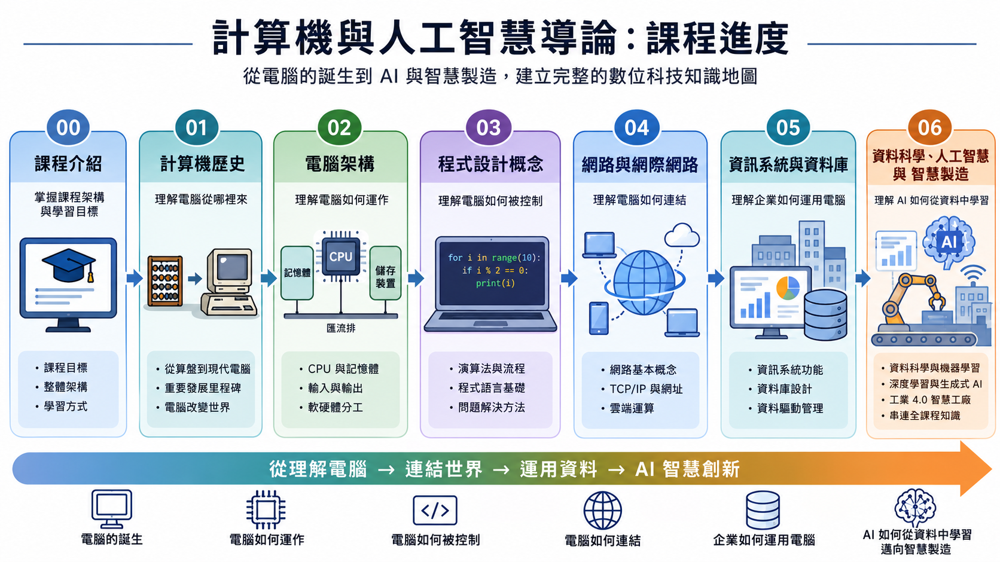
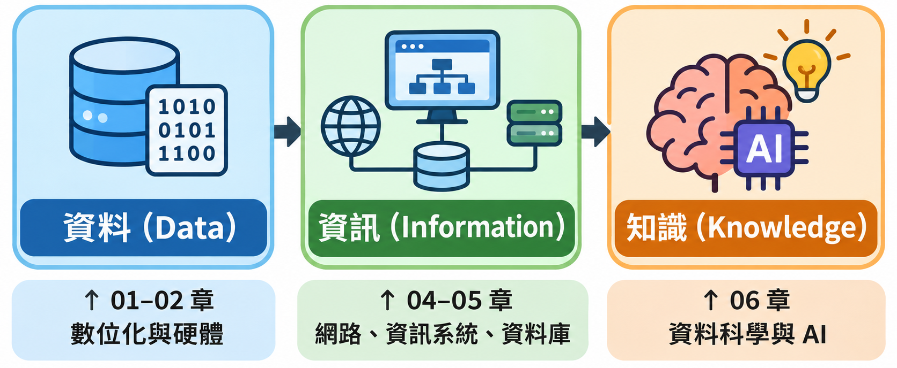
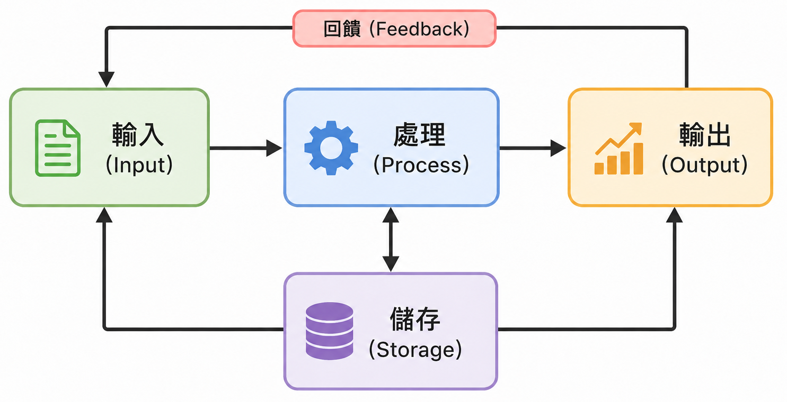

# 全課程複習

從算盤到 AI 代理人——把六章的重點串成一張複習地圖，但地圖不是路

課程教材：[GitHub](https://github.com/billy1125/Introduction-of-Information-Technology)

---

## 前言：從「考前一週才開始讀」談起

每學期都會遇到同樣的場景：考前一週，有同學問「老師，可以只讀複習投影片嗎？」

這份投影片的定位要先說清楚：

- 它是 **索引**，告訴你哪些概念一定要弄懂、去哪一章找
- 它是 **摘要**，每個概念只留一句話的骨架
- 它 **不是** 教材的替代品，正文裡的表格、範例與工業應用才是考題的來源

> **這份投影片能幫你安排複習順序，但沒辦法幫你讀完教材。**

---

## 只讀這份投影片，你可能會⋯⋯

- 認得名詞，卻說不出它解決了什麼問題——簡答題與情境題正是考這個
- 記得「二補數要取反加一」，卻沒動手算過，計算題照樣拿不到分
- 看得懂投影片上的結論，但正文裡用來推出結論的那張比較表沒讀過
- 以為考題只考投影片列出的項目，結果遇到正文才有的例子

---

## 搭配教材一起讀，你可以⋯⋯

- 用這份投影片盤點自己哪一塊沒把握，再回正文那一節補
- 用各章〈學習重點總結〉檢查自己是否真的說得出來
- 用兩本練習筆記本把計算題練到不必思考語法
- 把「這個技術解決了前一代的什麼問題」講成一條完整的線

> **能把技術演進講成一條線的人，考卷上任何一種問法都答得出來。**

---

## 這份投影片給你什麼、不給你什麼

| 這份投影片給你 | 你還是得回教材拿 |
|---|---|
| 概念清單與所在章節 | 概念的完整定義與前後脈絡 |
| 計算題的類型與步驟骨架 | 實際算過的練習與驗算 |
| 各章之間的關聯 | 正文的比較表、數據與工業案例 |
| 每章的重點節錄 | 每個重點背後的說明與案例 |

---



---

## 全課程的一條主線



---

## 全課程的一條主線

六章看起來各講一件事，其實都在回答同一個問題：**怎麼把現實世界變成可以運算的資料，再變成可以行動的判斷。**

> **複習時每讀到一項技術，先問它接在這條線的哪一段。**

---

# 一、計算機歷史

這一章要帶走的不是年份與人名，而是 **每一代工具解決了什麼問題、又留下什麼限制給下一代**。完整內容見 [01-History-of-Computer.md](01-History-of-Computer.md)。

---

## 資料、資訊、知識與計算工具

| 概念 | 重點 |
|---|---|
| 資料（Data） | 未經處理的原始符號、數字或文字 |
| 資訊（Information） | 資料整合解讀後，有脈絡、能幫助做決定 |
| 知識（Knowledge） | 資訊累積歸納後，可重複應用的判斷原則 |
| 轉換三步驟 | 蒐集（Input）→ 處理（Process）→ 應用（Output） |
| 計算工具的優勢 | 速度、精確度、容量、自動化 |

- **為何發明計算工具**：資料量變大，人腦慢、會累、會犯錯；工具最終服務人的資訊需求

各節完整說明見 [01-History-of-Computer.md](01-History-of-Computer.md)。

---

## 從計算工具到電子計算機

| 分類 | 運作方式 | 代表 |
|---|---|---|
| 計算工具 | 靠物理對位或位移，運算由人完成 | 算盤、計算尺 |
| 機械計算機 | 人力或蒸汽推動齒輪、槓桿 | 巴斯卡加法器、差分機 |
| 電力機械計算機 | 電力驅動，以繼電器開關傳遞訊號 | 哈佛一號（Mark I） |
| 電子計算機 | 完全透過電子流動運算 | ENIAC、現代筆電 |

- **手指計數**：最直觀的計數方式，十進位的由來
- **算盤（Abacus）與計算板**：撥珠或籌碼計算；算盤採位值制
- **計算尺（Slide Rule）**：可算對數與三角函數，不能算加減

---

## 機械與機電時代的里程碑

| 項目 | 重點 |
|---|---|
| 巴斯卡加法器（Pascaline） | 齒輪轉滿十格，自動帶動下一個齒輪進位 |
| 差分機（Difference Engine） | 自動算多項式並列印；巴貝奇生前未完成 |
| 分析機（Analytical Engine） | 程式化：換指令就能換任務 |
| 打孔卡片 | 概念來自提花織布機，巴貝奇引入計算領域 |
| Hollerith 打孔卡系統 | 1890 年美國人口普查，七年縮短為六週 |
| 製表機／分類機 | 讀卡累計統計數字／依孔洞位置分類歸檔 |

- **愛達·勒芙蕾絲（Ada Lovelace）**：被視為史上第一位程式設計師
- **機械計算機的限制**：只解特定問題、機械複雜度高、速度慢、維護困難

---

## 電子計算機的誕生：ABC 與 ENIAC

| 項目 | 重點 |
|---|---|
| 真空管（Vacuum Tube） | 電子開關，開／關對應二進位的 0／1 |
| 繼電器（Relay） | 電磁控制的機電元件，速度不及真空管 |
| ABC（1942 年） | 第一台以電子元件運算；二進位、電容記憶體 |
| ABC 的限制 | 只能解線性方程組，不能改寫程式 |
| ENIAC（1945 年） | 電子化、可程式、通用；重新配線就能換問題 |
| 1973 年判決 | ENIAC 專利無效，ABC 的先驅地位獲承認 |

- **ENIAC 的用途與速度**：算砲兵射擊表，每秒 5,000 次加法
- **時間換算**：所需秒數 = 運算次數 ÷ 每秒次數

---

## 電腦世代與發展趨勢

| 世代 | 核心元件 | 程式語言 | 特徵 |
|---|---|---|---|
| 第一代 | 真空管 | 機器語言 | 龐大耗電；軍事與科學計算 |
| 第二代 | 電晶體 | 組合語言 | 作業系統雛形 |
| 第三代 | 積體電路（IC） | COBOL、FORTRAN | 分時系統；商業應用普及 |
| 第四代 | VLSI 與微處理器 | C++、Python | 個人電腦、GUI、網路 |

- **積體電路（IC）**：電晶體、電阻、電容整合在一片矽晶片上
- **摩爾定律（Moore's Law）**：電晶體數每約兩年翻倍，$n$ 年後 $2^{n/2}$ 倍
- **三大趨勢**：小型化、高效能化、智慧化（能學習、推理、辨識）
- **量子運算**：以量子位元（Qubit）運算，與古典電腦互補

---

## 網際網路與全球資訊網

| 項目 | 重點 |
|---|---|
| ARPANET | 網際網路前身；部分節點被毀仍可改道傳遞 |
| 封包交換 | 資料切成封包分別傳送，再重新組合；不佔用專屬電路 |
| TCP/IP | IP 分配位址；TCP 確保送達，遺失就重傳 |
| 網際網路（Internet） | 基礎設施，解決設備如何連上線 |
| 全球資訊網（WWW） | 其上的服務；資料標準化呈現並彼此串聯 |
| 網路的影響 | 資訊共享、全球連結、去中心化、AI 的基礎 |

- **WWW 三項技術**：HTML 呈現、HTTP 傳送、URL 標示位置

> **網際網路是公路與橋梁，WWW 是公路上的標誌、標線與交通規則。**

---

## 雲端、物聯網與未來科技

| 項目 | 重點 |
|---|---|
| 軟體即服務（SaaS） | 直接使用完整的應用程式 |
| 平台即服務（PaaS） | 開發與部署應用程式的環境 |
| 基礎設施即服務（IaaS） | 虛擬化的硬體資源 |
| 物聯網（IoT） | 實體裝置連網，感測、收集資料並相互通訊 |

- **人工智慧（AI）**：機器學習從資料學規律；現有應用都是弱 AI
- **VR／AR**：完全沉浸虛擬世界／虛擬資訊疊加在現實上
- **元宇宙／空間運算**：多人共享的虛擬世界／VR 與 AR 的匯流
- **具身智慧／情感計算**：AI 有物理身體／由表情與生理訊號推估情緒

---

# 二、電腦硬體、作業系統與應用軟體

這一章從三個思想基礎出發，依序整理資料怎麼變成 0 與 1、硬體怎麼分工、作業系統與應用軟體怎麼調度。完整內容見 [02-Computer-Structure.md](02-Computer-Structure.md)。

---

## 三個思想基礎

| 概念 | 重點 |
|---|---|
| 圖靈機（Turing Machine） | 界定計算的本質與極限 |
| 停機問題（Halting Problem） | 存在任何電腦都解不了的問題 |
| 程式儲存（Stored Program） | 程式當成資料存進記憶體，換程式不必改接線 |
| 馮諾依曼瓶頸（Von Neumann Bottleneck） | CPU 與記憶體間的傳輸跟不上運算速度 |
| 位元（Bit）與熵（Entropy） | 資訊的基本單位；越難預測，資訊量越大 |
| 通道容量（Channel Capacity） | 通道的傳輸速率有理論上限 |

---

## 資料數位化、檔案大小與壓縮

| 項目 | 重點 |
|---|---|
| 計量單位 | 1 Byte = 8 bits；KB、MB、GB 每級 1,024 倍 |
| 圖片大小 | 寬 × 高 × 每像素 Byte 數（全彩 3、8 位元灰階 1） |
| 聲音大小 | 取樣率 × 位元深度 ÷ 8 × 聲道數 × 秒數 |
| 影片大小 | 單張畫面大小 × 每秒畫面數 × 秒數 |
| 無損壓縮（Lossless） | 可完全還原：PNG、FLAC；AOI 影像採用 |
| 破壞性壓縮（Lossy） | 無法還原：JPEG、MP3、H.264；WebP 兩種都支援 |

- **為什麼用二進位**：電路區分有電／沒電兩種狀態，比區分十種電壓簡單可靠

---

## 進位轉換與二進位加法

| 方向 | 方法 |
|---|---|
| 十 → 二（整數） | 連續除以 2，餘數由下往上讀 |
| 十 → 二（小數） | 連續乘以 2，整數部分由上往下讀 |
| 二、十六 → 十 | 各位乘以基底的次方後相加 |
| 二 ↔ 十六 | 每 4 個位元對應 1 個十六進位數字 |
| 十 → 十六 | 連續除以 16，餘數 10–15 寫成 A–F |
| 二進位加法 | 滿 2 進位，結果轉回十進位驗算 |

練習題見 [notebooks/Computer-Structure-Examples.ipynb](notebooks/Computer-Structure-Examples.ipynb)。

---

## 負數與小數怎麼存

| 概念 | 重點 |
|---|---|
| 二補數（Two's Complement） | 每一位取反再加 1；減法變成加法 |
| 符號位（Sign Bit） | 最左位 0 正、1 負；8 位元為 −128 到 +127 |
| 有號與無號（signed／unsigned） | 同一串 8 位元，兩種讀法相差 256 |
| IEEE 754 單精度 | 符號 1、指數 8（偏移值 127）、尾數 23 bits |
| 轉換步驟 | 轉二進位 → 正規化 → 指數加 127 → 尾數補 0 |
| 浮點誤差（Floating-Point Error） | 近似值，累加會累積；高精度用雙精度 64 bits |

---

## CPU、GPU 與 AI 晶片

| 項目 | 重點 |
|---|---|
| CPU 的組成 | 算術邏輯單元（ALU）、控制單元、暫存器 |
| 運作循環 | 取指—解碼—執行；時脈頻率單位 GHz |
| 多核心（Multi-core） | 同時執行多個工作，即平行處理 |
| CPU 的強項 | 少數強核心：複雜判斷、系統排程、資料前處理 |
| GPU 的強項 | 數千個簡單核心：同種運算大量重複，如矩陣乘法 |
| AI 加速器（NPU／TPU） | 專為 AI 設計，多屬特殊應用積體電路（ASIC） |

> **CPU 與 GPU 是分工互補的關係，不是誰取代誰。**

---

## 記憶體與儲存裝置

| 項目 | 重點 |
|---|---|
| 揮發性儲存 | 暫存器、快取、RAM；斷電後資料消失 |
| 非揮發性儲存 | HDD、SSD、隨身碟、光碟；斷電後資料保留 |
| 記憶體階層 | 越靠近 CPU 越快、越貴、容量越小 |
| 快閃記憶體（Flash Memory） | SSD 與隨身碟使用；抗震，寫入次數有限 |
| 緩衝（Buffer） | 感測資料先寫入 RAM，再批次寫入硬碟 |
| RAID | 0 快但不容錯；1 鏡像、容量 50%；5 容一顆故障 |

---

## 檔案系統、軟體授權概念

| 項目 | 重點 |
|---|---|
| 檔案系統（File System） | NTFS 有權限管理；ext4；FAT32 單檔上限 4 GB |
| 軟體授權 | 商業、免費軟體、開放原始碼、訂閱制、試用版 |

---

# 三、程式設計概念

這一章的重點不在語法，而在 **怎麼想問題**：把流程拆成步驟、選對資料的擺法、判斷資料量變大時算不算得完。完整內容見 [03-Computer-Program.md](03-Computer-Program.md)。

---

## 程式的本質、資料型態與運算

| 項目 | 重點 |
|---|---|
| **整數（Integer）** | 沒有小數；運算結果精確 |
| **浮點數（Float）** | 帶小數；運算結果是近似值 |
| **字串（String）** | 文字；`+` 是把兩段文字接起來 |
| **布林（Boolean）** | 只有真（True）與假（False） |
| **算術運算** | 加、減、乘、除、取餘數 `%` |
| **邏輯運算** | AND（且）、OR（或）、NOT（非） |

- **程式的本質**：輸入 → 處理 → 輸出
- **型態錯誤**：外部讀入的資料預設多為文字，要先轉型
- **同一串位元**：依資料型態不同，會解讀成不同的資料

---

## 控制結構

| 結構 | 重點 |
|---|---|
| **依序執行（Sequence）** | 由上而下，一行接一行 |
| **條件判斷（Selection）** | if-else；多個分支只走一條 |
| **for 迴圈** | 已知重複次數 |

- **計數與累加**：迴圈外歸零，迴圈內累加，可依條件重置
- **只能一行行往下執行**：程式冗長重複，除錯與修改都要動很多處

範例程式：[Computer-Program-Examples.ipynb](notebooks/Computer-Program-Examples.ipynb)

---

## 函式、模組化與物件導向

| 概念 | 重點 |
|---|---|
| **函式（Function）** | 可重複呼叫的程式區塊；參數進、回傳值出 |
| **模組化（Modularization）** | 每個函式只負責一件事 |
| **模組化的優點** | 可讀、可維護（只改一處）、可重用、可測試 |
| **物件導向（OOP）** | 資料與操作資料的函式包在一起 |

---

## 六種資料結構

| 結構 | 規則 | 工業場景 |
|---|---|---|
| 列表（List） | 依序排列；索引從 0 開始，依索引存取時間固定，走訪搭配迴圈 | 每日產量、感測器讀值 |

- **資料結構的目的**：決定資料怎麼組織、儲存與存取，常是效能好壞的關鍵
- **抽象資料型態（ADT）**：從使用者角度只定義能做什麼操作，不管內部實作

---

## 演算法的五個特性與 SOP

| 特性 | 意義 | SOP 的對應 |
|---|---|---|
| **明確性** | 步驟清楚無歧義 | 操作步驟不允許模糊 |
| **有限性** | 有限步驟後終止 | 作業有明確的開始與結束 |
| **輸入** | 明確定義的輸入 | 原料、半成品、設備參數 |
| **輸出** | 明確定義的輸出 | 成品、量測結果、生產記錄 |
| **有效性** | 每步都能實際執行 | 操作員做得到的動作 |

- **演算法與程式**：演算法是解題步驟，程式是具體實作
- **交給電腦執行**：速度快、不會累，同樣輸入給同樣輸出
- **適合自動化的工作**：重複性高、規則明確、資料量大、時效性要求高

---

## 效率：資料變多，時間怎麼成長

| 類型 | 成長方式 | 例子 |
|---|---|---|
| **O(1) 常數時間** | 固定不變 | 索引取值、映射依鍵查值 |
| **O(n) 線性時間** | 與 n 成正比 | 線性搜尋：逐一比對，不需先排序 |
| **O(n²) 平方時間** | 與 n 的平方成正比 | 泡沫排序：反覆比較與交換，約 n × n 次；實務用內建函式 |

- **大 O 符號（Big-O）**：最壞情況下的成長趨勢，不保留常數
- **估算時間**：操作次數 × 每次操作花的時間
- **效能瓶頸**：總時間由最慢的步驟決定；檢測跟不上生產節拍就成新瓶頸

---

# 四、網路與網際網路

網路把裝置連起來，網際網路再用 TCP/IP 把眾多獨立的網路連起來。複習時抓住每個設備與協定各自解決什麼問題，完整內容見 [04-Networks-and-Internet.md](04-Networks-and-Internet.md)。

---

## 網路拓樸與分割

- **星狀拓樸（Star）**：全接中央交換器，易擴充；中央是單點故障
- **匯流排拓樸（Bus）**：共用一條主幹線，成本低；主幹線斷即全癱
- **環狀拓樸（Ring）**：只接相鄰節點，時間可預測；一處斷可能全斷
- **網狀拓樸（Mesh）**：節點間多條路徑，容錯高；佈線複雜成本高

---

## 網路硬體設備

| 設備 | 做什麼 |
|---|---|
| 網路卡（NIC） | 讓裝置連網，帶有 48 位元的 MAC 位址 |
| 集線器（Hub） | 把訊號廣播到所有連接埠，易碰撞 |
| 交換器（Switch） | 依 MAC 位址，只送到目的裝置的連接埠 |
| 路由器（Router） | 依 IP 位址，在不同網路之間轉發 |
| 存取點（AP） | 把有線網路延伸成無線，不含路由功能 |
| 閘道（Gateway） | 轉換不同通訊協定，OT／IT 整合的關鍵 |

---

## 無線通訊技術比較

| 技術 | 範圍 | 特性 |
|---|---|---|
| Wi-Fi | 區域網路 | 2.4 GHz 穿透強、5 GHz 速度快，功耗高 |
| 藍牙／BLE | 10 公尺內 | 個人區域網路（PAN），BLE 更省電 |
| NFC | 4 公分內 | 碰一下完成感應 |
| Zigbee | 短距離 | 低功耗，可組網狀網路互相中繼 |
| LoRaWAN | 數公里至十幾公里 | 極低功耗，電池可撐數年 |
| NB-IoT | 電信業者覆蓋 | 基於 4G／5G 蜂巢式網路，可穿透建築 |

- **低功耗廣域網路（LPWAN）**：IoT 設備多、靠電池、資料量少，Wi-Fi 與 4G 功耗太高

---

## 無線區域網路（Wi-Fi）

| 項目 | 重點 |
|---|---|
| 標準 | IEEE 802.11 系列；Wi-Fi 4 到 Wi-Fi 7 一代比一代快 |
| 組成 | 裝置的無線網路卡 ↔ 無線存取點（AP）↔ 有線網路 |
| 頻寬 | 同一台 AP 的頻寬由所有連上的裝置共用 |
| 與有線比較 | 不必拉線、可移動；速度與穩定度通常不如有線 |
| 名稱裡的 5G | 指 5 GHz 頻段，不是第五代行動通訊 |
| 安全 | 一定要加密，目前最新為 WPA3 |

---

## RFID 與物聯網

- **RFID**：標籤加讀取器；不必對準、可同時讀多個、穿透非金屬包裝
- **被動式／主動式標籤**：無電池、距離短／內建電池、可達數十公尺、成本較高
- **物聯網（IoT）**：讓物品感知自己的狀態並與外界溝通；智慧家電與工廠機台同一概念
- **工業物聯網（IIoT）**：IoT 用於工業，更重可靠、即時與資安
- **AIoT**：IoT 負責感知與蒐集，AI 負責判斷與決策，例如預測性維護

---

## 5G 與衛星通訊

| 項目 | 重點 |
|---|---|
| 基本演進 | 1G → 2G → 3G → 4G → 5G，目前是 4G 逐漸過渡到 5G |
| 超高速（eMBB） | 最高 20 Gbps |
| 超低延遲（URLLC） | 小於 1 毫秒，用於即時控制，這個特別重要 |
| 大規模連接（mMTC） | 每平方公里 100 萬台裝置 |
| 私有 5G（Private 5G） | 廠內自建基地台，資料不離廠、品質可預測 |
| GEO 衛星 | 約 35,786 公里，延遲 600 毫秒以上，3 顆覆蓋全球 |
| LEO 衛星 | 200–2,000 公里，延遲 20–40 毫秒，需大量衛星與地面終端機，Starlink |

---

## 封包概念

| 項目 | 重點 |
|---|---|
| 封包（Packet） | 資料切成小塊；標頭帶來源與目的地 IP、編號、大小 |
| 傳遞與重組 | 路由器讀目的地 IP、查路由表轉發，各封包可走不同路徑；接收端依序號重組 |

---

## TCP/IP 四層架構（由上而下，順序要記清楚）

| 層級    | 功能          | 說明                       |
| ----- | ----------- | -------------------------- |
| 應用層   | 提供網路應用服務    | HTTP、DNS、SMTP；網頁、電子郵件、即時通訊都是在這一層 |
| 傳輸層   | 控制端對端資料傳輸   | TCP：可靠、有重傳；UDP：低開銷、不保證送達   |
| 網路層   | IP 定址與跨網路路由 | 決定裝置在網路上的地址、決定封包傳送路徑               |
| 網路存取層 | 實體的網路連線與資料傳送 | 例如：Ethernet(有線)、Wi-Fi(無線)、藍芽(無線)     |

> 應用層管服務、傳輸層管傳送、網路層管路由、網路存取層管實際連線。如果要換掉其中一層的軟體或硬體，只要換掉那一層就好，不用全部重新設計

---

## IP 位址與連網設定

| 項目 | 重點 |
|---|---|
| IP 的角色 | 為每台裝置分配位址；盡力而為，可靠傳送交給 TCP |
| IPv4／IPv6 | 32 位元，2011 年耗盡／128 位元，足供大量 IoT 節點 |
| DNS | 把網域名稱轉成 IP 位址；IP 更換時，設定不必改 |

---

## URL、HTTPS 與 VPN

| 項目 | 重點 |
|---|---|
| URL 的組成 | 協定、網域名稱、路徑、查詢參數 |
| HTTPS | HTTP 加上 TLS：加密內容，並以憑證驗證網站 |
| HTTPS 的普及 | 已是預設標準；郵件、API、VPN 也採用 TLS |
| VPN 原理 | 通道化（再包一層外殼）＋加密（有金鑰才能解） |
| VPN 部署 | 站對站連兩個網路；遠端存取連個別使用者 |
| VPN 風險 | 在 OT 網路開了門，要配最小權限、多因素驗證、稽核 |

---

## 智慧製造網路四層架構

| 層次 | 組成 | 即時性 | 通訊方式 |
|---|---|---|---|
| 現場層 | 機台、感測器 | 毫秒至微秒級；筆數多、每筆小 | Modbus、PROFIBUS |
| 控制層 | PLC、SCADA | 低延遲 | 工業乙太網路（PROFINET） |
| 管理層 | MES、ERP | 秒級 | 標準 TCP/IP 企業網路 |
| 雲端層 | 跨廠分析、AI | 分鐘級 | 網際網路：HTTPS、MQTT |

各層說明與示意圖見 [04-Networks-and-Internet.md](04-Networks-and-Internet.md)〈二十二、智慧製造網路架構〉。

---

# 五、資訊系統與資料庫

資訊系統把工廠每天產生的資料整理成各層級用得上的資訊，資料庫讓這些資料存得住、查得到。完整內容見 [05-Information-Systems-and-Database.md](05-Information-Systems-and-Database.md)。

---

## 系統觀念：五個環節

| 環節 | 做什麼 |
|---|---|
| 輸入（Input） | 從外界蒐集原始資料 |
| 處理（Process） | 依規則運算、比對、彙整或篩選 |
| 儲存（Storage） | 把資料與結果存進資料庫或檔案 |
| 輸出（Output） | 以報表、畫面、警報交給使用者 |
| 回饋（Feedback） | 把輸出送回輸入端，調整下一輪處理 |

- **資料 → 資訊 → 知識**：原始事實 → 可用於決策 → 可反覆套用
- **系統串接**：一套系統的輸出，可以是另一套系統的輸入
- **資訊系統五要素**：硬體、軟體、人員、流程、資料

---



---

## 三個決策層級

| 層級 | 服務對象 | 代表系統 |
|---|---|---|
| 作業層級 | 第一線人員、基層主管 | EDP、TPS |
| 管理層級 | 中階主管 | MIS、DSS、KMS、ES |
| 策略層級 | 高階主管 | EIS（儀表板、逐層鑽取）、SIS（競爭武器） |

- **層級的依據**：決策的性質，不是使用者的職級
- **橫跨多層**：一套系統常涵蓋多個層級，例如 ERP
- **作業層的判斷**：看交易是否日常、大量、重複，不看由誰輸入
- **垃圾進，垃圾出（GIGO）**：輸入資料錯，報表就跟著錯；要在輸入當下檢查
- **AI 與大數據**：沒有推翻這套分類，而是強化每一層

---

## 資訊系統的角色：從資料走到行動

| 層級 | 在做什麼 | 工廠例子 |
|---|---|---|
| 作業層 | 記錄 **資料** | MES 記下每張工單的產量與不良數 |
| 管理層 | 彙整成 **資訊** | MIS 產出各產線每週良率報表 |
| 策略層 | 形成 **知識** | 從數月良率趨勢判斷產線該汰換設備 |

```
資料 → 資訊：自動化（傳統資訊系統）
資訊 → 知識：智慧化（專家系統 → AI 專家系統）
知識 → 行動：自主化（AI 代理人）
```

---

## 各類資訊系統的重點

| 系統 | 重點 |
|---|---|
| EDP（電子資料處理） | 重複性資料處理自動化 |
| TPS（交易處理） | 批次（累積後一次處理）、分時（多人共用）、即時（立即處理） |
| MIS（管理資訊） | 定期固定報表，回顧已發生的事，用於監督與控制 |
| DSS（決策支援） | 模擬與多方案比較，支援半結構化、非例行決策 |
| KMS（知識管理） | 保存內隱知識（經驗）與外顯知識（文件），可結合 RAG |
| ES（專家系統） | 知識庫、推理機、使用者介面，以規則模擬專家判斷 |

- **ES 的四項限制**：知識獲取瓶頸、缺乏常識與穩健性、維護困難、缺乏學習能力

---

## 企業應用系統

| 系統 | 整合方向 | 負責什麼 |
|---|---|---|
| ERP（企業資源規劃） | 企業內部各部門 | 資料共用，打破資訊孤島 |
| MES（製造執行系統） | 向下到工廠現場 | 工單、派工、追蹤、品質、OEE |
| SCM（供應鏈管理） | 向上游到供應商 | 供應商與物料採購 |
| CRM（顧客關係管理） | 向下游到顧客 | 顧客資料、行銷與服務 |

- **五管**：生產、行銷、人力資源、研發、財務
- **MES 的位置**：ERP（計畫層）與 PLC／SCADA（控制層）之間

> **導入 ERP 常常不是裝軟體，而是改組織。**

---

## 資料庫基礎

| 名詞 | 重點 |
|---|---|
| 資料庫（DB） | 資料本身，有組織且彼此關聯 |
| 資料庫管理系統（DBMS） | 管理軟體：權限、備份還原、並行控制 |
| 資料庫系統（DBS） | 資料、軟體、硬體、人員組成的整體 |
| 主鍵（Primary Key） | 唯一識別每筆紀錄，不重複、不空白 |
| 外來鍵（Foreign Key） | 對應另一張表的主鍵，建立關聯；資料不必重複抄寫 |

- **資料的層級**：字元 → 欄位（一個屬性）→ 紀錄（多個欄位）→ 資料表 → 資料庫
- **六項優點**：共享、避免重複、一致性、資料獨立、安全控制、標準化
- **資料獨立**：資料結構改變，不影響應用程式

---

## 資料庫模型

| 模型 | 結構 | 特點 |
|---|---|---|
| 關聯式 | 二維表格，靠共通欄位關聯 | 目前主流；建表前先畫 ER 模型 |
| NoSQL | 不要求固定表格結構 | 非關聯式的統稱；適合格式不一的資料 |

- **一致性**：關聯式是強一致性，NoSQL 通常是最終一致性
- **擴展方式**：關聯式垂直擴展（升級單機），NoSQL 水平擴展（加伺服器）
- **分工並用**：關聯式存交易資料，NoSQL 存感測器資料與日誌

---

## SQL：資料庫的標準語言

- `SELECT` 選要顯示的欄位，`FROM` 指定資料表
- `WHERE` 篩選條件：`<` 是低於，`AND` 是同時成立
- `ORDER BY` 排序，`ASC` 由小到大、`DESC` 由小到大
- DQL（資料查詢語言）是最常見到的 SQL 類型，用於查詢資料，關鍵字是 `SELECT`
- **SQL**：操作關聯式資料庫的標準語言，各家 DBMS 共通

---

## 網路、雲端與大數據

| 主題 | 重點 |
|---|---|
| 電商模式 | B2B、B2C、C2C（平台媒合個人）、C2B（消費者主導，企業回應） |
| 行動商務 | 即時性、個人化、位置感知、行動支付 |
| 雲端服務 | IaaS 租硬體、PaaS 租開發平台、SaaS 用現成軟體 |
| 大數據 5V | Volume、Velocity、Variety、Veracity、Value |
| 分析流程 | 採集 → 儲存與清洗 → 分析 → 視覺化 → 決策 |

- **B 與 C**：B 是企業、C 是消費者；製造業最相關的是 B2B

各主題的說明見 [05-Information-Systems-and-Database.md](05-Information-Systems-and-Database.md)。

---

# 六、資料科學、人工智慧與智慧製造

前五章已經把「資料→資訊」自動化，這章談資料科學與 AI 怎麼接手「資訊→知識」。完整內容見 [06-Data-Science-AI-and-Smart-Manufacturing.md](06-Data-Science-AI-and-Smart-Manufacturing.md)。

---

## 資料科學：五個步驟與四種任務

```
採集 → 清洗 → 分析 → 視覺化 → 決策
```

- **清洗（Cleaning）**：補缺失、去重複、統一格式與單位、剔除異常值
- **分類（Classification）**：判斷資料屬於哪一個類別
- **迴歸（Regression）**：預測一個數值
- **分群（Clustering）**：找出性質相近的群體
- **關聯分析（Association Analysis）**：找出常一起出現的項目

---

## AI 為什麼重新崛起

- **前兩階已自動化**：資料與資訊交給機器，「資訊 → 知識」長年靠人
- **人的侷限**：看不完、帶不走、不一定準
- **前兩波 AI**：由人寫規則，規則寫不完又互相矛盾
- **第三波 AI**：電腦從資料學出規則；資料、演算法、算力在 2010 年前後到齊，使得 AI 應用像是突然橫空出世，但實際上也是長時間的慢慢演進
- **RAG 與 LLM 的 KMS**：先檢索相關片段，再由 LLM 整理回答並附來源

---

## AI 的基本邏輯與訓練

- **基本邏輯**：從資料學出函數，把輸入對應到輸出，再判斷新資料
- **參數（Parameter）**：$y = a \times x + b$ 的形狀由人決定，數字由資料決定
- **選模型與訓練模型**：人依問題挑形狀；資料與算力定數字；問題不同，形狀不同
- **損失函數與學習率**：把誤差量化；每次調整的幅度，太大會震盪、太小太慢
- **測試集與過度擬合（Overfitting）**：只記住訓練資料，用沒見過的資料才驗得出來

---

## 機器學習的四種類型

| 類型 | 資料特性 | 工業應用 |
|---|---|---|
| 監督式學習 | 每筆資料都有標籤 | 缺陷檢測、故障預測 |
| 非監督式學習 | 資料沒有標籤 | 特異生產模式、顧客分群 |
| 半監督式學習 | 少量有標籤＋大量無標籤 | 標記成本高的影像 |
| 強化學習 | 與環境互動，靠獎懲學習 | 路徑規劃、自動排程 |

---

## 人工神經網路

$$
y = f(w_1 x_1 + w_2 x_2 + w_3 x_3 + b)
$$

- **權重（Weight）**：輸入有多重要；權重與 $b$ 都靠訓練決定
- **啟動函數（Activation Function）**：讓輸出能「彎」；少了它，疊再多層仍是直線
- **輸入層／隱藏層／輸出層**：接收資料／把輸入加工成特徵／給出答案
- **深度學習（Deep Learning）**：隱藏層疊得多；逐層抽取邊緣 → 形狀 → 物件

---

## 深度學習與五種模型

| 模型 | 特長 | 用途 |
|---|---|---|
| CNN（卷積神經網路） | 看空間，掃描局部特徵 | 外觀瑕疵檢測 |
| RNN／LSTM | 看時間；記憶有上限，無法平行計算 | 感測器異常偵測 |
| Transformer | 注意力機制直接比對任兩個位置，可平行運算 | 大型語言模型 |
| 生成對抗網路（GAN） | 生成器與鑑別器互相對抗 | 影像生成 |
| 擴散模型（Diffusion Model） | 從隨機雜訊逐步去噪 | 影像生成 |

---

## 黑箱、幻覺與遺忘

| 關鍵詞 | 重點 |
|---|---|
| 黑箱（Black Box） | 深度學習說不出理由，專家系統可逐條回溯 |
| 事後解釋（post-hoc） | 不改模型，用熱區圖、特徵重要度反推 |
| 本質可解釋（interpretable by design） | 直接選決策樹、線性迴歸 |
| 準確度與可解釋性 | 常此消彼長 |
| 幻覺（Hallucination） | 內容通順卻錯誤，沒有查證機制 |
| 災難性遺忘（Catastrophic Forgetting） | 學新任務會沖掉舊任務 |

> **牽涉安全、品質放行或責任歸屬時，選判斷看得懂的模型。**

---

## 大型語言模型與 AI 代理人

| 關鍵詞 | 重點 |
|---|---|
| 詞元（Token） | LLM 讀文字的最小單位；輸入與輸出都按它計費 |
| 上下文視窗（Context Window） | 一次能讀進的 Token 上限 |
| 超出視窗 | 被截掉或擠掉舊內容；先估算、分批或摘要 |
| 提示詞工程（Prompt Engineering） | 交代角色、背景、要求與輸出格式 |
| 工具使用（Tool Use） | 輸出動作指令，由外部程式執行後回饋 |
| AI 代理人（AI Agent） | LLM ＋工具＋「觀察→思考→行動」迴圈 |

各主題的完整說明見 [06-Data-Science-AI-and-Smart-Manufacturing.md](06-Data-Science-AI-and-Smart-Manufacturing.md)。

---

# 七、計算題怎麼準備

計算題不看你記不記得公式名稱，只看你算不算得出來。這幾類每一種都親手算過三題以上，考場上就不必臨時推導。

以下只列類型與骨架，完整步驟與驗算方式都在兩本練習筆記本裡。

---

## 計算類型（一）：數字怎麼表示

| 類型 | 關鍵步驟 |
|---|---|
| 進位轉換 | 連除取餘（十→二、十→十六）、位權相加（二→十、十六→十） |
| 十六進位與二進位 | 每個十六進位數字對應 4 個位元，逐位互換 |
| 二進位加法 | 由右至左逐位相加，滿 2 進位 |
| 二補數 | 取反加一；注意 8／16／32 位元的範圍 |
| IEEE 754 | 轉二進位 → 正規化 → 指數加 127 → 尾數補到 23 位 |
| 檔案大小 | 像素或取樣數 × 每單位 Byte 數，再除 1,024 換算單位 |

---

## 計算類型（二）：效率與指標

| 類型 | 關鍵步驟 |
|---|---|
| 時間複雜度 | n 放大 k 倍，O(n) 為 k 倍、O(n²) 為 k² 倍 |
| 2 的次方 | k 個位元可表示 2ᵏ 種；每次排除一半，k 次可處理 2ᵏ 筆 |
| 倍數成長 | 每兩年翻倍，n 年後是 2 的 (n ÷ 2) 次方倍 |
| 切分與速率 | 總量 ÷ 單位量；有餘數要無條件進位，並注意時間單位換算 |
| 生產指標 | 良率 ＝ 良品數 ÷ 總產量 |
| 線性關係式 | 把條件代入 y ＝ a × x ＋ b，移項求 x |

> **算完一定要反向驗算一次，一題當兩題用。**

---

## 練習資源

- [notebooks/Computer-Structure-Examples.ipynb](notebooks/Computer-Structure-Examples.ipynb)：進位轉換 25 題、二進位加減 5 題、二補數 5 題、IEEE 754 5 題，另有多媒體檔案大小練習
- [notebooks/Computer-Program-Examples.ipynb](notebooks/Computer-Program-Examples.ipynb)：資料結構與程式邏輯範例，含庫存週轉率、OEE 等練習
- 兩本都可直接上傳 [Google Colab](https://colab.research.google.com/) 執行，不必在自己電腦安裝 Python

---

## 最後提醒：這份投影片沒有的東西

- 正文裡的 **比較表格、實際數據與工業案例**，是情境題最常取材的地方
- 各章的 **學習重點總結**，是最貼近考點的重點清單
- 課程規範（出席、考試規定）見 [00-Course-Introduction.md](00-Course-Introduction.md)

> **複習投影片是地圖，教材才是路；只看地圖的人不會真的走到終點。**

---

# 祝考試順利

有疑問請於課堂、辦公時間或 LINE 群組提出。

課程教材：[GitHub](https://github.com/billy1125/Introduction-of-Information-Technology)
